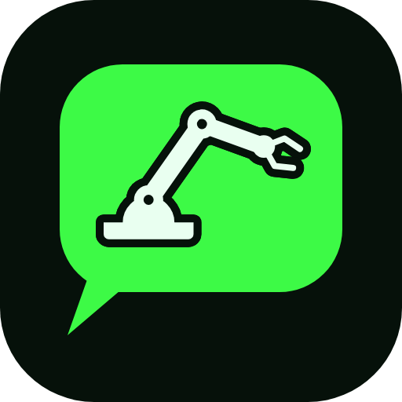
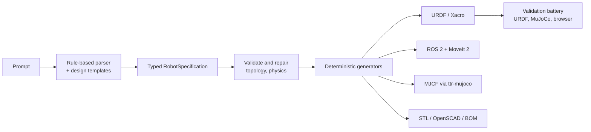

# Development

Everything you need to work on Text to Robot: set up, run the checks CI runs, regenerate the examples and release.

## Requirements

- Node.js 22.6 or newer. TypeScript runs natively (type stripping), so there is no build step.
- Python 3.10 or newer for the simulation and CAD layer. CI uses 3.11.
- Optional: Chromium through Playwright for the browser checks, Blender 4.5 and ffmpeg for the studio films.

## Set up

```bash
npm ci                                      # also vendors three.js for the viewer
pip install -e ./python                     # MuJoCo layer: convert, test, render, train
pip install -e './python[geometry]'         # collision decomposition and surface audits
pip install -e './python[build]'            # build123d parts library
pip install -e './python[train]'            # stable-baselines3 and torch
pip install -e './python[cad]'              # CadQuery STEP backend (large, optional)
pip install -r requirements-dev.txt && python -m playwright install chromium   # browser checks
```

## Checks

These are the checks CI runs. Run the first four before every pull request.

| Command | What it checks |
|---|---|
| `npm run typecheck` | Strict TypeScript across every package |
| `npm run lint` | Biome. Read the whole output, not the last line. |
| `npm test` | The node test suite: prompts, design engine, exports, CLI, every example prompt against its `robot.json` |
| `python3 scripts/check_links.py` | Every relative link and image in the Markdown files resolves |
| `python3 -m unittest discover -s python/tests -v` | Python layer. Modules whose optional dependencies are missing are skipped. |
| `python3 scripts/verify_examples.py` | Each example matches its pipeline and its report came from the shipped URDF |
| `python3 scripts/print_audit.py --check` | Every printed part is printable, or listed with a reason |
| `MUJOCO_GL=disable python3 scripts/simulate_examples.py --check` | Re-runs every example's MuJoCo task tests |
| `MUJOCO_GL=disable python3 scripts/check_motion.py --record` | No two parts pass through each other in any film frame |
| `python3 scripts/check_web.py` | All examples render in headless Chromium with external requests blocked |
| `deploy/build-pages.sh pages-dist && python3 scripts/check_site.py` | Every example prompt generated on the static website and compared with the shipped example |

CI pins `mujoco==3.13.0`, the version the shipped simulation evidence was recorded with. Other releases change contact behaviour, skid-steer turning most.

## Regenerate the examples

Never edit files under `examples/` by hand. Regenerate them:

```bash
node scripts/build_examples.ts                                  # every deliverable from each prompt
node scripts/export_circuits.ts                                 # only WIRING.md, schematic and breadboard view from the shipped robot.json
MUJOCO_GL=osmesa python3 -B scripts/simulate_examples.py         # task tests, GIFs, README results, gallery
python3 -B scripts/studio/film.py 15_wall_e                      # studio.gif: MuJoCo motion loop, Cycles frames (Blender 4.5, ffmpeg)
python3 scripts/verify_examples.py                               # what CI checks
```

When only the motions change (`packages/motion`), `node scripts/export_motions.ts [example ...]` re-exports each example's ROS 2 package and training scaffold from its `robot.json`. The human motion clips come from the Quaternius Universal Animation Library (CC0, not in the repository): `python3 scripts/human_clips.py <gltf-universal-animation-library>` rewrites `packages/motion/src/clips.ts`. Known motion findings, each with its reason, are in `examples/motion_play_known_issues.json` (checked by `tests/motion.test.ts`).

Text between `<!-- MANUAL_NOTES -->` and `<!-- /MANUAL_NOTES -->` in an example's README survives regeneration.

## Website

The site in `apps/web/public` is static. `deploy/build-pages.sh` bundles the generator for the browser and the Website workflow publishes it to GitHub Pages on every push to `main`. If you change a file in `apps/web/public`, run `python3 scripts/check_web.py --update-docs` to refresh the screenshots in `docs/img/web` and the source hashes in `examples/web_validation.json`.

## Brand

Logo files and rules are in [docs/brand](docs/brand/README.md). `python docs/brand/build.py` rewrites the SVGs and `python docs/brand/export.py` renders the PNGs. The website's copies live in `apps/web/public/icons/` and `apps/web/public/mark.svg`, and the header mark in `apps/web/public/index.html` is mark.svg inlined.

## Release

1. Move the entries under **Unreleased** in [CHANGELOG.md](CHANGELOG.md) to a new version with today's date.
2. Set that version in every `package.json` and in `python/pyproject.toml`, then run `npm install --package-lock-only`.
3. Commit, tag `vX.Y.Z` on `main` and publish a GitHub release with the changelog entry as its notes. The website rebuilds on release.

## Further reading

[Architecture](docs/ARCHITECTURE.md) · [Design engine](docs/DESIGN_ENGINE.md) · [Parts data](docs/PARTS_DATA.md) · [Printability](docs/PRINTABILITY.md) · [Physical fidelity](docs/PHYSICAL_FIDELITY.md) · [Python layer](python/README.md) · [Engineering references](references/engineering/README.md) · [Rebuild plan](docs/REBUILD_PLAN.md)

## How it works



The parser is local pattern matching over a vocabulary of robot families, units and
modifiers; no language model is included. Everything downstream consumes only the
typed `RobotSpecification` ([packages/robot-schema](packages/robot-schema)), so that
JSON is the extension point: any external tool or model that emits a valid
specification gets the same generators and checks. See
[architecture](docs/ARCHITECTURE.md) for the package layout.

## What is validated

Every check below runs in CI on each push:

- **Node tests** (`npm test`): prompt understanding (incl. Hinglish and task-only prompts), the parts-first
  design engine, exporters and CLI; typecheck and lint are clean.
- **Design checks** recorded in each designed robot (servo torque held continuously within the rated torque,
  peak torque, loaded speed, supply voltage and current, wheel torque on a 10° slope, traction, skid turning,
  battery runtime, tipping on a slope while braking). All shipped designed examples pass all of them; a prompt
  whose request cannot be met (e.g. SG90 servos for a long arm) is built and shown with a **warning** that names
  the failing check.
- **Every printed part is printable** (`scripts/print_audit.py`, [docs/PRINTABILITY.md](docs/PRINTABILITY.md)): each STL is checked in
  its best orientation on a Prusa MK4 bed (250 x 210 x 220 mm) for a flat face to stand on, support area (faces steeper than 45 deg),
  wall thickness (under 0.8 mm fails, 0.8-1.2 mm is a thin-wall warning) and that it is one connected, watertight solid. Parts that
  are not printed (laser-cut aluminium decks, tube, vacuum-formed visor, sewn covers) go to `cad/fabricate/` with their own list.
  Known open issues are listed with a reason in `examples/print_known_issues.json` and `examples/sim_known_issues.json`; CI fails on
  anything not listed there.
- **How the parts are built**: arm pitch joints are clevises (horn cheek + a cheek on a 625ZZ bearing riding an M5 bolt in a
  heat-set insert on the back of the servo's cradle), servos sit in closed cradles screwed through their case holes, links are
  truss-lightened beams; electronics on wheeled bases live in a vented printed enclosure with a screwed lid and cable slot.
- **No two parts intersect** in any shipped designed example, checked on the exact meshes
  (`tests/examples-interference.test.ts`).
- **MuJoCo task tests** for every example (`scripts/simulate_examples.py`), recorded into each example's GIF:
  arms hold their payload, reach and move at rated speed and grip; wheeled robots drive straight at their claimed
  speed, climb a 10° ramp and turn in place at their claimed rate (speed ramped at the design acceleration);
  legged robots stand and squat. **All 16 non-wearable examples pass; nothing fails.** Mecanum strafing and
  free-standing bipeds are reported as untested (no roller joints / no balance controller), not as passes.
  CI re-runs them with `simulate_examples.py --check` and `scripts/verify_examples.py` checks every report was
  produced from the shipped URDF.
- **Browser**: all 24 examples render in headless Chromium with third-party requests blocked and rendered
  triangles compared with the served STL files (`scripts/check_web.py`).
- **Mark 43**: door ranges come from exact sweeps of armour against armour in the order the suit opens, `door:*` checks cover
  range, torque, clutch, pinch force and latch strength, its faceplate and door servos are simulated like every other actuator, and a
  MuJoCo test runs the opening sequence. Nothing has been built.
- **Mark 43 forge**: the website forges the armour in its worker (`packages/mesh/src/forge/`). The same code in Node writes the shipped
  cache, `node --max-old-space-size=4096 scripts/forge_suit.ts packages/parts/data/mark43_pack --checkpoints out/forge` (about half an
  hour; `--checkpoints` lets a stopped run pick up after its last finished stage). `tests/mark43-forge.test.ts` checks it against the
  Python reference (`scripts/forge_mark43.py`, summarised in `tests/fixtures/forge_oracle.json`), and the site check forges the
  example suit live in the tab and compares every download with the example.
