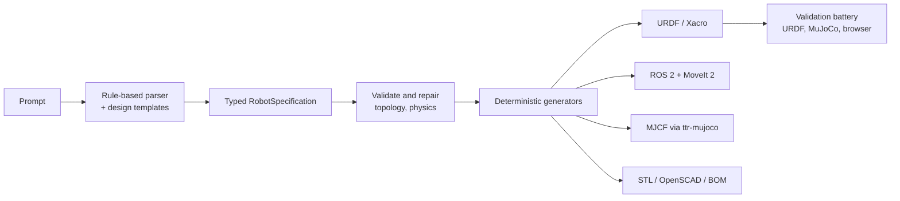

# Development

```bash
npm ci
npm test && npm run typecheck && npm run lint
pip install -e ./python                    # MuJoCo layer: convert, test, render, train
pip install -e './python[geometry]'        # collision decomposition and surface audits
pip install -e './python[train]'           # stable-baselines3 + torch
pip install -e './python[cad]'             # CadQuery STEP backend (large, optional)
python3 -m unittest discover -s python/tests -v   # modules whose deps are missing are skipped
pip install -r requirements-dev.txt && python3 scripts/check_web.py --update-docs   # refresh browser screenshots
```

Regenerate and re-audit the examples:

```bash
node scripts/build_examples.ts                                  # every deliverable from each prompt
MUJOCO_GL=osmesa python3 -B scripts/simulate_examples.py         # task tests, GIFs, README results, gallery
python3 scripts/verify_examples.py                               # what CI checks
```

Further reading: [Python layer](python/README.md),
[physical fidelity](docs/PHYSICAL_FIDELITY.md),
[rebuild plan and checklist](docs/REBUILD_PLAN.md),
[engineering references](references/engineering/README.md),
[changelog](CHANGELOG.md).

## How it works




The parser is local pattern matching over a vocabulary of robot families, units and
modifiers; no language model is included. Everything downstream consumes only the
typed `RobotSpecification` ([packages/robot-schema](packages/robot-schema)), so that
JSON is the extension point: any external tool or model that emits a valid
specification gets the same generators and checks. See
[architecture](docs/ARCHITECTURE.md) for the package layout.

## What is validated


Every check below runs in CI on each push:

- **Node tests** (`npm test`): prompt understanding (incl. Hinglish and task-only prompts), the parts-first
  design engine, exporters and CLI; typecheck and lint are clean.
- **Design checks** recorded in each designed robot (servo torque held continuously within the rated torque,
  peak torque, loaded speed, supply voltage and current, wheel torque on a 10° slope, traction, skid turning,
  battery runtime, tipping on a slope while braking). All shipped designed examples pass all of them; a prompt
  whose request cannot be met (e.g. SG90 servos for a long arm) is built and shown with a **warning** that names
  the failing check.
- **Every printed part is printable** (`scripts/print_audit.py`, [docs/PRINTABILITY.md](docs/PRINTABILITY.md)): each STL is checked in
  its best orientation on a Prusa MK4 bed (250 x 210 x 220 mm) for a flat face to stand on, support area (faces steeper than 45 deg),
  wall thickness (under 0.8 mm fails, 0.8-1.2 mm is a thin-wall warning) and that it is one connected, watertight solid. Parts that
  are not printed (laser-cut aluminium decks, tube, vacuum-formed visor, sewn covers) go to `cad/fabricate/` with their own list.
  Known open issues are listed with a reason in `examples/print_known_issues.json` and `examples/sim_known_issues.json`; CI fails on
  anything not listed there.
- **How the parts are built**: arm pitch joints are clevises (horn cheek + a cheek on a 625ZZ bearing riding an M5 bolt in a
  heat-set insert on the back of the servo's cradle), servos sit in closed cradles screwed through their case holes, links are
  truss-lightened beams; electronics on wheeled bases live in a vented printed enclosure with a screwed lid and cable slot.
- **No two parts intersect** in any shipped designed example, checked on the exact meshes
  (`tests/examples-interference.test.ts`).
- **MuJoCo task tests** for every example (`scripts/simulate_examples.py`), recorded into each example's GIF:
  arms hold their payload, reach and move at rated speed and grip; wheeled robots drive straight at their claimed
  speed, climb a 10° ramp and turn in place at their claimed rate (speed ramped at the design acceleration);
  legged robots stand and squat. **All 16 non-wearable examples pass; nothing fails.** Mecanum strafing and
  free-standing bipeds are reported as untested (no roller joints / no balance controller), not as passes.
  CI re-runs them with `simulate_examples.py --check` and `scripts/verify_examples.py` checks every report was
  produced from the shipped URDF.
- **Browser**: all 19 examples render in headless Chromium with third-party requests blocked and rendered
  triangles compared with the served STL files (`scripts/check_web.py`).
- **Mark 43**: built body first as worn armour; its posed checks (sit, raise arms, bend elbows, open the faceplate) run in the design engine and its faceplate servos are simulated like every other actuator.
