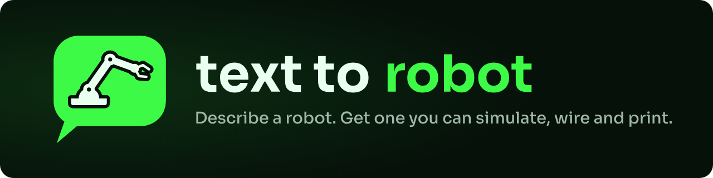
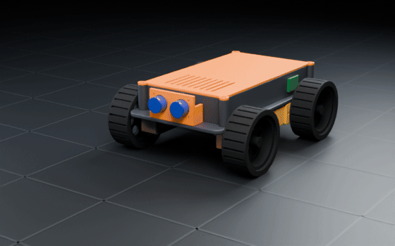
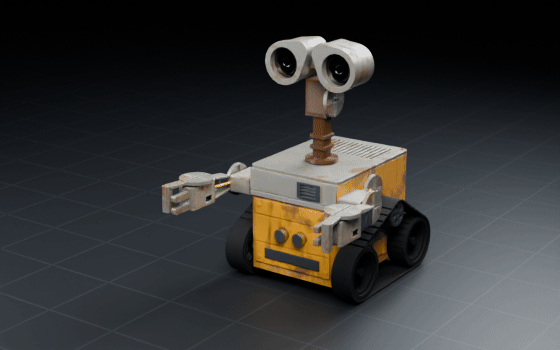
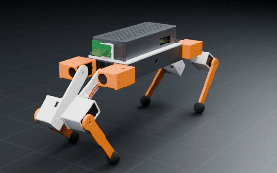
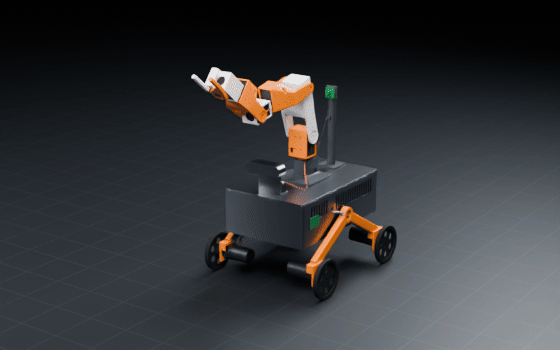

<p align="center"><picture><source media="(prefers-color-scheme: light)" srcset="docs/brand/banner-light.png"></picture></p>

<p align="center"><b>Type a robot. Get a robot.</b></p>

<p align="center">
  <a href="https://megazron.github.io/text-to-robot/"><b>Open the app</b></a> &nbsp;·&nbsp;
  <a href="examples/README.md">Gallery</a> &nbsp;·&nbsp;
  <a href="docs/GUIDE.md">Guide</a> &nbsp;·&nbsp;
  <a href="CHANGELOG.md">Changelog</a>
</p>
<p align="center">
  <a href="https://github.com/megazron/text-to-robot/actions/workflows/ci.yml"></a>
  <a href="https://github.com/megazron/text-to-robot/actions/workflows/site.yml"></a>
  <a href="LICENSE"></a>
</p>

<br>

```text
> An Arduino 4WD obstacle avoiding car with an ultrasonic sensor

  4WD on TT gear motors · 0.6 kg · $58 of parts · 36/36 design checks · 3/3 simulation tests
```

One sentence in. A robot out: real parts with prices, printable parts, 3D wiring, Arduino code, and files for ROS 2 and MuJoCo. Free, open source, and it runs in your browser. No account, nothing uploaded.

| | | | |
|:-:|:-:|:-:|:-:|
| <br>Arduino car | <br>WALL-E | <br>Quadruped | <br>Mars rover |

## What comes out

- **Parts list.** Real components, real prices, sized to the job.
- **Printable parts.** STL files that fit a normal print bed.
- **Wiring.** Routed in 3D around the parts, plus a schematic, a breadboard view and a power budget.
- **Code.** An Arduino sketch from the wiring, runnable on a virtual board in the browser.
- **Physics.** Torque, power, battery life and tipping, simulated, with the numbers.
- **Robot files.** URDF, ROS 2, MoveIt and MuJoCo.

Ask for anything: "a robot that waters my plants", "a hand that plays rock paper scissors", "explores the bottom of my pond". Or list the parts in your drawer and it builds from those.

## Try it

**[megazron.github.io/text-to-robot](https://megazron.github.io/text-to-robot/)**. Type a robot, press enter.

Or locally, with Node.js 22.6+:

```bash
git clone https://github.com/megazron/text-to-robot && cd text-to-robot
npm ci
node cli/src/index.ts "a 6 DOF arm with a gripper" -o out/arm
```

## Good to know

Nothing has been built on a real bench yet, and simulation is not proof. Every check and test it runs is shown, failures included. Details in the [guide](docs/GUIDE.md#limits).

## More

[Guide](docs/GUIDE.md) · [Gallery](examples/README.md) · [Engine API](docs/ENGINE_API.md) · [Development](DEVELOPMENT.md) · [Contributing](CONTRIBUTING.md) · [Security](SECURITY.md)

MIT licence · [Terms](TERMS.md) · [Privacy](PRIVACY.md) · [Notice](NOTICE.md). Character examples are unofficial fan work; their names and designs belong to their owners.
