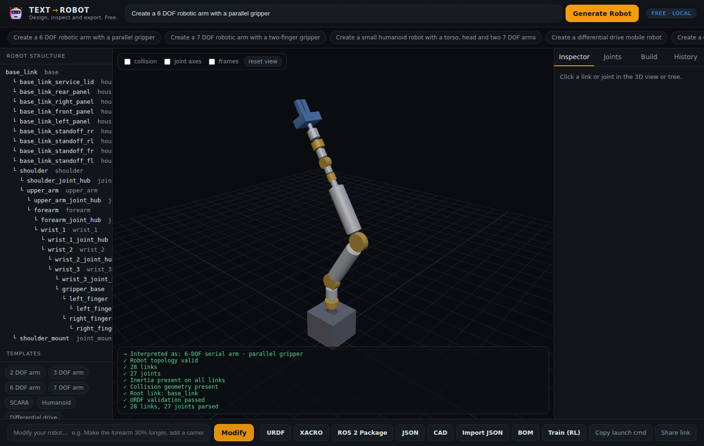
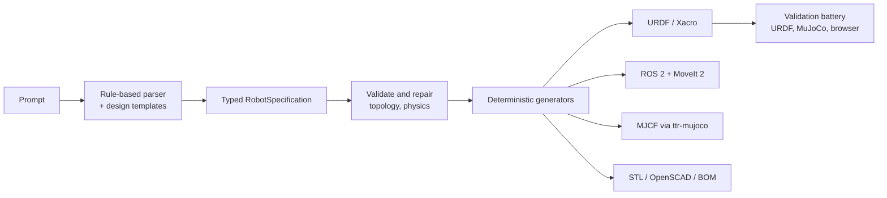

# Text to Robot

Describe a robot in plain English and get a simulated, inspectable robot package:
URDF/Xacro, a ROS 2 + MoveIt 2 package, MuJoCo model, CAD and a bill of materials.

[](https://github.com/megazron/text-to-robot/actions/workflows/ci.yml)
[](LICENSE)

<p align="center">
  
  
  
  
</p>

These and the gallery animations are MuJoCo runs of the exported models with gravity
and self-collision enabled, not renderings of separate assets.

## What it does

- **Reads a prompt locally.** A rule-based parser turns text into a typed
  `RobotSpecification`: robot family, DOF, reach, payload, sensors, gripper, budget,
  colour and name. It warns about anything it could not apply instead of dropping it.
- **Generates deterministic robot files.** URDF and Xacro with computed inertia and
  collision geometry, an `ament_cmake` ROS 2 package with `ros2_control`, MoveIt 2 (SRDF,
  KDL, OMPL) and Gazebo launch files.
- **Builds geometry you can print or inspect.** Procedural polygon meshes (STL),
  OpenSCAD parts, an optional CadQuery STEP enclosure backend, and a preliminary BOM
  sized to the payload and fitted to a budget.
- **Simulates and trains.** `ttr-mujoco` converts the URDF to MJCF, runs a physics
  test battery, renders GIFs and trains PPO; PyBullet/Gymnasium environments are
  exported alongside.
- **Edits in place.** Follow-up instructions such as `make the forearm 20 cm longer and
  add a wrist camera` modify the existing robot clause by clause.
- **Runs entirely on your machine.** A small web viewer and HTTP API with no account,
  API key, inference provider or third-party network requests.

## Quick start

Requires Node.js 22.6 or newer.

```bash
git clone https://github.com/megazron/text-to-robot
cd text-to-robot
npm ci
node cli/src/index.ts "a 6 DOF arm with a gripper" -o out/arm
npm run api          # web viewer and API on http://localhost:8787
```

The CLI writes `out/arm/` with the ROS 2 package (`arm_6dof/`, including
`urdf/arm_6dof.urdf` and `.urdf.xacro`), `arm_6dof.json`, a simulation URDF, `meshes/`,
`cad/`, `training/` and `BOM.md`. Other commands: `modify robot.json "<instruction>"`,
`bom`, `validate` and `inspect`; run `node cli/src/index.ts --help`.



The viewer has joint sliders, modification, version history, share links and
downloads. `docker compose up --build` serves the same app with persistent storage.

To simulate the generated arm in MuJoCo (Python 3.10+):

```bash
python3 -m venv .venv && . .venv/bin/activate
pip install -e ./python
ttr-mujoco test out/arm/arm_6dof.sim.urdf --self-collision
ttr-mujoco convert out/arm/arm_6dof.sim.urdf -o out/arm/arm_6dof.mjcf.xml
```

## What you can ask for

```text
$ node cli/src/index.ts "a red 6 dof arm with 70 cm reach, a wrist camera and no lidar, lifting 1 kg, budget $600"
✓ Interpreted as: 6-DOF serial arm · parallel gripper · camera (wrist_3) · reach 0.70 m · red · payload 1 kg · budget $600
```

| Say | Effect |
|---|---|
| `6 DOF`, `seven-axis`, `3-link arm`, `60 cm reach`, `each link 25 cm`, `small` | arm size and joint count |
| `2 kg payload`, `budget $1500` | actuator sizing and BOM tier |
| `wrist camera`, `lidar on the front`, `no lidar`, `suction cup` | sensors and gripper, including negation |
| `robot dog`, `mobile manipulator`, `mecanum`, `hexapod`, `cobot` | template family |
| `called Atlas`, `painted blue`, `for a 1.85 m wearer` | name, colour, wearable fit |

Anything it cannot apply is listed as `not applied`, and contradictions (two robot types,
two joint counts, two reaches) are each flagged as `conflict:`. A small German, French and
Spanish keyword list covers the common robot words (`Roboterarm mit sechs Achsen und Greifer`).

Families: 1-12 DOF arms, SCARA, grippers, differential/four-wheel/mecanum bases, a
rover with an arm, quadruped, hexapod, humanoid, and character robots. Drones, delta and
gantry robots, snake and marine robots and dexterous hands are refused with a reason.

## Examples

Seventeen checked-in examples, each with a README, ROS 2 package, CAD, MoveIt
configuration and simulation report. Counts are MuJoCo smoke-battery checks passed.
[Full table with failures and downloads](examples/README.md).

| | | | |
|:-:|:-:|:-:|:-:|
| <br>[2-DOF arm](examples/01_arm_2dof/) 4/5 | <br>[6-DOF arm](examples/02_arm_6dof/) 4/5 | <br>[7-DOF arm](examples/03_arm_7dof/) 4/5 | <br>[SCARA](examples/04_scara/) 4/5 |
| <br>[Diff drive](examples/05_diff_drive/) 5/6 | <br>[Four-wheel](examples/06_four_wheel/) 5/6 | <br>[Mecanum](examples/07_mecanum/) 5/6 | <br>[Humanoid](examples/08_humanoid/) 4/6 |
| <br>[Gripper](examples/09_gripper/) 5/5 | <br>[Quadruped](examples/10_quadruped/) 5/6 | <br>[Spider scout](examples/11_spider_scout/) 6/6 | <br>[Mars rover](examples/12_mars_rover/) 5/6 |
| <br>[Battle mech](examples/13_battle_mech/) 4/6 | <br>[Mark 43 suit](examples/14_iron_man_mark_43/) 4/6 | <br>[WALL-E](examples/15_wall_e/) 5/6 | <br>[EVA](examples/16_eva/) 5/6 |
| <br>[Baymax](examples/17_baymax/) 4/6 | | | |

### Highlight: Mark 43 wearable suit


The largest example: 268 links, 216 unique STL parts and 86 actuated joints,
including three-segment fingers, neck yaw/pitch and opening armour panels, with a
MoveIt configuration that plans and executes small arm and neck goals through mock
control. It is a concept model: it is not movie-accurate, wearer entry and full-range
clearance still fail, and no hardware exists.
[Model detail, audits and known failures](examples/14_iron_man_mark_43/README.md).

<br clear="right">

## How it works



The parser is local pattern matching over a vocabulary of robot families, units and
modifiers; no language model is included. Everything downstream consumes only the
typed `RobotSpecification` ([packages/robot-schema](packages/robot-schema)), so that
JSON is the extension point: any external tool or model that emits a valid
specification gets the same generators and checks. See
[architecture](docs/ARCHITECTURE.md) for the package layout.

## What is validated

Measured on a fresh clone of this revision:

- **162/162** Node tests pass (`npm test`); typecheck and lint are clean and gate CI.
- **17/17** example URDFs pass structural validation (`node cli/src/index.ts validate`).
- **MuJoCo smoke battery** (compile, initial clearance, settle under gravity, hold pose,
  actuator sweep, and disturbance recovery for free-standing robots): **78/97** checks
  pass across the 17 examples, with **0** initial penetrations. Gripper and spider scout
  pass every check; the remaining failures are actuator sweep (14 examples) and
  disturbance recovery (5). See [examples/validation_summary.json](examples/validation_summary.json).
- **Motion checks:** wheel-driven forward driving and mecanum strafing
  ([mobile_motion.json](examples/mobile_motion.json)) and four coordinated
  arm paths through effort-limited actuators all pass.
- **CI** also renders all 17 examples in headless Chromium with third-party requests
  blocked, compares rendered triangles with the served STL files, checks that shipped
  GIFs and reports match the models by hash, and audits every STL for closed topology.

## Limitations

- The parser covers the families and phrases above. Unsupported requests are refused
  or reported rather than guessed, but it does not understand arbitrary language.
- Outputs are concept models. No example has a documented physical build; motor
  interfaces, bearings, wiring, tolerances and assembly remain open
  (see each example's `BUILDABILITY.md`).
- Simulation uses approximate servo gains, friction and motor dynamics. Passing the
  smoke battery is not evidence of sim-to-real accuracy or a learned skill.
- MoveIt runs have been executed with `mock_components`; Gazebo export has not had the
  same runtime validation. The BOM is preliminary.

## Website

Try it at **[megazron.github.io/text-to-robot](https://megazron.github.io/text-to-robot/)**. That
page runs the whole generator inside your browser (no server, nothing uploaded) and is rebuilt
by the Website workflow on every push to `main` and every release. Share links carry the robot
in the URL itself. Build it locally with `npm ci && deploy/build-pages.sh`.

## Development

```bash
npm ci
npm test && npm run typecheck && npm run lint
pip install -e ./python                    # MuJoCo layer: convert, test, render, train
pip install -e './python[geometry]'        # collision decomposition and surface audits
pip install -e './python[train]'           # stable-baselines3 + torch
pip install -e './python[cad]'             # CadQuery STEP backend (large, optional)
python3 -m unittest discover -s python/tests -v   # modules whose deps are missing are skipped
pip install -r requirements-dev.txt && python3 scripts/check_web.py --update-docs   # refresh browser screenshots
```

Regenerate and re-audit the examples:

```bash
node scripts/export_examples.ts
python3 scripts/audit_examples.py
python3 scripts/render_example_gifs.py
python3 scripts/verify_example_artifacts.py
```

Further reading: [Python layer](python/README.md),
[physical fidelity](docs/PHYSICAL_FIDELITY.md),
[motion-path checks](docs/motion_paths/README.md),
[engineering references](references/engineering/README.md),
[changelog](CHANGELOG.md).

Code is MIT licensed; see [LICENSE](LICENSE). Character references and associated
intellectual property belong to their respective owners.
