<p align="center"><picture><source media="(prefers-color-scheme: light)" srcset="docs/brand/banner-light.png">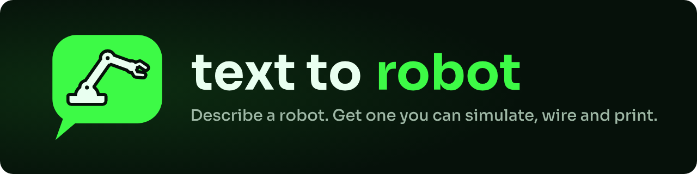</picture></p>

<p align="center">
  <a href="https://megazron.github.io/text-to-robot/"><b>Open the app</b></a> &nbsp;·&nbsp;
  <a href="examples/README.md">Gallery</a> &nbsp;·&nbsp;
  <a href="#quick-start">Quick start</a> &nbsp;·&nbsp;
  <a href="DEVELOPMENT.md">Develop</a> &nbsp;·&nbsp;
  <a href="CHANGELOG.md">Changelog</a>
</p>
<p align="center">
  <a href="https://github.com/megazron/text-to-robot/actions/workflows/ci.yml"></a>
  <a href="https://github.com/megazron/text-to-robot/actions/workflows/site.yml"></a>
  <a href="LICENSE"></a>
</p>

**Describe a robot in plain words. Get one you can simulate, wire and print.**

Text to Robot turns a sentence into a robot design you can check: real parts with prices, printable housings, wiring, a ROS 2 package and the physics tests to run on it. It is free, open source and runs in your browser.

```text
> An Arduino 4WD obstacle avoiding car with an ultrasonic sensor

  4WD on TT gear motors · 0.6 kg · $58 of parts · 36/36 design checks · 3/3 simulation tests
```

Your design stays yours. The website runs entirely in your browser, nothing is uploaded, and there is no account.

| | | | |
|:-:|:-:|:-:|:-:|
| 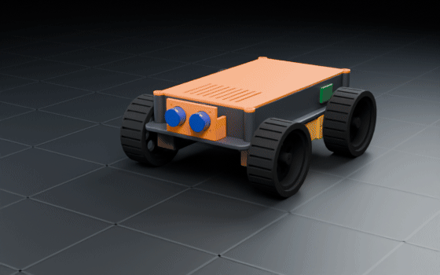<br>Arduino car | 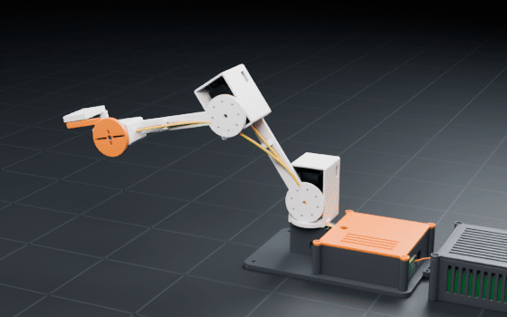<br>Arduino arm | 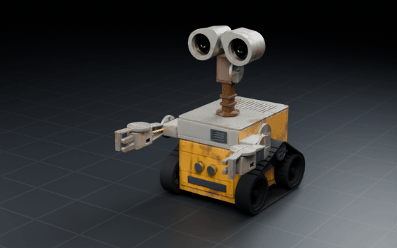<br>WALL-E | 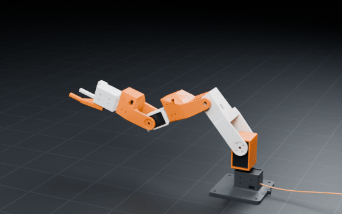<br>6-DOF arm |
| 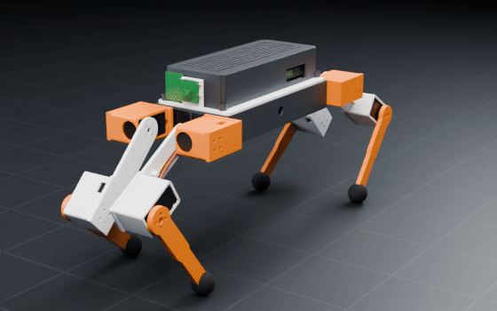<br>Quadruped | 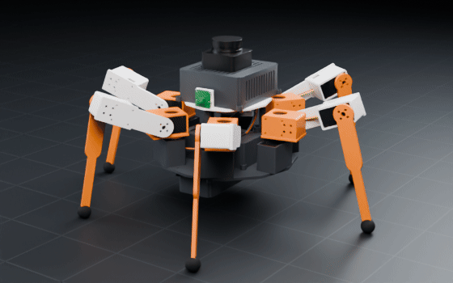<br>Hexapod | 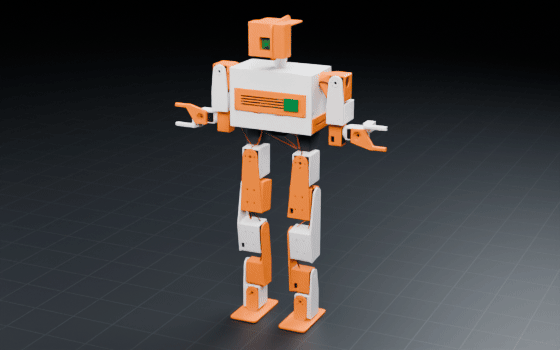<br>Humanoid | 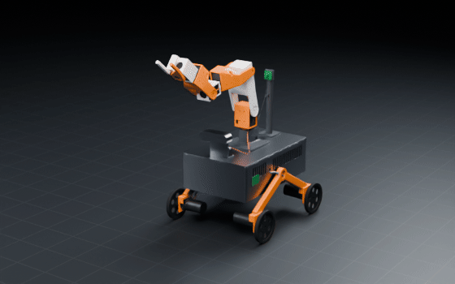<br>Mars rover |

Every film above is the exported model itself: its URDF and meshes in a Cycles studio, moved by a MuJoCo run through its real motors. All 19 are in the [gallery](examples/README.md). Every one of them is generated on the website by a browser test in CI, and every frame of every film is checked on the exact meshes for parts passing through each other.

## What you get

| | |
|---|---|
| **Parts list** | Real components with prices and suppliers, sized to the job. |
| **Printable parts** | STL files that fit a normal print bed, with a print report for each. |
| **Robot files** | URDF, Xacro, ROS 2, MoveIt, MuJoCo. |
| **Wiring and circuits** | A schematic in KiCad style (reference designators, numbered pins, power symbols with each rail's voltage, net labels, title block; SVG and PDF), a picture view with every wire in its colour, and `WIRING.md`: power budget, fuses, wire gauges and drop, battery runtime, regulator heat and a 3.3 V / 5 V logic-level check. See the [Arduino car's schematic](examples/18_arduino_car/schematic.svg) and [breadboard view](examples/18_arduino_car/breadboard.svg). |
| **Engineering checks** | Torque, speed, power, runtime, clearance and tipping, shown with the numbers. |
| **Motion** | Every robot moves in the 3D view: a tour of its joints and a demo of what it is for (pick and place, a drive, a gait, a step cycle, suit-up), checked for collisions on every frame. Drag it into a pose, record a clip, download it as a GIF, a video, a joint CSV or a ROS 2 trajectory. See [Motions](docs/ENGINE_API.md#motions). |
| **Physics tests** | The MuJoCo task tests (drive, ramp, turn, hold, squat, grip) come with every robot to run on your machine; the 19 examples are run in CI and their results are in the gallery. Failures are listed, not hidden. |

## Arduino mode

Flip the Arduino switch and the design is rebuilt around cheap, compatible parts with price tiers. If a request can't be done on a budget it says so and offers what can, like a motorised helmet instead of a powered suit. Name a part ("with MG996R servos and an Arduino Nano") and it is used, or you are told why not.

## Build from my parts

Tell it what you have: "I have an Arduino Uno, 2 TT gear motors, an L298N, an HC-SR04, 4 AA batteries and a servo SG90". Type it in the prompt bar, open **My parts** in the Create pane to pick parts from the catalog with counts, or paste a shopping list or a kit's contents ("Elegoo smart robot car kit", Hinglish like "mere paas 2 motor aur ek Arduino hai" works too). Parts it cannot place are listed as not recognised, with the closest parts it knows.

It ranks what those parts can build (obstacle-avoiding car, scanning car, line follower, camera car, desk arm, radar scanner, eight-servo walker, WALL-E) by how much of your list each uses and how little it needs on top, and shows the best three as cards: "uses 6/7 of your parts, needs +$20 (1x 2S 18650 pack, ...)". The design you pick uses your exact parts: the parts list marks each line "you have it" or "to buy", the wiring, schematic and power budget use your board, driver and battery, and the Arduino sketch (or Pi script) is written for the pins it wired. When your parts cannot do it safely it says so with numbers, for example that 4 AA cells sag to 3.6 V when two TT motors start, so an Uno resets, and takes the cheapest fix. The engine API has the same thing as `parseInventory(text)` and `fromParts(inventory)`.

## Mark 43, designed to be worn, not yet built

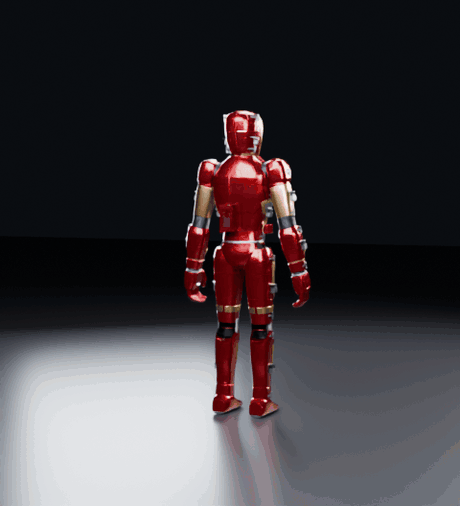

The hardest thing I could think of. Designed directly from reference photos of the film suit, with no body or scanned model underneath: every part is a mathematical form with plates, panel lines and bevels added to it. The website designs the armour itself, in your browser: a worker forges every part from the prompt (fields, marching cubes, shells cut to the print bed), trims the overlaps, fits the hinges, servos, latches, cable channels and battery bay, and measures every joint and door by exact intersection. Words in the prompt change the armour: its build (`bulky`, `sleek`, `10 % bulkier`), the pauldrons (`bigger shoulders`), the panels (`smooth panels`, `heavy plates`), the paint (`black and gold`, `silver joints`), and the height, tier and budget. The reference suit opens at once: it is the forge's own output for the film shape, shipped ready-made. A custom shape is forged in your browser only after the page tells you the time and memory it will take on your device (about 25 minutes in Chrome on a laptop, up to 6 GB) and you agree; it shows progress and a cancel button, and the result is kept in the browser. The offline Python scripts that first made it stay in `scripts/` as the reference the browser forge is tested against. 358 printed parts sized for a home printer, a mask that lifts on two micro servos, lit eyes, chest and palms. Joint ranges are measured by sweeping armour against armour.

It opens for real, and the film is the design: every mesh, hinge line and limit in it comes from the built example. The back splits on its centre line and the rear shells of the helmet and limbs swing out 80 degrees or more on hinges, each a revolute joint in the URDF on its own servo, with pinned hinges, servo pods, sprung latches that hold with no power, hand-release cords and a slipping clutch at each horn. Two PCA9685 boards and their own regulator drive 23 servos; the battery bay rides on one back door and its cables cross the hinge in a service loop. Door ranges are measured by exact intersection in the order the suit opens, and the sequence runs in simulation.

**Nothing has been built or tested, and a person must not get in on the strength of this design.** Clutch, latch and pinch figures are calculations with estimated inputs; the shell has no body model inside it and fits only a slim wearer; gloves and boots do not come on through the suit. [What must be checked first](examples/14_iron_man_mark_43/README.md#before-anyone-gets-inside).

Fan work, not affiliated with or endorsed by the rights holders. See [NOTICE](NOTICE.md).

<br clear="right">

## Quick start

**In the browser.** Open [megazron.github.io/text-to-robot](https://megazron.github.io/text-to-robot/), type a robot and press enter. Every download is built in the tab.

**On your machine.** You need Node.js 22.6 or newer.

```bash
git clone https://github.com/megazron/text-to-robot
cd text-to-robot
npm ci
node cli/src/index.ts "a 6 DOF arm with a gripper" -o out/arm
```

`out/arm/` now holds the ROS 2 package (`arm_6dof/`, with `urdf/arm_6dof.urdf` and `.urdf.xacro`), the spec `arm_6dof.json`, a simulation URDF, `meshes/`, `cad/` (print list, wiring table, `wiring.svg`, `schematic.svg` and `.pdf`, `breadboard.svg`), `training/` and `BOM.md`. The CLI also has `modify`, `bom`, `validate` and `inspect`; see `node cli/src/index.ts --help`.

**The app, locally.** `npm run api` serves the same web app and an HTTP API on http://localhost:8787. `docker compose up --build` does the same with persistent storage.

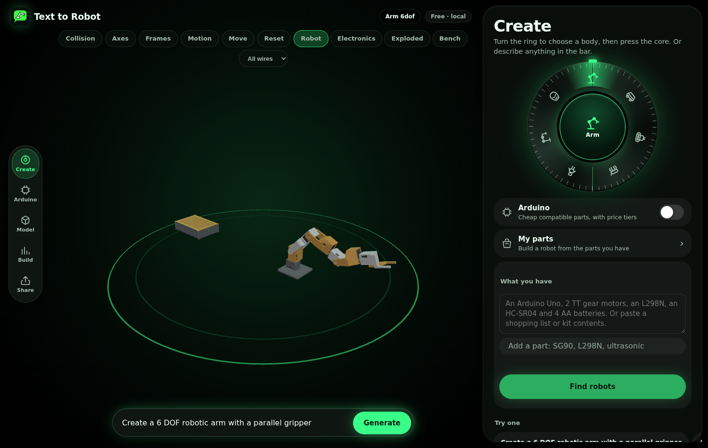

**Simulate it.** With Python 3.10 or newer:

```bash
python3 -m venv .venv && . .venv/bin/activate
pip install -e ./python
ttr-mujoco test out/arm/arm_6dof.sim.urdf --self-collision
ttr-mujoco convert out/arm/arm_6dof.sim.urdf -o out/arm/arm_6dof.mjcf.xml
```

## What you can ask for

```text
$ node cli/src/index.ts "a red 6 dof arm with 70 cm reach, a wrist camera and no lidar, lifting 1 kg, budget $600"
✓ Interpreted as: 6-DOF serial arm · parallel gripper · camera (wrist_rotator) · reach 0.70 m · red · payload 1 kg · budget $600
  ! warning: design check failed: wiring:rail:V48: power_supply gives 7.3 A continuous, 10.9 A peak; loads 7.725 A typical, 42.825 A peak ...
```

| Say | Effect |
|---|---|
| `6 DOF`, `seven-axis`, `3-link arm`, `60 cm reach`, `each link 25 cm`, `small` | arm size and joint count |
| `2 kg payload`, `budget $1500` | actuator sizing and BOM tier |
| `wrist camera`, `lidar on the front`, `no lidar`, `suction cup` | sensors and gripper, including negation |
| `robot dog`, `mobile manipulator`, `mecanum`, `hexapod`, `cobot` | template family |
| `called Atlas`, `painted blue`, `for a 1.85 m wearer` | name, colour, suit size (a Mark 43 is scaled as a whole; there is no body model) |
| `bulky`, `sleek`, `bigger shoulders`, `smooth panels`, `black and gold` | the Mark 43 armour itself: forged again with that build, pauldrons, panels or paint |

What it cannot apply is listed as `not applied`, and contradictions (two robot types, two joint counts, two reaches) are each flagged as `conflict:`. A few requests are still dropped without a note (a slope or runtime target, a second colour or budget); the [launch audit](docs/LAUNCH_AUDIT.md#bugs-remaining) lists them. A small German, French, Spanish, Hindi and Urdu keyword list (romanised Hindi too) covers the common robot words (`Roboterarm mit sechs Achsen und Greifer`, `छह पैरों वाला रोबोट`, `ایک روبوٹک بازو گرپر کے ساتھ`).

Families: 1-7 DOF arms (a larger count is built as 7 and says so), SCARA, grippers, differential, four-wheel and mecanum bases, a rover with an arm, quadruped, hexapod, humanoid and character robots. Drones, delta and gantry robots, snake and marine robots and dexterous hands are refused with a reason.

## How it works

1. **Read the prompt.** A local, rule-based parser picks a robot family and reads sizes, payload, budget, sensors, colour and parts. It is not a language model, so it runs offline and gives the same answer every time.
2. **Design from parts.** The design engine picks real motors, servos, boards and batteries for the loads, then builds the structure around them: cradles, bearings, housings, an electronics bay and the wiring.
3. **Check it.** Torque, speed, power, runtime, tipping, clearance and printability are computed and shown with their numbers. A request that cannot be met is still built, with a warning that names the failing check.
4. **Export it.** Every output is generated from one typed `RobotSpecification`: URDF and Xacro, ROS 2 and MoveIt, MuJoCo, STL, BOM, wiring and training scaffolds.

The same engine runs in the CLI, the local server and, compiled for the browser, the website. Other web pages can load it too, from `engine/v1/engine.js` on the website: see [Engine API](docs/ENGINE_API.md). More in [Architecture](docs/ARCHITECTURE.md) and [Design engine](docs/DESIGN_ENGINE.md).

## Limits

- Nothing here has been built on a real bench yet. Printability is checked on the geometry, not in a slicer.
- Simulation is not proof. Every example passes the tests it has; what is not tested (mecanum strafing, free standing on the bipeds) is listed in its README.
- Some printed parts have known issues, each with its cause, in [Printability](docs/PRINTABILITY.md).
- The parser covers the families above and refuses the rest with a reason.
- A custom Mark 43 shape is forged in the tab, which takes about 25 minutes and up to 6 GB of memory the first time; the page asks first. Its shells match the offline Python reference to within about 1 % in volume, with a few thin slivers joined to their neighbours instead of printed apart; hinge clearances are cut with each part's convex hull through its swing, a little more generous than the reference. Shape words outside the supported range are reported as `not applied`. A custom shape is checked like the reference suit, and not every shape passes: a bulkier build (1.12) forges, but four of its doors (the right back door, the right upper arm and both shins) meet other armour within a few degrees, and its door checks say so.
- Prices are estimates from the parts catalogue, and about half the electrical values (pinouts, currents) are estimated rather than taken from a datasheet. Each one is marked in [Parts data](docs/PARTS_DATA.md). Check before you order or power anything.

## Project

- [Gallery](examples/README.md): all 19 examples with their files, checks and test results.
- [Community blog](docs/COMMUNITY.md): post a design you made, anonymously or with a display name, no account. Opt-in only; its small server is in [`community/`](community/).
- [Development](DEVELOPMENT.md): set up, run the checks, regenerate the examples.
- [Contributing](CONTRIBUTING.md) · [Code of conduct](CODE_OF_CONDUCT.md) · [Security](SECURITY.md)
- [Changelog](CHANGELOG.md) · [Brand](docs/brand/README.md)

## Legal

Code under the [MIT licence](LICENSE). [Terms](TERMS.md) · [Privacy](PRIVACY.md) · [Content policy](docs/CONTENT_POLICY.md) · [Third-party notice](NOTICE.md). Character examples are unofficial fan work; their names and designs belong to their owners.
