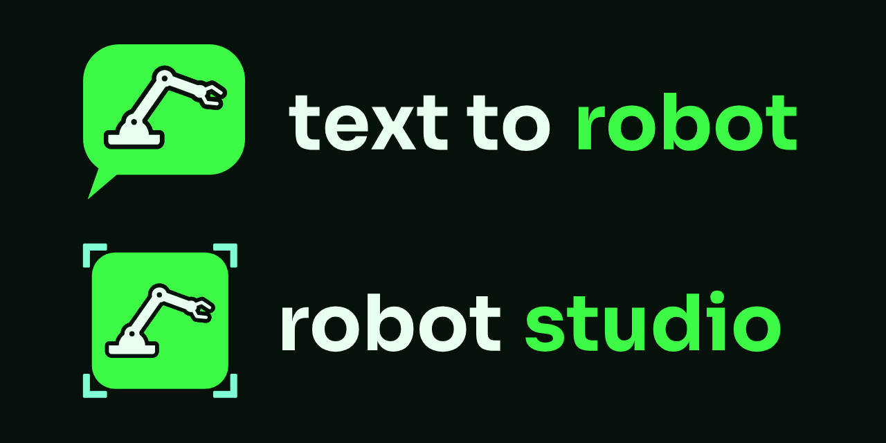
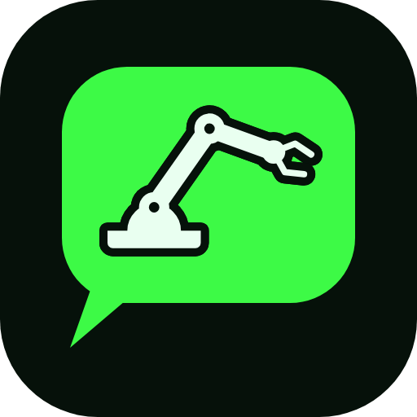

# Brand

The mark is a speech bubble with a robot arm cut out of it: you say what you want, and a machine comes out of the words. The arm has a base, two links, two ring joints and an open gripper. [Robot Studio](https://github.com/megazron/robot-studio), the drag and drop editor I built on the same engine, cuts the same arm out of a tile with selection corners round it.

## Files

| Asset | Vector | Raster |
|---|---|---|
| App icon, dark (primary) | [mark.svg](mark.svg) | [mark.png](mark.png) 512 px |
| App icon, light | [mark-light.svg](mark-light.svg) | [mark-light.png](mark-light.png) |
| Symbol only, no tile | [glyph.svg](glyph.svg) | [glyph.png](glyph.png) |
| One colour, black and white | [mark-mono-black.svg](mark-mono-black.svg), [mark-mono-white.svg](mark-mono-white.svg) | [black](mark-mono-black.png), [white](mark-mono-white.png) |
| Lockup for dark backgrounds | [lockup.svg](lockup.svg) | [lockup.png](lockup.png) |
| Lockup for light backgrounds | [lockup-light.svg](lockup-light.svg) | [lockup-light.png](lockup-light.png) |
| README banner, dark and light | [banner.svg](banner.svg), [banner-light.svg](banner-light.svg) | [dark](banner.png), [light](banner-light.png) 1280 x 320 |
| Social preview | [social.svg](social.svg) | [social.png](social.png) 1280 x 640 |
| Both products | [family.svg](family.svg) | [family.png](family.png) 1280 x 640 |
| Favicons and app icons | [favicon-small.svg](favicon-small.svg) (16 px cut), [favicon-32.svg](favicon-32.svg) (32 px cut), [app-square.svg](app-square.svg), [app-maskable.svg](app-maskable.svg) | [16](favicon-16.png), [32](favicon-32.png), [180](apple-touch-icon.png), [192](icon-192.png), [512](icon-512.png), [512 maskable](icon-maskable-512.png) |

&nbsp;
&nbsp;
&nbsp;
&nbsp;

The two favicons are their own drawings on a pixel grid: the straight edges sit on whole pixels, the links are heavier, and the gap round the arm is painted in the void colour so the icon looks the same on a light or a dark tab. The 16 px cut drops the ring holes and the gap. Use each cut only at its own size.

To change the logo, I edit [build.py](build.py), then run `python docs/brand/build.py` to rewrite the SVGs and `python docs/brand/export.py` to render the PNGs (fontTools, Playwright and Chromium, as in `requirements-dev.txt`). The same build.py lives in Robot Studio with `PRODUCT = "studio"`, so the two stay in step. The website's copies go in `apps/web/public/icons/` and `apps/web/public/mark.svg`, and the header mark in `apps/web/public/index.html` is mark.svg inlined.

## Colour

| Name | Hex | Use |
|---|---|---|
| Green | `#3DFA46` | The bubble, the word "robot", links and buttons on dark. |
| Ink | `#E9FFF0` | The arm, and "text to" on dark. |
| Void | `#06110A` | Tile and page background. |
| Cyan | `#7FFCD5` | Robot Studio's selection corners. |
| Muted | `#9FB8A6` | Secondary text on dark. |
| Forest | `#118A2A` | The accent on light backgrounds, where green has too little contrast. |
| Paper | `#F3FAF5` | Light tile and light backgrounds. |

Green on the void is the brand. Keep green to the mark and one or two accents per screen.

## Type

The wordmark is Sora Bold: "text to" in ink and "robot" in green, lowercase, outlined from [fonts/Sora-700.ttf](fonts/Sora-700.ttf). The banner and social card set the tagline in Sora Medium. Sora is under the SIL Open Font License 1.1, with the licence in [fonts/OFL.txt](fonts/OFL.txt). Use the files rather than retyping the name.

Next to the logo, set text in the system UI face and code in the system monospace. In running text the product is **Text to Robot**. The repository and the packages are `text-to-robot`. Only the wordmark is lowercase.

## Clear space and size

- Keep clear space round the symbol equal to the height of the bubble's tail.
- Smallest sizes: the symbol at 16 px (use the 16 px cut), the lockup at 24 px tall.
- On iOS and Android give the system the square files (`apple-touch-icon.png`, `icon-maskable-512.png`) and let it cut the corners.

## Do and don't

- Do put the dark icon on dark backgrounds and the light icon or the black one colour mark on light ones.
- Don't recolour the bubble or the arm, add outlines or shadows, rotate, flip or stretch the symbol.
- Don't close the gap round the arm or fill in the ring joints above 16 px.
- Don't put the green bubble on a busy photo. Use the one colour white mark there.
