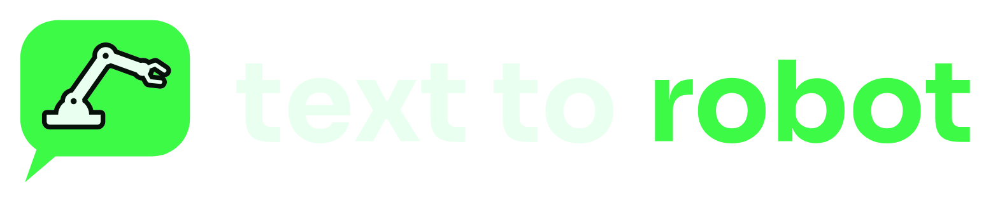
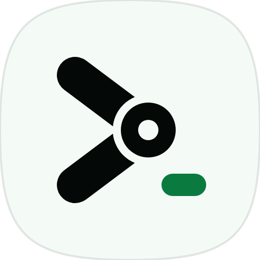
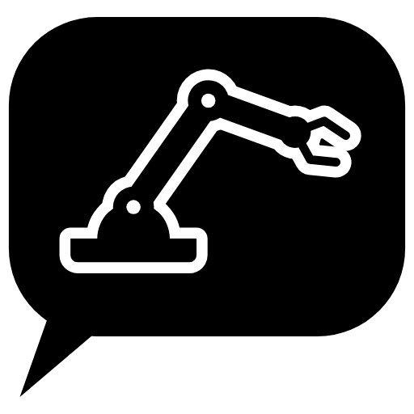
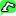

# Brand

The mark is a prompt that has become a machine. The `>` of a command line is drawn as two links, its point is a pin joint, and the cursor waits underneath for the next instruction.

## Files

| Asset | Vector | Raster |
|---|---|---|
| App icon, dark (primary) | [mark.svg](mark.svg) | [mark.png](mark.png) 512 px |
| App icon, light | [mark-light.svg](mark-light.svg) | [mark-light.png](mark-light.png) |
| Symbol only, no tile | [glyph.svg](glyph.svg) | [glyph.png](glyph.png) |
| Horizontal lockup, for dark backgrounds | [lockup.svg](lockup.svg) | [lockup.png](lockup.png) |
| Horizontal lockup, for light backgrounds | [lockup-light.svg](lockup-light.svg) | [lockup-light.png](lockup-light.png) |
| One colour, black | [mark-mono-black.svg](mark-mono-black.svg) | [mark-mono-black.png](mark-mono-black.png) |
| One colour, white | [mark-mono-white.svg](mark-mono-white.svg) | [mark-mono-white.png](mark-mono-white.png) |
| README banner | [banner.svg](banner.svg) | [banner.png](banner.png) 2560 x 640 |
| Social preview | [social.svg](social.svg) | [social.png](social.png) 1280 x 640 |
| Favicons | [favicon-small.svg](favicon-small.svg) (16 px cut) | [16](favicon-16.png), [32](favicon-32.png), [180](apple-touch-icon.png), [192](icon-192.png), [512](icon-512.png), [512 maskable](icon-maskable-512.png) |

&nbsp;
&nbsp;
&nbsp;
&nbsp;

The 16 px favicon is its own drawing: thicker links, a solid joint and no pin hole, so it stays sharp on a browser tab. Use it only at 16 and 24 px.

To change the logo, edit the coordinates in [build.py](build.py), run `python docs/brand/build.py` to rewrite the SVGs and `python docs/brand/export.py` to render the PNGs (Playwright with Chromium, as in `requirements-dev.txt`). Copy the icons the website uses into `apps/web/public/icons/`.

## Colour

| Name | Hex | Use |
|---|---|---|
| Signal green | `#39FF88` | The accent. Cursor, the word "to", links and buttons on dark. |
| Green light | `#9DFFC8` | Top of the symbol gradient. |
| Green deep | `#22E374` | Bottom of the symbol gradient. |
| Field | `#040806` | Tile and page background. |
| Ink | `#ECFBF1` | Text on dark. |
| Muted | `#A3B9AB` | Secondary text on dark. |
| Forest | `#0B7A3F` | The accent on light backgrounds, where signal green has too little contrast. |
| Paper | `#F4FAF6` | Light tile. |

Green on black is the brand. Keep green to the mark and one or two accents per screen; a page washed in green stops looking like Text to Robot.

## Type

The wordmark is drawn, not typeset: lowercase monoline letters with round ends and the same weight as the links in the symbol. Always use the files; never retype the name in a font to stand in for the logo.

Next to the logo, set text in the system UI face (`-apple-system, "Segoe UI", Roboto, sans-serif`) and code in the system monospace. In running text the product is **Text to Robot**. The repository and the packages are `text-to-robot`. Only the drawn wordmark is lowercase.

## Clear space and size

- Keep clear space around the mark equal to the diameter of the joint (a quarter of the tile width). For the lockup, measure it from the tile.
- Smallest sizes: the app icon at 16 px (use the 16 px cut), the lockup at 24 px tall.
- The tile is a superellipse, not a rounded rectangle. On iOS and Android give the system the square file (`apple-touch-icon.png`, `icon-maskable-512.png`) and let it cut the corners.

## Do and don't

- Do put the dark icon on dark backgrounds and the light icon or the black one-colour mark on light ones.
- Don't recolour the symbol outside the palette, add outlines or shadows, rotate it, or stretch it.
- Don't separate the cursor from the chevron, or redraw the joint without its gap.
- Don't put the green symbol on a busy photo. Use the one-colour white mark there.

## Explorations

Three directions were drawn and checked at 16 px and at full size before choosing. See [explorations/directions.png](explorations/directions.png).

- **A. Joint prompt** (chosen). The prompt's chevron is a two link arm with a pin joint at its point. It says both halves of the name in one shape, it still reads as `>_` at 16 px, and nothing about it depends on fine detail.
- **B. Arm letter r.** A lowercase r drawn as a desktop arm. Clear at full size, but at full size it also looks like any stock robot arm icon, and at 16 px it turns into an L.
- **C. Cursor sweep.** A text cursor tipping over about a pivot, shown as three positions. Good motion, but the faded positions disappear below 32 px and leave a stick.
