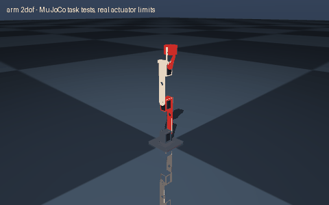

# arm 2dof

> Create a 2 DOF robotic arm

Interpreted as: 2-DOF serial arm · parallel gripper

**2-DOF arm, 350 mm reach, 0.1 kg payload, Feetech STS serial-bus servos (12 V)**

Parts cost **$129.98** · printed structure 4 parts, 362 g · checks passed 10/10

## What it can do

| | |
|---|--:|
| reach m | 0.35 |
| payload kg | 0.1 |
| mass kg | 0.547 |
| actuators | Feetech STS serial-bus servos (12 V) |
| max joint speed rad s | 4.44 |
| grip force n | 14 |
| holding current a | 1.24 |
| upper arm m | 0.144 |
| forearm m | 0.205 |

## Actuators (sized from this robot's own loads)

| Joint | Actuator | Needs (peak) N·m | Rated / peak N·m | Margin | Speed loaded rad/s |
|---|---|--:|--:|--:|--:|
| shoulder_pitch | feetech_sts3250 | 1.316 | 1.5691 / 4.9033 | 3.73x | 5.98 |
| elbow_pitch | feetech_sts3215_c047 | 0.534 | 0.9807 / 2.942 | 5.51x | 4.44 |

## Engineering checks

All 10 checks pass (torque, speed, power, stability, print-bed fit, grip). Details in `robot.json` → `metadata.design.checks`.

## Assumptions and limits

- Arm clamps or bolts to the bench through the four M5 holes in the base; it is not free-standing at full reach.
- Links are cantilevered from one side of each horn (as on SO-101 / Koch arms); add an idler bearing on the far side for heavy use.
- Torques are exact static gravity loads of this geometry: the worst pose (stretched out with the payload) must be held within each actuator's rated continuous torque, peaks get +30 %, and each joint must still reach >= 1 rad/s loaded on its torque-speed line.

<!-- SIM -->
## Simulation (MuJoCo, real actuator limits)

**4/4 task tests pass.** Every motor is limited to its datasheet peak torque and its torque-speed line, with the rotor inertia reflected through its gearbox; continuous loads are compared with the rated torque. The animation above is recorded from these tests.

| | Test | Result |
|---|---|---|
| ✅ | payload hold | stretched_plus: holds 0.1 kg with the arm stretched out for 3 s; worst continuous utilisation 0.74x rated at shoulder_pitch | stretched_minus: holds 0.1 kg with the arm stretched out for 3 s; worst continuous utilisation 0.74x rated at shoulder_pitch |
| ✅ | reach | TCP 0.350 m from the shoulder axis with the payload, claimed 0.350 m (tolerance 7 mm) |
| ✅ | speed | 1.98 s move at 80 % rated speed tracks within 0.1 rad; most saturated shoulder_pitch (0 % of the move) |
| ✅ | grip | holds 0.1 kg against its weight with friction 0.5: slip 0.0 mm in 3 s, clamp force 27.1 N (needs >= 1.0 N), gripper limited to its rated (continuous) torque |

_PASS means the modelled actuators (datasheet peak torque as a hard limit, a linear torque-speed line to no-load speed, reflected rotor inertia, URDF damping/friction) can produce the torques and speeds the task needs in this geometry and mass distribution, and that mean torque over the hold stays within the continuous (rated) torque. Joint control uses an ideal model-based feedforward (computed torque) through the force-limited servo for fixed-base robots and plain position servos for floating robots; a pass therefore proves torque/speed capacity, not that a given controller achieves it. Untested: thermal limits over long duty cycles (only the mean-vs-rated proxy), gearbox backlash and compliance, link and joint flexibility, encoder resolution, supply voltage sag and current limits, bus latency, controller tuning, and contact/friction values (nominal friction only)._
<!-- /SIM -->

## Files

| File | What |
|---|---|
| `robot.urdf`, `meshes/` | URDF with real component and printed-part meshes, datasheet effort/velocity limits |
| `BOM.md`, `bom.json` | every part to buy, with supplier links and prices |
| `robot.cad.zip` | build package: printable STLs, print list, bought-part models, assembly order |
| `robot.ros2.zip` | ROS 2 description package (ros2_control, MoveIt config, Gazebo launch) |
| `robot.training.zip` | MuJoCo / RL training scaffold |
| `simulation_report.json` | MuJoCo task tests under the real actuator limits |
