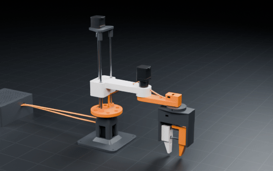
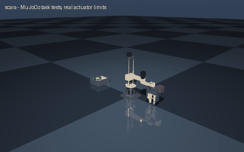

# scara

> Create a SCARA robot

Interpreted as: SCARA · parallel gripper

**SCARA arm: 0.30 m reach, 159 mm Z stroke, 0.5 kg payload; NEMA17 + 5.18:1 planetary on J1/J2, Tr8x8 lead-screw Z, Feetech STS3215 C047 12 V 30 kg.cm (1:345) wrist, parallel gripper**

Parts cost **$359** · printed structure 13 parts, 1964 g · checks passed 56/56

## What it can do

| | |
|---|--:|
| reach m | 0.3 |
| inner arm mm | 165 |
| outer arm mm | 135 |
| z stroke mm | 159 |
| payload kg | 0.5 |
| mass kg | 4.985 |
| j1 range deg | 332 |
| j2 range deg | 253 |
| tcp speed m s | 0.9 |
| z speed mm s | 80 |
| worst backlash error mm | 7.6 |
| j1 inertia kgm2 | 0.129 |
| j2 inertia kgm2 | 0.022 |
| gripper stroke mm | 40 |
| grip force rated n | 46.7 |
| lowest fingertip mm | 13 |
| cost usd | 360.09 |
| cost breakdown | parts 284.08 USD, filament 49.10 USD (1.96 kg), fasteners ~8.40 USD, wiring 18.51 USD |

## Actuators (sized from this robot's own loads)

| Joint | Actuator | Needs (peak) N·m | Rated / peak N·m | Margin | Speed loaded rad/s |
|---|---|--:|--:|--:|--:|
| j1 | nema17_42x40_pg5 | 1.224 | 2 / 4 | 1.63x | 12.147 |
| j2 | nema17_42x40_pg5 | 0.369 | 2 / 4 | 5.42x | 12.147 |
| z | nema17_42x40 | 36.6 | 157.6 / 236.4 | 4.3x | 0.08 |
| wrist_roll | feetech_sts3215_c047 | 0.047 | 0.9807 / 2.942 | 20.88x | 4.712 |
| finger_a | feetech_sts3215_c047 | 0.155 | 0.9807 / 2.942 | 6.35x | 4.712 |

## Engineering checks

All 56 checks pass (torque, speed, power, stability, print-bed fit). Details in `robot.json` → `metadata.design.checks`.

## Assumptions and limits

- J1: a direct-drive NEMA17 (0.3 N·m pull-out) would give only 0.27x margin, so the 5.18:1 planetary is used.
- J2: a direct-drive NEMA17 (0.3 N·m pull-out) would give only 0.88x margin, so the 5.18:1 planetary is used.
- Unpowered, the Z carriage slowly back-drives the 8 mm-lead screw and settles on its lower stop; a 2 mm-lead screw would self-lock at a quarter of the speed.
- Sizing targets: J1 8 rad/s², J2 12 rad/s², wrist 30 rad/s², Z 2 m/s² with 0.5 kg at full reach; steppers keep >= 1.5x margin on their usable torque so they do not lose steps.
- J1 and J2 are vertical axes: gravity loads their bearings, not their motors. Each output hub runs in two thin-section bearings that carry the overhung moment; the gearbox shaft only transmits torque.
- Planetary backlash (1° per joint) limits repeatability to about ±3.8 mm at the TCP; a GT2 belt reduction (as in the HowToMechatronics build) or a low-backlash gearbox improves it.
- Joint speed limits are configured below the gearmotor's 12.147 rad/s no-load speed (J1 3 rad/s, J2 4 rad/s): stepper pull-out torque falls with speed, and these limits keep the sized acceleration available.
- Z travel starts where the fingertips are 13 mm above the table/base plate; the controller box stands outside the swept radius.
- J2 is limited to ±127° so the gripper never swings into the column or base.
- Steppers run open loop with sensorless homing (TMC2209 StallGuard) or end-stop switches (not modelled); the ESP32-S3 runs the kinematics and talks to the drivers over STEP/DIR + UART and to the servos over the bus adapter.
- Controller box: printed case with a screwed lid and an electronics deck; mains come in through a fused, switched IEC inlet, earth wired first.

<!-- SIM -->
## Simulation (MuJoCo, real actuator limits)

**2/2 task tests pass.** Every motor is limited to its datasheet peak torque and its torque-speed line, with the rotor inertia reflected through its gearbox; continuous loads are compared with the rated torque. The animation below is recorded from these tests.

| | Test | Result |
|---|---|---|
| ✅ | payload hold | home: holds 0.5 kg at home for 3 s; worst continuous utilisation 0.15x rated at z |
| ✅ | speed | 4.63 s move at 80 % rated speed tracks within 0.1 rad; most saturated z (0 % of the move) |
| ➖ | grip | untested: the TCP is not between two finger surfaces |

_PASS means the modelled actuators (datasheet peak torque as a hard limit, a linear torque-speed line to no-load speed, reflected rotor inertia, URDF damping/friction) can produce the torques and speeds the task needs in this geometry and mass distribution, and that mean torque over the hold stays within the continuous (rated) torque. Joint control uses an ideal model-based feedforward (computed torque) through the force-limited servo for fixed-base robots and plain position servos for floating robots; a pass therefore proves torque/speed capacity, not that a given controller achieves it. Untested: thermal limits over long duty cycles (only the mean-vs-rated proxy), gearbox backlash and compliance, link and joint flexibility, encoder resolution, supply voltage sag and current limits, bus latency, controller tuning, and contact/friction values (nominal friction only)._
<!-- /SIM -->

## Files

| File | What |
|---|---|
| `robot.urdf`, `meshes/` | URDF with real component and printed-part meshes, datasheet effort/velocity limits |
| `BOM.md`, `bom.json` | every part to buy, with supplier links and prices |
| `WIRING.md`, `wiring.svg` | power budget per rail, pin-to-pin table, cut list, slack at each joint, wiring diagram |
| `robot.cad.zip` | build package: printable STLs, print list, bought-part models, assembly order |
| `robot.ros2.zip` | ROS 2 description package (ros2_control, MoveIt config, Gazebo launch) |
| `robot.training.zip` | MuJoCo / RL training scaffold |
| `simulation_report.json`, `simulation.gif` | MuJoCo task tests under the real actuator limits |
| `studio.gif` | Cycles render of a physics motion loop: every link where MuJoCo put it, the harness on its real routes |
