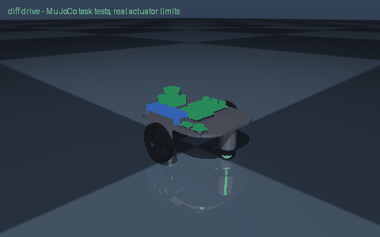

# diff drive

> Create a differential drive mobile robot

Interpreted as: differential-drive base · lidar (base_link) · imu (base_link)

**Differential-drive base: pololu_37d_30to1_64cpr gearmotors, 1.458 kg, 1.24 m/s, 1.8 h on 1 x lipo_3s_2200, rpi5**

Parts cost **$492.62** · printed structure 13 parts, 543 g · checks passed 21/21

## What it can do

| | |
|---|--:|
| mass kg | 1.458 |
| loaded mass kg | 2.458 |
| top speed m s | 1.24 |
| wheel torque nm | 0.138 |
| drive motor | pololu_37d_30to1_64cpr |
| battery | 1 x lipo_3s_2200 |
| average power w | 10.8 |
| runtime h | 1.8 |
| tip angle deg | 36.3 |
| compute | rpi5 |
| slope deg | 10 |
| turn rate rad s | 5.22 |
| turn slip factor | 1 |
| cargo kg | 1 |
| cost usd | 509 |
| cost breakdown | catalog parts $472, filament 0.62 kg $16, fasteners $7, fabricated/other $15 (power switch, 15 A fuse, wiring) |

## Actuators (sized from this robot's own loads)

| Joint | Actuator | Needs (peak) N·m | Rated / peak N·m | Margin | Speed loaded rad/s |
|---|---|--:|--:|--:|--:|
| left_wheel_joint | pololu_37d_30to1_64cpr | 0.138 | 0.686 / 1.373 | 4.97x | 34.558 |
| right_wheel_joint | pololu_37d_30to1_64cpr | 0.138 | 0.686 / 1.373 | 4.97x | 34.558 |

## Engineering checks

All 21 checks pass (torque, speed, power, stability, print-bed fit). Details in `robot.json` → `metadata.design.checks`.

## Assumptions and limits

- Drive sized for the robot plus 1 kg cargo on a 10 deg slope accelerating at 0.5 m/s^2, rolling resistance 0.03; motors compared at their continuous (not stall) rating.
- All motors and servos are 12 V parts run straight from a 3S LiPo (9.9-12.6 V); a power switch, 15 A blade fuse and XT60 wiring are budgeted as a lump sum.
- Printed parts: PETG; brackets bolt to the deck with M3 screws and nuts; the motor face screws are the gearmotor's own six M3 holes.
- Two ball casters (front and rear) keep the deck level; on rough floors fit only one or add the Pololu spacer set so the drive wheels never lift.

<!-- SIM -->
## Simulation (MuJoCo, real actuator limits)

**3/3 task tests pass.** Every motor is limited to its datasheet peak torque and its torque-speed line, with the rotor inertia reflected through its gearbox; continuous loads are compared with the rated torque. The animation above is recorded from these tests.

| | Test | Result |
|---|---|---|
| ✅ | drive straight | 3.44 m in 4.01 s, cruise speed 1.212 m/s vs claimed 1.240 m/s, heading drift -0.1 deg, lateral -0.7 cm |
| ✅ | ramp 10deg | from standstill on a 10 deg slope (speed ramped over 4.7 s at 0.5 m/s^2): 5.19 m uphill in 6.7 s, speed 1.206 m/s of 1.240 commanded |
| ✅ | turn in place | yaw rate 4.97 rad/s with 4.83 commanded (no-slip), claimed 5.22 rad/s (needs >= 4.44), centre moved 1.2 cm over 2.0 turn(s) (0.6 cm per turn) |

_PASS means the modelled actuators (datasheet peak torque as a hard limit, a linear torque-speed line to no-load speed, reflected rotor inertia, URDF damping/friction) can produce the torques and speeds the task needs in this geometry and mass distribution, and that mean torque over the hold stays within the continuous (rated) torque. Joint control uses an ideal model-based feedforward (computed torque) through the force-limited servo for fixed-base robots and plain position servos for floating robots; a pass therefore proves torque/speed capacity, not that a given controller achieves it. Untested: thermal limits over long duty cycles (only the mean-vs-rated proxy), gearbox backlash and compliance, link and joint flexibility, encoder resolution, supply voltage sag and current limits, bus latency, controller tuning, and contact/friction values (nominal friction only)._
<!-- /SIM -->

## Files

| File | What |
|---|---|
| `robot.urdf`, `meshes/` | URDF with real component and printed-part meshes, datasheet effort/velocity limits |
| `BOM.md`, `bom.json` | every part to buy, with supplier links and prices |
| `robot.cad.zip` | build package: printable STLs, print list, bought-part models, assembly order |
| `robot.ros2.zip` | ROS 2 description package (ros2_control, MoveIt config, Gazebo launch) |
| `robot.training.zip` | MuJoCo / RL training scaffold |
| `simulation_report.json` | MuJoCo task tests under the real actuator limits |
