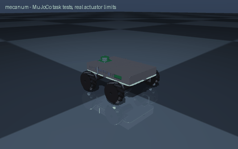

# mecanum

> Create a mecanum-wheel robot

Interpreted as: mecanum-wheel base · lidar (base_link) · imu (base_link)

**Mecanum holonomic base: pololu_37d_30to1_64cpr gearmotors, 2.728 kg, 1.33 m/s, 1.58 h on 1 x lipo_3s_2200, rpi5**

Parts cost **$785.9** · printed structure 11 parts, 140 g · checks passed 18/18

## What it can do

| | |
|---|--:|
| mass kg | 2.728 |
| loaded mass kg | 4.728 |
| top speed m s | 1.33 |
| wheel torque nm | 0.166 |
| drive motor | pololu_37d_30to1_64cpr |
| battery | 1 x lipo_3s_2200 |
| average power w | 12.3 |
| runtime h | 1.58 |
| tip angle deg | 43.8 |
| compute | rpi5 |
| slope deg | 10 |
| turn rate rad s | 5.14 |
| turn slip factor | 1 |
| cargo kg | 2 |
| cost usd | 845 |
| cost breakdown | catalog parts $774, filament 0.16 kg $4, fasteners $8, fabricated/other $59 (300 x 200 x 3 mm 5052 aluminium deck, laser cut (~$44); power switch, 15 A fuse, wiring) |

## Actuators (sized from this robot's own loads)

| Joint | Actuator | Needs (peak) N·m | Rated / peak N·m | Margin | Speed loaded rad/s |
|---|---|--:|--:|--:|--:|
| front_left_wheel_joint | pololu_37d_30to1_64cpr | 0.166 | 0.686 / 1.373 | 4.12x | 34.558 |
| front_right_wheel_joint | pololu_37d_30to1_64cpr | 0.166 | 0.686 / 1.373 | 4.12x | 34.558 |
| rear_left_wheel_joint | pololu_37d_30to1_64cpr | 0.166 | 0.686 / 1.373 | 4.12x | 34.558 |
| rear_right_wheel_joint | pololu_37d_30to1_64cpr | 0.166 | 0.686 / 1.373 | 4.12x | 34.558 |

## Engineering checks

All 18 checks pass (torque, speed, power, stability, print-bed fit). Details in `robot.json` → `metadata.design.checks`.

## Assumptions and limits

- Drive sized for the robot plus 2 kg cargo on a 10 deg slope accelerating at 0.5 m/s^2, rolling resistance 0.03; motors compared at their continuous (not stall) rating.
- All motors and servos are 12 V parts run straight from a 3S LiPo (9.9-12.6 V); a power switch, 15 A blade fuse and XT60 wiring are budgeted as a lump sum.
- Printed parts: PETG; brackets bolt to the deck with M3 screws and nuts; the motor face screws are the gearmotor's own six M3 holes.
- Mecanum wheels mount in an X pattern seen from above (front-left and rear-right left-handed, the others right-handed); goBILDA sells them as a 2+2 set.
- The simulation contacts each mecanum wheel as a plain cylinder: free rollers are not simulated, so sideways motion is a kinematics claim, not a physics-tested one.
- Forward drive torque includes an 0.85 efficiency for roller rolling losses.
- The deck is larger than a 250 x 210 mm bed, so it is a laser-cut 3 mm aluminium plate (send-cut-send style service) rather than a print.

<!-- SIM -->
## Simulation (MuJoCo, real actuator limits)

**2/2 task tests pass.** Every motor is limited to its datasheet peak torque and its torque-speed line, with the rotor inertia reflected through its gearbox; continuous loads are compared with the rated torque. The animation above is recorded from these tests.

| | Test | Result |
|---|---|---|
| ✅ | drive straight | 3.66 m in 4.07 s, cruise speed 1.301 m/s vs claimed 1.330 m/s, heading drift -0.0 deg, lateral -0.0 cm |
| ✅ | ramp 10deg | from standstill on a 10 deg slope (speed ramped over 5.0 s at 0.5 m/s^2): 5.78 m uphill in 7.0 s, speed 1.294 m/s of 1.330 commanded |
| ➖ | turn in place | untested: mecanum rollers are not modelled as joints (rigid wheels scrub like skid steer); measured yaw rate 3.84 rad/s with 4.94 commanded (no-slip), claimed 5.14 rad/s (needs >= 4.37), centre moved 12.4 cm over 1.5 turn(s) (8.1 cm per turn) |
| ➖ | strafe | untested: mecanum rollers are not modelled as joints, so a rigid wheel cannot strafe in simulation |

_PASS means the modelled actuators (datasheet peak torque as a hard limit, a linear torque-speed line to no-load speed, reflected rotor inertia, URDF damping/friction) can produce the torques and speeds the task needs in this geometry and mass distribution, and that mean torque over the hold stays within the continuous (rated) torque. Joint control uses an ideal model-based feedforward (computed torque) through the force-limited servo for fixed-base robots and plain position servos for floating robots; a pass therefore proves torque/speed capacity, not that a given controller achieves it. Untested: thermal limits over long duty cycles (only the mean-vs-rated proxy), gearbox backlash and compliance, link and joint flexibility, encoder resolution, supply voltage sag and current limits, bus latency, controller tuning, and contact/friction values (nominal friction only)._
<!-- /SIM -->

## Files

| File | What |
|---|---|
| `robot.urdf`, `meshes/` | URDF with real component and printed-part meshes, datasheet effort/velocity limits |
| `BOM.md`, `bom.json` | every part to buy, with supplier links and prices |
| `robot.cad.zip` | build package: printable STLs, print list, bought-part models, assembly order |
| `robot.ros2.zip` | ROS 2 description package (ros2_control, MoveIt config, Gazebo launch) |
| `robot.training.zip` | MuJoCo / RL training scaffold |
| `simulation_report.json` | MuJoCo task tests under the real actuator limits |
