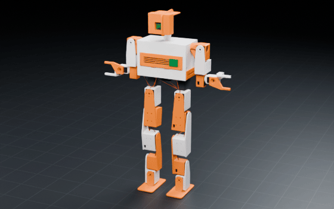
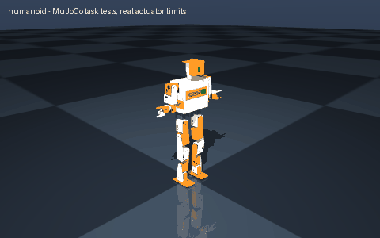

# humanoid

> Create a small humanoid robot with a torso, head, two arms and two-finger grippers

Interpreted as: humanoid · parallel gripper · imu (base_link) · camera (neck_pan_link)

**Humanoid, 0.687 m, 3.61 kg, 24 DOF (4-DOF arms + grippers), 44 min, $4221 of parts**

Parts cost **$4323.54** · printed structure 30 parts, 1353 g · checks passed 94/94

## What it can do

| | |
|---|--:|
| average power w | 60.5 |
| com height m | 0.362 |
| com x over sole mm | -9 |
| mass kg | 3.607 |
| height m | 0.687 |
| hip height m | 0.378 |
| dof | 24 |
| arm dof | 4 |
| payload per hand kg | 0.15 |
| leg actuators | Feetech STS3215 C047 12 V 30 kg.cm (1:345) / DYNAMIXEL XH540-W270-T(R) / Feetech STS3250 C002 12 V 50 kg.cm (1:345) |
| arm actuators | DYNAMIXEL XL430-W250-T / DYNAMIXEL XL330-M288-T |
| runtime min | 44 |
| cost usd | 4221.49 |
| sensors | camera, imu |

## Actuators (sized from this robot's own loads)

| Joint | Actuator | Needs (peak) N·m | Rated / peak N·m | Margin | Speed loaded rad/s |
|---|---|--:|--:|--:|--:|
| l_hip_yaw | feetech_sts3215_c047 | 0.404 | 0.9807 / 2.942 | 7.28x | 4.712 |
| l_hip_roll | dxl_xh540_w270 | 4.224 | 2.97 / 9.9 | 2.34x | 4.084 |
| l_hip_pitch | dxl_xh540_w270 | 5.434 | 2.97 / 9.9 | 1.82x | 4.084 |
| l_knee | dxl_xh540_w270 | 5.13 | 2.97 / 9.9 | 1.93x | 4.084 |
| l_ankle_pitch | feetech_sts3250 | 2.792 | 1.5691 / 4.9033 | 1.76x | 7.854 |
| l_ankle_roll | feetech_sts3215_c047 | 1.168 | 0.9807 / 2.942 | 2.52x | 4.712 |
| r_hip_yaw | feetech_sts3215_c047 | 0.404 | 0.9807 / 2.942 | 7.28x | 4.712 |
| r_hip_roll | dxl_xh540_w270 | 4.224 | 2.97 / 9.9 | 2.34x | 4.084 |
| r_hip_pitch | dxl_xh540_w270 | 5.434 | 2.97 / 9.9 | 1.82x | 4.084 |
| r_knee | dxl_xh540_w270 | 5.13 | 2.97 / 9.9 | 1.93x | 4.084 |
| r_ankle_pitch | feetech_sts3250 | 2.792 | 1.5691 / 4.9033 | 1.76x | 7.854 |
| r_ankle_roll | feetech_sts3215_c047 | 1.168 | 0.9807 / 2.942 | 2.52x | 4.712 |
| l_shoulder_pitch | dxl_xl430_w250 | 0.379 | 0.42 / 1.4 | 3.7x | 5.969 |
| l_shoulder_roll | dxl_xl430_w250 | 0.365 | 0.42 / 1.4 | 3.83x | 5.969 |
| l_upper_arm_yaw | dxl_xl430_w250 | 0.215 | 0.42 / 1.4 | 6.5x | 5.969 |
| l_elbow | dxl_xl330_m288 | 0.033 | 0.156 / 0.52 | 15.56x | 10.786 |
| l_gripper | dxl_xl330_m288 | 0.002 | 0.156 / 0.52 | 99x | 10.786 |
| r_shoulder_pitch | dxl_xl430_w250 | 0.381 | 0.42 / 1.4 | 3.67x | 5.969 |
| r_shoulder_roll | dxl_xl430_w250 | 0.368 | 0.42 / 1.4 | 3.81x | 5.969 |
| r_upper_arm_yaw | dxl_xl430_w250 | 0.215 | 0.42 / 1.4 | 6.5x | 5.969 |
| r_elbow | dxl_xl330_m288 | 0.033 | 0.156 / 0.52 | 15.56x | 10.786 |
| r_gripper | dxl_xl330_m288 | 0.002 | 0.156 / 0.52 | 99x | 10.786 |
| neck_pan | dxl_xl330_m288 | 0 | 0.156 / 0.52 | 99x | 10.786 |
| neck_tilt | dxl_xl330_m288 | 0.108 | 0.156 / 0.52 | 4.8x | 10.786 |

## Engineering checks

All 94 checks pass (torque, speed, power, stability, print-bed fit). Details in `robot.json` → `metadata.design.checks`.

## Assumptions and limits

- Joint limits trimmed to the collision-free range found by exact solid sweeps: l_hip_roll [-0.45, 0.45] -> [-0.13, 0.45]; l_knee [-2.20, 2.20] -> [-2.04, 2.20]; l_ankle_roll [-0.50, 0.50] -> [-0.50, 0.13]; r_hip_roll [-0.45, 0.45] -> [-0.45, 0.13]; r_knee [-2.20, 2.20] -> [-2.20, 2.04]; r_ankle_roll [-0.50, 0.50] -> [-0.13, 0.50]; l_shoulder_roll [-1.60, 1.60] -> [-0.12, 1.60]; r_shoulder_roll [-1.60, 1.60] -> [-1.60, 0.12]; neck_tilt [-0.70, 0.70] -> [-0.70, 0.38].
- Joint ranges are swept with the arms held 0.35 rad out to the side (the walking posture); with the arms hanging straight the hands touch the thighs when a leg abducts or a wrist turns.
- Zero joint angles are the standing pose (knees bent 0.25 rad, soles flat); the base origin is on the hip-yaw output plane.
- Leg loads are J^T F at the sole with the whole robot on one foot and the centre of pressure anywhere on the central 60 % of the sole, over squat / lean / step poses, ±10 % traction, x 1.3 dynamic factor; continuous duty checked at 71 % of the worst stance load (RMS over a gait cycle with half of it in stance).
- Soles carry a 2 mm rubber pad (silicone / neoprene sheet, glued) as the contact patch.
- Arm loads are exact gravity torques with the payload in each hand, arms stretched forward, sideways and rolled.
- Small humanoid: walking needs a balance controller using the pelvis IMU (ZMP preview / RL policy); position-controlled standing is passively stable only while the COM stays over the soles.

## Prompt notes

- not applied: "small": the humanoid is sized from its parts and load

<!-- SIM -->
## Simulation (MuJoCo, real actuator limits)

**3/3 task tests pass.** Every motor is limited to its datasheet peak torque and its torque-speed line, with the rotor inertia reflected through its gearbox; continuous loads are compared with the rated torque. The animation below is recorded from these tests.

| | Test | Result |
|---|---|---|
| ➖ | stand free | informational (no balance controller; a biped is not statically stable): base z 0.382 -> 0.377 m (creep after settling 0.0 mm), upright 1.000; worst leg joint l_knee at 0.06x rated |
| ✅ | stand rail | on a vertical guide rail (balance removed, full weight on the legs): base z 0.383 -> 0.377 m (creep after settling 0.0 mm), upright 1.000; worst leg joint l_ankle_pitch at 0.04x rated |
| ✅ | single leg rail | one leg (l_hip_yaw chain) carrying the full body weight on the rail, the other legs out of contact: base z 0.383 -> 0.377 m (creep after settling 0.0 mm), upright 1.000; worst leg joint l_ankle_pitch at 0.08x rated |
| ✅ | squat rail | on the rail: commanded body drop 76 mm (20 % of 378 mm leg), achieved 77 mm, back up to 77 mm above the low point, upright 1.000 |

_PASS means the modelled actuators (datasheet peak torque as a hard limit, a linear torque-speed line to no-load speed, reflected rotor inertia, URDF damping/friction) can produce the torques and speeds the task needs in this geometry and mass distribution, and that mean torque over the hold stays within the continuous (rated) torque. Joint control uses an ideal model-based feedforward (computed torque) through the force-limited servo for fixed-base robots and plain position servos for floating robots; a pass therefore proves torque/speed capacity, not that a given controller achieves it. Untested: thermal limits over long duty cycles (only the mean-vs-rated proxy), gearbox backlash and compliance, link and joint flexibility, encoder resolution, supply voltage sag and current limits, bus latency, controller tuning, and contact/friction values (nominal friction only)._
<!-- /SIM -->

## Files

| File | What |
|---|---|
| `robot.urdf`, `meshes/` | URDF with real component and printed-part meshes, datasheet effort/velocity limits |
| `BOM.md`, `bom.json` | every part to buy, with supplier links and prices |
| `WIRING.md`, `wiring.svg` | power budget per rail, battery runtime, regulator heat, logic levels, pin-to-pin table, cut list, slack at each joint, cable diagram |
| `schematic.svg`, `schematic.pdf`, `breadboard.svg` | schematic with reference designators, power symbols and net labels; picture view with every wire in its colour |
| `robot.cad.zip` | build package: printable STLs, print list, bought-part models, assembly order |
| `robot.ros2.zip` | ROS 2 description package (ros2_control, MoveIt config, Gazebo launch) |
| `robot.training.zip` | MuJoCo / RL training scaffold |
| `simulation_report.json`, `simulation.gif` | MuJoCo task tests under the real actuator limits |
| `studio.gif` | Cycles render of a physics motion loop: every link where MuJoCo put it, the harness on its real routes |
