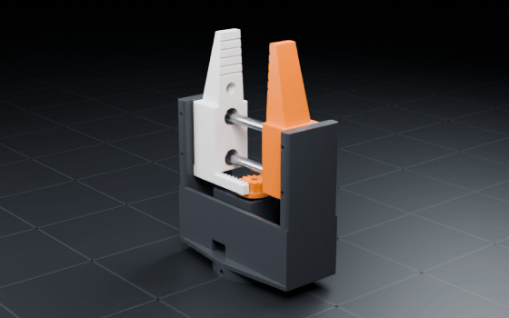
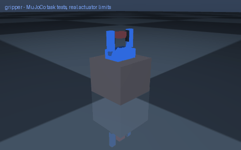

# gripper

> Create a two-finger parallel gripper

Interpreted as: standalone parallel gripper

**Parallel gripper: 60 mm stroke, 47 N rated squeeze per finger, Feetech STS3215 C047 12 V 30 kg.cm (1:345)**

Parts cost **$93.49** · printed structure 7 parts, 530 g · checks passed 29/29

## What it can do

| | |
|---|--:|
| stroke mm | 60 |
| max object width mm | 60 |
| grip force rated n | 46.7 |
| grip force peak n | 140.1 |
| holds kg mu05 | 4.76 |
| finger speed mm s | 49.5 |
| close time s | 0.61 |
| payload kg | 0.5 |
| mass kg | 1.032 |
| height mm | 199.1 |
| actuator | Feetech STS3215 C047 12 V 30 kg.cm (1:345) |
| mount | ISO 9409-1-50-4-M6 style adapter (4 x M6 on PCD 50, 31.5 mm centring recess) |
| cost usd | 94.23 |
| cost breakdown | parts 71.52 USD, filament 13.26 USD (0.53 kg), fasteners ~4.50 USD, wiring 4.95 USD |

## Actuators (sized from this robot's own loads)

| Joint | Actuator | Needs (peak) N·m | Rated / peak N·m | Margin | Speed loaded rad/s |
|---|---|--:|--:|--:|--:|
| finger_a | feetech_sts3215_c047 | 0.155 | 0.9807 / 2.942 | 6.35x | 4.712 |

## Engineering checks

All 29 checks pass (torque, speed, power, stability, print-bed fit). Details in `robot.json` → `metadata.design.checks`.

## Assumptions and limits

- Grip force uses the servo's rated (continuous) torque 0.9807 N·m; stall torque 2.942 N·m gives 140 N per finger for short squeezes.
- Friction coefficient 0.5 between the printed pads (or TPU/rubber pads glued into the grooves) and the object; safety factor 1.5.
- The fingers are coupled by the rack-and-pinion: finger_a is the actuated prismatic joint (servo torque / pitch radius), finger_b and the pinion carry a URDF <mimic> of it (MuJoCo: joint equality constraints), so one actuator drives both fingers.
- Rack/pinion teeth are module 1.5 printed in PETG; grease them and expect backlash of a few tenths of a millimetre.
- Servo bus adapter and 12 V supply sit in a bench control case off the gripper (cable through the window under the servo).
- The adapter plate bolts to the robot first (heads sunk in the plate), then the housing slides over it and is fixed by four radial M4 screws.

<!-- SIM -->
## Simulation (MuJoCo, real actuator limits)

**0/0 task tests pass.** Every motor is limited to its datasheet peak torque and its torque-speed line, with the rotor inertia reflected through its gearbox; continuous loads are compared with the rated torque. The animation below is recorded from these tests.

| | Test | Result |
|---|---|---|
| ➖ | grip | untested: the TCP is not between two finger surfaces |

_PASS means the modelled actuators (datasheet peak torque as a hard limit, a linear torque-speed line to no-load speed, reflected rotor inertia, URDF damping/friction) can produce the torques and speeds the task needs in this geometry and mass distribution, and that mean torque over the hold stays within the continuous (rated) torque. Joint control uses an ideal model-based feedforward (computed torque) through the force-limited servo for fixed-base robots and plain position servos for floating robots; a pass therefore proves torque/speed capacity, not that a given controller achieves it. Untested: thermal limits over long duty cycles (only the mean-vs-rated proxy), gearbox backlash and compliance, link and joint flexibility, encoder resolution, supply voltage sag and current limits, bus latency, controller tuning, and contact/friction values (nominal friction only)._
<!-- /SIM -->

## Files

| File | What |
|---|---|
| `robot.urdf`, `meshes/` | URDF with real component and printed-part meshes, datasheet effort/velocity limits |
| `BOM.md`, `bom.json` | every part to buy, with supplier links and prices |
| `WIRING.md`, `wiring.svg` | power budget per rail, battery runtime, regulator heat, logic levels, pin-to-pin table, cut list, slack at each joint, cable diagram |
| `schematic.svg`, `schematic.pdf`, `breadboard.svg` | schematic with reference designators, power symbols and net labels; picture view with every wire in its colour |
| `robot.cad.zip` | build package: printable STLs, print list, bought-part models, assembly order |
| `robot.ros2.zip` | ROS 2 description package (ros2_control, MoveIt config, Gazebo launch) |
| `robot.training.zip` | MuJoCo / RL training scaffold |
| `simulation_report.json`, `simulation.gif` | MuJoCo task tests under the real actuator limits |
| `studio.gif` | Cycles render of a physics motion loop: every link where MuJoCo put it, the harness on its real routes |
