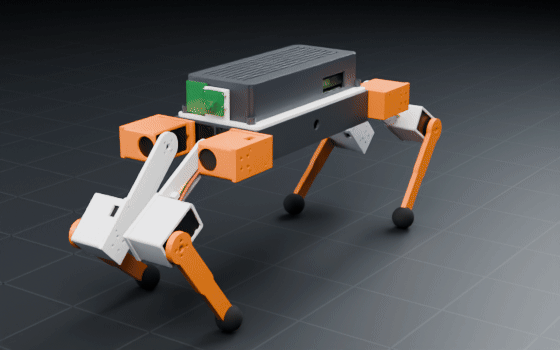
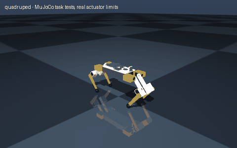

# quadruped

> Create a quadruped robot

Interpreted as: quadruped · imu (base_link) · camera (base_link)

**Servo quadruped, 1.41 kg, hip height 0.18 m, 12 DOF, 33 min runtime, $530 of parts**

Parts cost **$578.75** · printed structure 15 parts, 538 g · checks passed 62/62

## What it can do

| | |
|---|--:|
| average power w | 36 |
| com height m | 0.145 |
| mass kg | 1.409 |
| standing height m | 0.199 |
| hip height m | 0.18 |
| payload kg | 0.3 |
| legs | 4 |
| dof | 12 |
| actuators | Feetech STS3215 C047 12 V 30 kg.cm (1:345) (abduction), Feetech STS3215 C047 12 V 30 kg.cm (1:345) (hip), Feetech STS3215 C047 12 V 30 kg.cm (1:345) (knee) |
| runtime min | 33 |
| cost usd | 530.15 |
| stance width m | 0.13 |
| wheelbase m | 0.301 |

## Actuators (sized from this robot's own loads)

| Joint | Actuator | Needs (peak) N·m | Rated / peak N·m | Margin | Speed loaded rad/s |
|---|---|--:|--:|--:|--:|
| fl_hip_abduction | feetech_sts3215_c047 | 0.841 | 0.9807 / 2.942 | 3.5x | 4.712 |
| fl_hip_pitch | feetech_sts3215_c047 | 1.26 | 0.9807 / 2.942 | 2.34x | 4.712 |
| fl_knee | feetech_sts3215_c047 | 1.26 | 0.9807 / 2.942 | 2.33x | 4.712 |
| fr_hip_abduction | feetech_sts3215_c047 | 0.841 | 0.9807 / 2.942 | 3.5x | 4.712 |
| fr_hip_pitch | feetech_sts3215_c047 | 1.26 | 0.9807 / 2.942 | 2.34x | 4.712 |
| fr_knee | feetech_sts3215_c047 | 1.26 | 0.9807 / 2.942 | 2.33x | 4.712 |
| rl_hip_abduction | feetech_sts3215_c047 | 0.841 | 0.9807 / 2.942 | 3.5x | 4.712 |
| rl_hip_pitch | feetech_sts3215_c047 | 1.26 | 0.9807 / 2.942 | 2.34x | 4.712 |
| rl_knee | feetech_sts3215_c047 | 1.26 | 0.9807 / 2.942 | 2.33x | 4.712 |
| rr_hip_abduction | feetech_sts3215_c047 | 0.841 | 0.9807 / 2.942 | 3.5x | 4.712 |
| rr_hip_pitch | feetech_sts3215_c047 | 1.26 | 0.9807 / 2.942 | 2.34x | 4.712 |
| rr_knee | feetech_sts3215_c047 | 1.26 | 0.9807 / 2.942 | 2.33x | 4.712 |

## Engineering checks

All 62 checks pass (torque, speed, power, stability, print-bed fit). Details in `robot.json` → `metadata.design.checks`.

## Assumptions and limits

- A trot has two diagonal feet on the ground: the COM sits on the support line, so trotting needs the dynamic balance of the gait controller; the creep gait keeps three feet down (statically stable).
- Every joint's limits are inside its collision-free range (exact solid sweeps).
- Zero joint angles are the standing pose (knees bent); the base origin is at hip-axis height with the feet on the ground plane.
- Joint loads are J^T F at the stance feet for a trot (two diagonal feet carry the whole robot + payload) over a gait envelope, plus ±15 % traction forces, x 1.3 dynamic factor; continuous duty checked at 71 % of the worst stance load (RMS over a gait cycle with half of it in stance).
- Feet are moulded / TPU-printed rubber spheres (contact pads) bolted to the shin tip.
- Servo dog: position-controlled gaits (open-loop trot / creep) run on the computer through the serial servo bus.
- Battery is strapped into the printed fence on the body floor; never screw into a pack.

<!-- SIM -->
## Simulation (MuJoCo, real actuator limits)

**2/2 task tests pass.** Every motor is limited to its datasheet peak torque and its torque-speed line, with the rotor inertia reflected through its gearbox; continuous loads are compared with the rated torque. The animation below is recorded from these tests.

| | Test | Result |
|---|---|---|
| ✅ | stand free | base z 0.185 -> 0.180 m (creep after settling 0.2 mm), upright 1.000; worst leg joint fr_knee at 0.25x rated |
| ✅ | squat | free standing: commanded body drop 38 mm (20 % of 188 mm leg), achieved 38 mm, back up to 37 mm above the low point, upright 1.000 |

_PASS means the modelled actuators (datasheet peak torque as a hard limit, a linear torque-speed line to no-load speed, reflected rotor inertia, URDF damping/friction) can produce the torques and speeds the task needs in this geometry and mass distribution, and that mean torque over the hold stays within the continuous (rated) torque. Joint control uses an ideal model-based feedforward (computed torque) through the force-limited servo for fixed-base robots and plain position servos for floating robots; a pass therefore proves torque/speed capacity, not that a given controller achieves it. Untested: thermal limits over long duty cycles (only the mean-vs-rated proxy), gearbox backlash and compliance, link and joint flexibility, encoder resolution, supply voltage sag and current limits, bus latency, controller tuning, and contact/friction values (nominal friction only)._
<!-- /SIM -->

## Files

| File | What |
|---|---|
| `robot.urdf`, `meshes/` | URDF with real component and printed-part meshes, datasheet effort/velocity limits |
| `BOM.md`, `bom.json` | every part to buy, with supplier links and prices |
| `WIRING.md`, `wiring.svg` | power budget per rail, pin-to-pin table, cut list, slack at each joint, wiring diagram |
| `robot.cad.zip` | build package: printable STLs, print list, bought-part models, assembly order |
| `robot.ros2.zip` | ROS 2 description package (ros2_control, MoveIt config, Gazebo launch) |
| `robot.training.zip` | MuJoCo / RL training scaffold |
| `simulation_report.json`, `simulation.gif` | MuJoCo task tests under the real actuator limits |
| `studio.gif` | Cycles render of a physics motion loop: every link where MuJoCo put it, the harness on its real routes |
