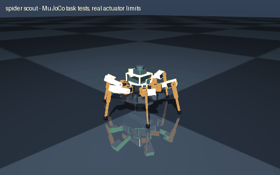

# spider scout

> Build a six-legged reconnaissance spider-bot with a LiDAR turret, budget $1500

Interpreted as: hexapod · imu (base_link) · lidar (base_link) · camera (base_link) · budget $1500

**Hexapod, 18 x Feetech STS3250 C002 12 V 50 kg.cm (1:345), 2.47 kg, 207 mm body, camera + lidar + imu, 40 min, $998 of parts**

Parts cost **$1032.68** (budget $1500: within) · printed structure 20 parts, 672 g · checks passed 47/47

## What it can do

| | |
|---|--:|
| average power w | 66.1 |
| com height m | 0.113 |
| mass kg | 2.468 |
| standing height m | 0.247 |
| belly clearance m | 0.044 |
| body diameter m | 0.207 |
| payload kg | 0.2 |
| legs | 6 |
| dof | 18 |
| actuators | Feetech STS3215 C047 12 V 30 kg.cm (1:345) x18 |
| runtime min | 40 |
| cost usd | 998.03 |
| sensors | camera, lidar, imu |

## Actuators (sized from this robot's own loads)

| Joint | Actuator | Needs (peak) N·m | Rated / peak N·m | Margin | Speed loaded rad/s |
|---|---|--:|--:|--:|--:|
| lf_coxa | feetech_sts3215_c047 | 0.346 | 0.9807 / 2.942 | 8.5x | 4.712 |
| lf_femur | feetech_sts3250 | 2.179 | 1.5691 / 4.9033 | 2.25x | 7.854 |
| lf_tibia | feetech_sts3215_c047 | 1.497 | 0.9807 / 2.942 | 1.96x | 4.712 |
| lm_coxa | feetech_sts3215_c047 | 0.346 | 0.9807 / 2.942 | 8.5x | 4.712 |
| lm_femur | feetech_sts3250 | 2.182 | 1.5691 / 4.9033 | 2.25x | 7.854 |
| lm_tibia | feetech_sts3215_c047 | 1.502 | 0.9807 / 2.942 | 1.96x | 4.712 |
| lr_coxa | feetech_sts3215_c047 | 0.329 | 0.9807 / 2.942 | 8.93x | 4.712 |
| lr_femur | feetech_sts3250 | 2.179 | 1.5691 / 4.9033 | 2.25x | 7.854 |
| lr_tibia | feetech_sts3215_c047 | 1.497 | 0.9807 / 2.942 | 1.96x | 4.712 |
| rr_coxa | feetech_sts3215_c047 | 0.346 | 0.9807 / 2.942 | 8.5x | 4.712 |
| rr_femur | feetech_sts3250 | 2.179 | 1.5691 / 4.9033 | 2.25x | 7.854 |
| rr_tibia | feetech_sts3215_c047 | 1.497 | 0.9807 / 2.942 | 1.96x | 4.712 |
| rm_coxa | feetech_sts3215_c047 | 0.346 | 0.9807 / 2.942 | 8.5x | 4.712 |
| rm_femur | feetech_sts3250 | 2.182 | 1.5691 / 4.9033 | 2.25x | 7.854 |
| rm_tibia | feetech_sts3215_c047 | 1.502 | 0.9807 / 2.942 | 1.96x | 4.712 |
| rf_coxa | feetech_sts3215_c047 | 0.329 | 0.9807 / 2.942 | 8.93x | 4.712 |
| rf_femur | feetech_sts3250 | 2.179 | 1.5691 / 4.9033 | 2.25x | 7.854 |
| rf_tibia | feetech_sts3215_c047 | 1.497 | 0.9807 / 2.942 | 1.96x | 4.712 |

## Engineering checks

All 47 checks pass (torque, speed, power, stability, print-bed fit). Details in `robot.json` → `metadata.design.checks`.

## Assumptions and limits

- Joint limits trimmed to the collision-free range found by exact solid sweeps: lf_tibia [-1.20, 1.20] -> [-0.86, 1.20]; lm_tibia [-1.20, 1.20] -> [-0.90, 1.20]; lr_tibia [-1.20, 1.20] -> [-0.90, 1.20]; rr_tibia [-1.20, 1.20] -> [-0.86, 1.20]; rm_tibia [-1.20, 1.20] -> [-0.90, 1.20]; rf_tibia [-1.20, 1.20] -> [-0.90, 1.20].
- Zero joint angles are the standing pose (femurs raised 20 deg, tibias near vertical); the base origin is on the coxa horn plane.
- Servo loads are J^T F at the stance feet of a tripod gait (three feet carry robot + payload), ±15 % traction, over a gait envelope, x 1.3 dynamic factor; continuous duty checked at 71 % of the worst stance load (RMS over a gait cycle with half of it in stance).
- Tripod gait keeps three feet down at all times: statically stable walking with open-loop position control.
- Feet are moulded / TPU-printed rubber spheres pushed over the tibia tips.
- The battery rides in a strapped cradle under the body plate (a 3S 5000 mAh pack is longer than the space between the coxa servos).
- The body plate and the top deck each print in one piece on a 250 x 210 mm bed; the deck stands on three printed pillars screwed into the plate.

<!-- SIM -->
## Simulation (MuJoCo, real actuator limits)

**2/2 task tests pass.** Every motor is limited to its datasheet peak torque and its torque-speed line, with the rotor inertia reflected through its gearbox; continuous loads are compared with the rated torque. The animation above is recorded from these tests.

| | Test | Result |
|---|---|---|
| ✅ | stand free | base z 0.119 -> 0.113 m (creep after settling 0.8 mm), upright 1.000; worst leg joint lf_femur at 0.25x rated |
| ✅ | squat | free standing: commanded body drop 37 mm (20 % of 183 mm leg), achieved 37 mm, back up to 36 mm above the low point, upright 1.000 |

_PASS means the modelled actuators (datasheet peak torque as a hard limit, a linear torque-speed line to no-load speed, reflected rotor inertia, URDF damping/friction) can produce the torques and speeds the task needs in this geometry and mass distribution, and that mean torque over the hold stays within the continuous (rated) torque. Joint control uses an ideal model-based feedforward (computed torque) through the force-limited servo for fixed-base robots and plain position servos for floating robots; a pass therefore proves torque/speed capacity, not that a given controller achieves it. Untested: thermal limits over long duty cycles (only the mean-vs-rated proxy), gearbox backlash and compliance, link and joint flexibility, encoder resolution, supply voltage sag and current limits, bus latency, controller tuning, and contact/friction values (nominal friction only)._
<!-- /SIM -->

## Files

| File | What |
|---|---|
| `robot.urdf`, `meshes/` | URDF with real component and printed-part meshes, datasheet effort/velocity limits |
| `BOM.md`, `bom.json` | every part to buy, with supplier links and prices |
| `robot.cad.zip` | build package: printable STLs, print list, bought-part models, assembly order |
| `robot.ros2.zip` | ROS 2 description package (ros2_control, MoveIt config, Gazebo launch) |
| `robot.training.zip` | MuJoCo / RL training scaffold |
| `simulation_report.json` | MuJoCo task tests under the real actuator limits |
