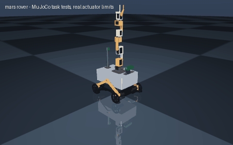

# mars rover

> Design a Mars rover with four wheels and a 6 DOF sampling arm, RGB-D camera, budget $4000

Interpreted as: mobile manipulator (wheeled rover + arm) · parallel gripper · depth (deck_lid) · camera (deck_lid) · budget $4000

**4-wheel rocker-bogie rover with a 6-DOF arm: 4.477 kg, 1.24 m/s, 1.53 h, jetson_orin_nano_super**

Parts cost **$3811.94** (budget $4000: within) · printed structure 20 parts, 627 g · checks passed 42/42

## What it can do

| | |
|---|--:|
| arm | 6-DOF, reach 0.437 m, 0.2 kg, ROBOTIS DYNAMIXEL XM/XH (12 V) |
| mass kg | 4.477 |
| loaded mass kg | 4.477 |
| top speed m s | 1.24 |
| wheel torque nm | 0.126 |
| drive motor | pololu_37d_30to1_64cpr |
| battery | 1 x lipo_3s_5000 |
| average power w | 28.9 |
| runtime h | 1.53 |
| tip angle deg | 24.5 |
| compute | jetson_orin_nano_super |
| slope deg | 10 |
| turn rate rad s | 1.65 |
| turn slip factor | 2.54 |
| cost usd | 3924 |
| cost breakdown | catalog parts $3779, filament 0.72 kg $18, fasteners $17, fabricated/other $110 (320 x 210 x 100 mm folded 2 mm aluminium body box (~$60); 320 x 210 x 3 mm aluminium lid, laser cut (~$35); power switch, 15 A fuse, wiring) |

## Actuators (sized from this robot's own loads)

| Joint | Actuator | Needs (peak) N·m | Rated / peak N·m | Margin | Speed loaded rad/s |
|---|---|--:|--:|--:|--:|
| arm_base_yaw | dxl_xm430_w350 | 0 | 1.23 / 4.1 | 99x | 4.58 |
| arm_shoulder_pitch | dxl_xh540_w270 | 2.851 | 2.97 / 9.9 | 3.47x | 3.6 |
| arm_elbow_pitch | dxl_xh540_w270 | 1.783 | 2.97 / 9.9 | 5.55x | 3.88 |
| arm_forearm_roll | dxl_xm430_w350 | 0.75 | 1.23 / 4.1 | 5.47x | 4.58 |
| arm_wrist_pitch | dxl_xm430_w350 | 0.75 | 1.23 / 4.1 | 5.47x | 4.58 |
| arm_wrist_roll | dxl_xm430_w350 | 0.056 | 1.23 / 4.1 | 72.91x | 4.58 |
| left_front_wheel_joint | pololu_37d_30to1_64cpr | 0.126 | 0.686 / 1.373 | 5.46x | 34.558 |
| left_rear_wheel_joint | pololu_37d_30to1_64cpr | 0.126 | 0.686 / 1.373 | 5.46x | 34.558 |
| right_front_wheel_joint | pololu_37d_30to1_64cpr | 0.126 | 0.686 / 1.373 | 5.46x | 34.558 |
| right_rear_wheel_joint | pololu_37d_30to1_64cpr | 0.126 | 0.686 / 1.373 | 5.46x | 34.558 |

## Engineering checks

All 42 checks pass (torque, speed, power, stability, print-bed fit). Details in `robot.json` → `metadata.design.checks`.

## Assumptions and limits

- Rocker-bogie after the JPL Open Source Rover, 4 driven wheels, skid steering (the OSR's four corner-steering servos are left out; add them for less tyre scrub).
- A rover's differential bar links the two rockers through the body, a closed loop URDF cannot describe; the model frees the left rocker on its pivot and bolts the right rocker to the body, which keeps every wheel on the ground and the body supported on three points (body pitch follows the right rocker instead of the average).
- Rockers and bogies are printed in PETG; for outdoor use print them in 6 bolt-on sections from aluminium channel instead (as the OSR does).
- Body: folded 2 mm aluminium box with a 3 mm lid; electronics on printed standoff plates on its floor.
- All motors and servos are 12 V parts run straight from a 3S LiPo; arm servos share the pack through the bus adapter.
- Arm: 6 DOF bolted to the lid front, sized as mounted for a 0.2 kg sample at full reach; the rover's tipping check includes the arm stretched forward, sideways and back with the sample.

<!-- SIM -->
## Simulation (MuJoCo, real actuator limits)

**3/3 task tests pass.** Every motor is limited to its datasheet peak torque and its torque-speed line, with the rotor inertia reflected through its gearbox; continuous loads are compared with the rated torque. The animation above is recorded from these tests.

| | Test | Result |
|---|---|---|
| ✅ | drive straight | 3.44 m in 4.01 s, cruise speed 1.213 m/s vs claimed 1.240 m/s, heading drift -0.0 deg, lateral -0.0 cm |
| ✅ | ramp 10deg | from standstill on a 10 deg slope (speed ramped over 4.7 s at 0.5 m/s^2): 5.17 m uphill in 6.7 s, speed 1.203 m/s of 1.240 commanded |
| ✅ | turn in place | yaw rate 1.40 rad/s with 4.06 commanded (no-slip), claimed 1.65 rad/s (needs >= 1.40), centre moved 3.8 cm over 1.0 turn(s) (3.8 cm per turn) |

_PASS means the modelled actuators (datasheet peak torque as a hard limit, a linear torque-speed line to no-load speed, reflected rotor inertia, URDF damping/friction) can produce the torques and speeds the task needs in this geometry and mass distribution, and that mean torque over the hold stays within the continuous (rated) torque. Joint control uses an ideal model-based feedforward (computed torque) through the force-limited servo for fixed-base robots and plain position servos for floating robots; a pass therefore proves torque/speed capacity, not that a given controller achieves it. Untested: thermal limits over long duty cycles (only the mean-vs-rated proxy), gearbox backlash and compliance, link and joint flexibility, encoder resolution, supply voltage sag and current limits, bus latency, controller tuning, and contact/friction values (nominal friction only)._
<!-- /SIM -->

## Files

| File | What |
|---|---|
| `robot.urdf`, `meshes/` | URDF with real component and printed-part meshes, datasheet effort/velocity limits |
| `BOM.md`, `bom.json` | every part to buy, with supplier links and prices |
| `robot.cad.zip` | build package: printable STLs, print list, bought-part models, assembly order |
| `robot.ros2.zip` | ROS 2 description package (ros2_control, MoveIt config, Gazebo launch) |
| `robot.training.zip` | MuJoCo / RL training scaffold |
| `simulation_report.json` | MuJoCo task tests under the real actuator limits |
