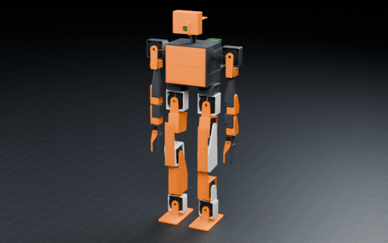
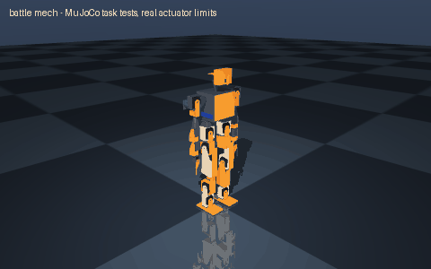

# battle mech

> Create a humanoid battle mech with two 7 DOF arms, a head camera and an IMU

Interpreted as: humanoid battle mech · imu (base_link) · camera (neck_pan_link)

**Battle mech, 1.204 m, 23.05 kg, 30 DOF (7-DOF arms + grippers), 170 min, $16183 of parts**

Parts cost **$16664.31** · printed structure 52 parts, 6550 g · checks passed 133/133

## What it can do

| | |
|---|--:|
| average power w | 125.5 |
| com height m | 0.659 |
| com x over sole mm | -27.3 |
| mass kg | 23.055 |
| height m | 1.204 |
| hip height m | 0.74 |
| dof | 30 |
| arm dof | 7 |
| payload per hand kg | 0.5 |
| leg actuators | CubeMars AK60-6 V3.0 KV80 / CubeMars AK80-64 KV80 / CubeMars AK70-10 KV100 |
| arm actuators | CubeMars AK70-10 KV100 / DYNAMIXEL XM430-W350-T(R) / DYNAMIXEL XH540-W270-T(R) |
| runtime min | 170 |
| cost usd | 16183.14 |
| sensors | camera, imu |

## Actuators (sized from this robot's own loads)

| Joint | Actuator | Needs (peak) N·m | Rated / peak N·m | Margin | Speed loaded rad/s |
|---|---|--:|--:|--:|--:|
| l_hip_yaw | cubemars_ak60_6 | 4.743 | 3 / 9 | 1.9x | 51.313 |
| l_hip_roll | cubemars_ak80_64 | 50.455 | 48 / 120 | 2.38x | 5.027 |
| l_hip_pitch | cubemars_ak80_64 | 64.308 | 48 / 120 | 1.87x | 5.027 |
| l_knee | cubemars_ak80_64 | 61.543 | 48 / 120 | 1.95x | 5.027 |
| l_ankle_pitch | cubemars_ak80_64 | 31.779 | 48 / 120 | 3.78x | 5.027 |
| l_ankle_roll | cubemars_ak70_10 | 13.435 | 8.3 / 24.8 | 1.85x | 32.463 |
| r_hip_yaw | cubemars_ak60_6 | 4.743 | 3 / 9 | 1.9x | 51.313 |
| r_hip_roll | cubemars_ak80_64 | 50.455 | 48 / 120 | 2.38x | 5.027 |
| r_hip_pitch | cubemars_ak80_64 | 64.308 | 48 / 120 | 1.87x | 5.027 |
| r_knee | cubemars_ak80_64 | 61.543 | 48 / 120 | 1.95x | 5.027 |
| r_ankle_pitch | cubemars_ak80_64 | 31.779 | 48 / 120 | 3.78x | 5.027 |
| r_ankle_roll | cubemars_ak70_10 | 13.435 | 8.3 / 24.8 | 1.85x | 32.463 |
| l_shoulder_pitch | cubemars_ak70_10 | 7.546 | 8.3 / 24.8 | 3.29x | 32.463 |
| l_shoulder_roll | cubemars_ak70_10 | 7.547 | 8.3 / 24.8 | 3.29x | 32.463 |
| l_upper_arm_yaw | dxl_xm430_w350 | 0.104 | 1.23 / 4.1 | 39.35x | 4.817 |
| l_elbow | dxl_xh540_w270 | 3.477 | 2.97 / 9.9 | 2.85x | 4.084 |
| l_wrist_yaw | dxl_xm430_w350 | 0.125 | 1.23 / 4.1 | 32.82x | 4.817 |
| l_wrist_pitch | dxl_xh540_w270 | 1.876 | 2.97 / 9.9 | 5.28x | 4.084 |
| l_wrist_roll | dxl_xm430_w350 | 0.146 | 1.23 / 4.1 | 28.14x | 4.817 |
| l_gripper | dxl_xm430_w350 | 0.006 | 1.23 / 4.1 | 99x | 4.817 |
| r_shoulder_pitch | cubemars_ak70_10 | 7.539 | 8.3 / 24.8 | 3.29x | 32.463 |
| r_shoulder_roll | cubemars_ak70_10 | 7.539 | 8.3 / 24.8 | 3.29x | 32.463 |
| r_upper_arm_yaw | dxl_xm430_w350 | 0.105 | 1.23 / 4.1 | 39.05x | 4.817 |
| r_elbow | dxl_xh540_w270 | 3.474 | 2.97 / 9.9 | 2.85x | 4.084 |
| r_wrist_yaw | dxl_xm430_w350 | 0.125 | 1.23 / 4.1 | 32.71x | 4.817 |
| r_wrist_pitch | dxl_xh540_w270 | 1.875 | 2.97 / 9.9 | 5.28x | 4.084 |
| r_wrist_roll | dxl_xm430_w350 | 0.146 | 1.23 / 4.1 | 28.14x | 4.817 |
| r_gripper | dxl_xm430_w350 | 0.006 | 1.23 / 4.1 | 99x | 4.817 |
| neck_pan | dxl_xl430_w250 | 0 | 0.42 / 1.4 | 99x | 5.969 |
| neck_tilt | dxl_xm430_w350 | 0.847 | 1.23 / 4.1 | 4.84x | 4.817 |

## Engineering checks

All 133 checks pass (torque, speed, power, stability, print-bed fit). Details in `robot.json` → `metadata.design.checks`.

## Assumptions and limits

- Joint limits trimmed to the collision-free range found by exact solid sweeps: l_hip_roll [-0.45, 0.45] -> [-0.07, 0.45]; l_hip_pitch [-1.60, 1.60] -> [-0.84, 1.60]; l_knee [-2.20, 2.20] -> [-2.04, 0.31]; r_hip_roll [-0.45, 0.45] -> [-0.45, 0.07]; r_hip_pitch [-1.60, 1.60] -> [-1.60, 0.84]; r_knee [-2.20, 2.20] -> [-0.31, 2.04]; l_shoulder_roll [-1.60, 1.60] -> [-0.04, 1.60]; l_elbow [-2.30, 2.30] -> [-2.30, 2.18]; l_wrist_pitch [-1.60, 1.60] -> [-1.60, 1.27]; r_shoulder_roll [-1.60, 1.60] -> [-1.60, 0.04]; r_elbow [-2.30, 2.30] -> [-2.18, 2.30]; r_wrist_pitch [-1.60, 1.60] -> [-1.27, 1.60]; neck_tilt [-0.70, 0.70] -> [-0.70, 0.57].
- Joint ranges are swept with the arms held 0.35 rad out to the side (the walking posture); with the arms hanging straight the hands touch the thighs when a leg abducts or a wrist turns.
- CubeMars actuators run on a 12S bus (two 6S packs in series, 44.4 V nominal) at their 48 V ratings; DYNAMIXEL arms and the computer run from the 12 V DC-DC converter.
- Zero joint angles are the standing pose (knees bent 0.25 rad, soles flat); the base origin is on the hip-yaw output plane.
- Leg loads are J^T F at the sole with the whole robot on one foot and the centre of pressure anywhere on the central 60 % of the sole, over squat / lean / step poses, ±10 % traction, x 1.3 dynamic factor; continuous duty checked at 71 % of the worst stance load (RMS over a gait cycle with half of it in stance).
- Soles carry a 2 mm rubber pad (silicone / neoprene sheet, glued) as the contact patch.
- Arm loads are exact gravity torques with the payload in each hand, arms stretched forward, sideways and rolled.
- Research-grade biped: it cannot walk, or even stand reliably, without a whole-body balance controller (torque-controlled QDD legs, IMU feedback, e.g. MPC or an RL policy). Armour panels are thin cosmetic shells with no structural role; their mass is counted.

<!-- SIM -->
## Simulation (MuJoCo, real actuator limits)

**3/3 task tests pass.** Every motor is limited to its datasheet peak torque and its torque-speed line, with the rotor inertia reflected through its gearbox; continuous loads are compared with the rated torque. The animation below is recorded from these tests.

| | Test | Result |
|---|---|---|
| ➖ | stand free | informational (no balance controller; a biped is not statically stable): base z 0.745 -> 0.739 m (creep after settling 0.7 mm), upright 0.999; worst leg joint r_knee at 0.10x rated |
| ✅ | stand rail | on a vertical guide rail (balance removed, full weight on the legs): base z 0.745 -> 0.740 m (creep after settling 0.1 mm), upright 1.000; worst leg joint l_knee at 0.03x rated |
| ✅ | single leg rail | one leg (l_hip_yaw chain) carrying the full body weight on the rail, the other legs out of contact: base z 0.745 -> 0.740 m (creep after settling 0.1 mm), upright 1.000; worst leg joint l_knee at 0.06x rated |
| ✅ | squat rail | on the rail: commanded body drop 148 mm (20 % of 741 mm leg), achieved 152 mm, back up to 152 mm above the low point, upright 1.000 |

_PASS means the modelled actuators (datasheet peak torque as a hard limit, a linear torque-speed line to no-load speed, reflected rotor inertia, URDF damping/friction) can produce the torques and speeds the task needs in this geometry and mass distribution, and that mean torque over the hold stays within the continuous (rated) torque. Joint control uses an ideal model-based feedforward (computed torque) through the force-limited servo for fixed-base robots and plain position servos for floating robots; a pass therefore proves torque/speed capacity, not that a given controller achieves it. Untested: thermal limits over long duty cycles (only the mean-vs-rated proxy), gearbox backlash and compliance, link and joint flexibility, encoder resolution, supply voltage sag and current limits, bus latency, controller tuning, and contact/friction values (nominal friction only)._
<!-- /SIM -->

## Files

| File | What |
|---|---|
| `robot.urdf`, `meshes/` | URDF with real component and printed-part meshes, datasheet effort/velocity limits |
| `BOM.md`, `bom.json` | every part to buy, with supplier links and prices |
| `WIRING.md`, `wiring.svg` | power budget per rail, battery runtime, regulator heat, logic levels, pin-to-pin table, cut list, slack at each joint, cable diagram |
| `schematic.svg`, `schematic.pdf`, `breadboard.svg` | schematic with reference designators, power symbols and net labels; picture view with every wire in its colour |
| `robot.cad.zip` | build package: printable STLs, print list, bought-part models, assembly order |
| `robot.ros2.zip` | ROS 2 description package (ros2_control, MoveIt config, Gazebo launch) |
| `robot.training.zip` | MuJoCo / RL training scaffold |
| `simulation_report.json`, `simulation.gif` | MuJoCo task tests under the real actuator limits |
| `studio.gif` | Cycles render of a physics motion loop: every link where MuJoCo put it, the harness on its real routes |
