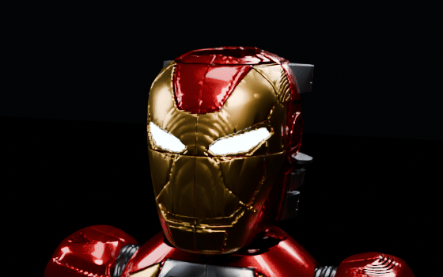
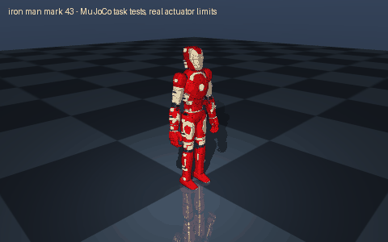

# iron man mark 43

> Build me a movie-accurate wearable Iron Man Mark 43 suit from Age of Ultron with all the small polygon armour plates that open and close, repulsors, a HUD and an IMU. Budget $60000

Interpreted as: Iron Man Mark 43 wearable suit · budget $60000

**Iron Man Mark 43 (full wearable suit): 362 printed pieces, 8.6 kg filament, motorised faceplate, $528 incl. filament**

Parts cost **$564.95** (budget $60000: within) · printed structure 362 parts, 7929 g · checks passed 479/479

## What it can do

| | |
|---|--:|
| tier | suit |
| tier label | full wearable suit |
| wearer height m | 1.75 |
| printed pieces | 362 |
| armour mass kg | 8.85 |
| filament kg | 8.56 |
| cost usd | 527.9 |
| mass kg | 9.95 |

## Actuators (sized from this robot's own loads)

| Joint | Actuator | Needs (peak) N·m | Rated / peak N·m | Margin | Speed loaded rad/s |
|---|---|--:|--:|--:|--:|
| faceplate | hobby_mg90s | 0.13 | 0.1294 / 0.4314 | 3.32x | 13.09 |
| back_door_left_hinge | hobby_ds3218 | 0.534 | 0.559 / 1.863 | 3.49x | 7.48 |
| back_door_right_hinge | hobby_ds3218 | 0.212 | 0.559 / 1.863 | 8.78x | 7.48 |
| helmet_door_left_hinge | hobby_mg90s | 0.049 | 0.055 / 0.183 | 3.7x | 13.09 |
| helmet_door_right_hinge | hobby_mg90s | 0.044 | 0.055 / 0.183 | 4.2x | 13.09 |
| left_upper_arm_door_hinge | hobby_mg996r | 0.096 | 0.284 / 0.948 | 9.88x | 7.48 |
| right_upper_arm_door_hinge | hobby_mg996r | 0.096 | 0.284 / 0.948 | 9.89x | 7.48 |
| left_forearm_door_hinge | hobby_mg996r | 0.082 | 0.284 / 0.948 | 11.61x | 7.48 |
| right_forearm_door_hinge | hobby_mg996r | 0.082 | 0.284 / 0.948 | 11.6x | 7.48 |
| left_thigh_door_hinge | hobby_mg996r | 0.124 | 0.284 / 0.948 | 7.66x | 7.48 |
| right_thigh_door_hinge | hobby_mg996r | 0.124 | 0.284 / 0.948 | 7.67x | 7.48 |
| left_shin_door_hinge | hobby_mg996r | 0.073 | 0.284 / 0.948 | 13.06x | 7.48 |
| right_shin_door_hinge | hobby_mg996r | 0.073 | 0.284 / 0.948 | 13.07x | 7.48 |

## Engineering checks

All 479 checks pass (torque, speed, power, stability, print-bed fit). Details in `robot.json` → `metadata.design.checks`.

## Assumptions and limits

- armour shape from: suit: designed directly by scripts/forge_mark43.py from reference photos of the movie suit; 3 mm walls, 2 mm faceplate, 15 % gyroid infill (shells are mostly walls)
- filament at $22/kg, 8 % waste
- the suit is worn armour over a black undersuit: the wearer moves every joint; nothing powers the limbs (hobby servos cannot move a person); the servos only open and close the doors
- the wearer is an average adult male body at 1.75 m and the pieces scale evenly with height; check against your own measurements before printing
- gaps at the groin, armpits and elbows are cut on purpose so the joints move; the undersuit shows through them, as on real builds
- cable channels are 7 to 10 mm deep on the inside of the shells and the latch servos stand up to 31 mm off them: there is no body model, so their room against a real wearer is not checked; fit the suit before bonding them
- NOTHING HERE HAS BEEN BUILT OR TESTED. Door torques, the clutch setting, pawl strength and pinch force are calculations with estimated inputs; none has been measured on hardware
- gloves and boots are not part of the opening: their mouths are smaller than a hand or a foot, so they are put on separately and are not designed to come on through the suit

## Prompt notes

- not applied: imu: the Iron Man Mark 43 wearable suit design has no mount for it yet

<!-- SIM -->
## Simulation (MuJoCo, real actuator limits)

<<<<<<< HEAD
**2/2 task tests pass.** Every motor is limited to its datasheet peak torque and its torque-speed line, with the rotor inertia reflected through its gearbox; continuous loads are compared with the rated torque. The animation below is recorded from these tests.
=======
**1/1 task tests pass.** Every motor is limited to its datasheet peak torque and its torque-speed line, with the rotor inertia reflected through its gearbox; continuous loads are compared with the rated torque. The animation below is recorded from these tests.
>>>>>>> 866c2a5 (WALL-E print fixes, Mark 43 film framed on the helmet, docs)

| | Test | Result |
|---|---|---|
| ✅ | open and hold | opens faceplate to -0.95 rad (target -0.95), helmet_door_left_hinge to -1.326 rad (target -1.326), latch_helmet_left_0_pawl to 0.19 rad (target 0.19), helmet_door_right_hinge to 1.326 rad (target 1.326), left_forearm_door_hinge to -1.326 rad (target -1.326), latch_left_forearm_0_pawl to -0.19 rad (target -0.19), left_upper_arm_door_hinge to -1.326 rad (target -1.326), latch_left_upper_arm_0_pawl to -0.19 rad (target -0.19), left_shin_door_hinge to -1.326 rad (target -1.326), latch_left_shin_0_pawl to -0.19 rad (target -0.19), left_thigh_door_hinge to -1.326 rad (target -1.326), latch_left_thigh_0_pawl to -0.19 rad (target -0.19), right_forearm_door_hinge to 1.326 rad (target 1.326), latch_right_forearm_0_pawl to 0.19 rad (target 0.19), right_upper_arm_door_hinge to 1.326 rad (target 1.326), latch_right_upper_arm_0_pawl to 0.19 rad (target 0.19), right_shin_door_hinge to 1.326 rad (target 1.326), latch_right_shin_0_pawl to 0.19 rad (target 0.19), right_thigh_door_hinge to 1.326 rad (target 1.326), latch_right_thigh_0_pawl to 0.19 rad (target 0.19), back_door_left_hinge to -1.327 rad (target -1.326), latch_back_left_0_pawl to 0.19 rad (target 0.19), latch_back_left_1_pawl to 0.19 rad (target 0.19), back_door_right_hinge to 1.327 rad (target 1.326) and holds 1.5 s |
| ✅ | doors open close | 12 doors open in 8 stages to 78 deg or more and close again: worst lag 0.0 deg at the end of a stage, 0.04 deg from shut at the end |

_PASS means the modelled actuators (datasheet peak torque as a hard limit, a linear torque-speed line to no-load speed, reflected rotor inertia, URDF damping/friction) can produce the torques and speeds the task needs in this geometry and mass distribution, and that mean torque over the hold stays within the continuous (rated) torque. Joint control uses an ideal model-based feedforward (computed torque) through the force-limited servo for fixed-base robots and plain position servos for floating robots; a pass therefore proves torque/speed capacity, not that a given controller achieves it. Untested: thermal limits over long duty cycles (only the mean-vs-rated proxy), gearbox backlash and compliance, link and joint flexibility, encoder resolution, supply voltage sag and current limits, bus latency, controller tuning, and contact/friction values (nominal friction only)._
<!-- /SIM -->

## Files

| File | What |
|---|---|
| `robot.urdf`, `meshes/` | URDF with real component and printed-part meshes, datasheet effort/velocity limits |
| `BOM.md`, `bom.json` | every part to buy, with supplier links and prices |
| `WIRING.md`, `wiring.svg` | power budget per rail, pin-to-pin table, cut list, slack at each joint, wiring diagram |
| `robot.cad.zip` | build package: printable STLs, print list, bought-part models, assembly order |
| `robot.ros2.zip` | ROS 2 description package (ros2_control, MoveIt config, Gazebo launch) |
| `robot.training.zip` | MuJoCo / RL training scaffold |
| `simulation_report.json`, `simulation.gif` | MuJoCo task tests under the real actuator limits |
| `studio.gif` | Cycles render of a physics motion loop: every link where MuJoCo put it, the harness on its real routes |
<<<<<<< HEAD

<!-- MANUAL_NOTES -->
## How it opens

**Nothing here has been built or tested. A person inside this is a safety matter: read "Before anyone gets inside" first.**

The suit opens from behind and only the servos move it. The back splits on its centre line, and the rear shells of the helmet, upper arms, forearms, thighs and shins swing out about 80 degrees on hinges along their flanks, so a person steps in and it closes round them. Every door is a revolute joint in `robot.urdf` on its own servo, whose output lies on the hinge line. `scripts/fit_doors.py` makes the hardware from the finished shells: a fixed leaf with two knuckles and a door leaf with one on an M4 pin at each hinge, a pod on the fixed half that holds the servo, an arm from the horn to the door, and a latch on the free edge.

Doors open a left and right pair at a time, always in this order, and close in reverse: forearm, shin, upper arm, thigh, back, helmet. On the back and the helmet the left door's pawl reaches behind the right door, so the right door moves first. The order matters: a door swept alone with its neighbours shut can be stopped by them (the `alone_deg` figures in `robot.json`), so the back doors must never be commanded before the arms and thighs are open. The order is in the design as `door_sequence`; no sketch is written for it yet.

Ranges are measured by `scripts/fit_doors.py` with exact intersection, every door swept in that order against all the armour, hardware and servos. Torques come from the spec's own masses and inertias: gravity with the suit 10 degrees off plumb, hinge pin friction, an estimated 0.03 N·m for the cable loop, and a 3 s swing. Stall is read at the 5 V rail.

| Door | Servo | Range deg | Mass kg | Inertia kg m2 | Hold N·m | Peak N·m | Stall N·m | Clutch N·m | Edge force N |
|---|---|--:|--:|--:|--:|--:|--:|--:|--:|
| back door left | DS3218 | 80 | 0.90 | 0.0197 | 0.516 | 0.534 | 1.863 | 0.69 | 2.8 |
| back door right | DS3218 | 80 | 0.41 | 0.0066 | 0.206 | 0.212 | 1.863 | 0.28 | 1.1 |
| helmet door left | MG90S | 80 | 0.10 | 0.0006 | 0.049 | 0.049 | 0.183 | 0.06 | 0.5 |
| helmet door right | MG90S | 80 | 0.08 | 0.0004 | 0.043 | 0.044 | 0.183 | 0.06 | 0.4 |
| left upper arm door | MG996R | 80 | 0.26 | 0.0021 | 0.094 | 0.096 | 0.948 | 0.12 | 0.9 |
| right upper arm door | MG996R | 80 | 0.26 | 0.0021 | 0.094 | 0.096 | 0.948 | 0.12 | 0.9 |
| left forearm door | MG996R | 80 | 0.22 | 0.0016 | 0.080 | 0.082 | 0.948 | 0.11 | 0.8 |
| right forearm door | MG996R | 80 | 0.22 | 0.0016 | 0.080 | 0.082 | 0.948 | 0.11 | 0.8 |
| left thigh door | MG996R | 80 | 0.41 | 0.0056 | 0.119 | 0.124 | 0.948 | 0.16 | 0.9 |
| right thigh door | MG996R | 80 | 0.41 | 0.0056 | 0.118 | 0.124 | 0.948 | 0.16 | 0.9 |
| left shin door | MG996R | 80 | 0.28 | 0.0022 | 0.071 | 0.073 | 0.948 | 0.09 | 0.7 |
| right shin door | MG996R | 80 | 0.28 | 0.0022 | 0.070 | 0.073 | 0.948 | 0.09 | 0.7 |

Shutting: a sprung pawl per door (two on the back) hooks a ledge on the door, and stays shut with no power. Opening by hand: a cord on every pawl, and a ball-detent clutch between each horn and its arm that slips at the figure above, so a door swings by hand with the servo dead. The clutch also limits how hard a closing door can press. A backup strap goes over each door below the neck. Pawls, ledges, hinges, pods and arms are modelled solids; the springs, cords, clutch plungers and the slot that should let a servo lift a pawl without holding it are bought or detail parts, listed and calculated but not drawn.

Cables: the battery bay rides on the left back door, clear of the centre seam. Its leads cross that one hinge in a service loop and run on in channels on the fixed halves. Two PCA9685 boards sit in the hollow of the waist on the fixed half, so no limb's servo lead crosses a door. Door servos have their own 5 V regulator.

## Before anyone gets inside

All of this is a design on a computer. None of it has been printed, assembled, powered or worn. The clutch, pawl spring, shear strength, pinch force, hinge bond and cable stiffness are calculations or estimates. Before a person gets in:

- Print one door and test it on the bench: hinge leaf bond to the shell, pawl load to failure, clutch slip torque, measured closing force at the edge against a load cell, with a soft dummy limb in the gap.
- Test every door's hand release with the power off, with the door loaded, and from the wearer's position. Rigid gloves cannot work a cord: a second person who can open the suit from outside must be there every time. Never wear it alone.
- Run the opening sequence empty, many times, including a brown-out and a Nano reset in the middle. Add a hardware stop or interlock so a back door cannot move before the arm doors, and an emergency stop the helper can reach.
- Fit a real person: there is no body model, the waist inside the shell is about 234 x 180 mm, and latch servos stand up to 31 mm off the inner faces, worst on the forearms. It will not fit many adults as it stands. Gloves and boots are not designed to come on through the suit.
- Check heat and breathing: the helmet has no ventilation design. A person in a closed printed shell can overheat; the helmet's mask must lift by hand, and should be tested the same way.
- Keep fingers, hair and undersuit clear of every seam while a door moves. The doors have no sensing: nothing stops them for a person except the clutch.
<!-- /MANUAL_NOTES -->
=======
>>>>>>> 866c2a5 (WALL-E print fixes, Mark 43 film framed on the helmet, docs)
