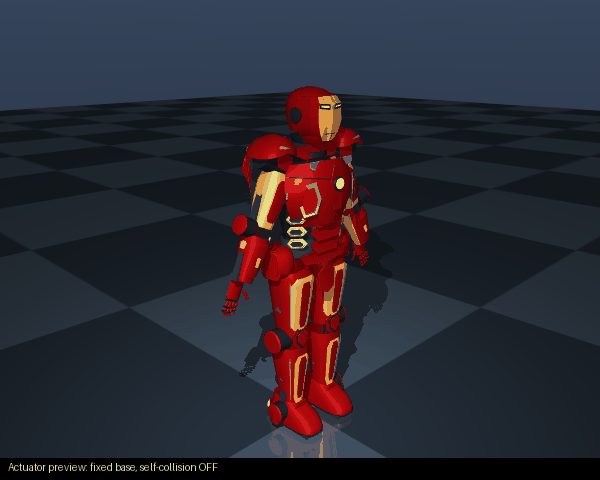
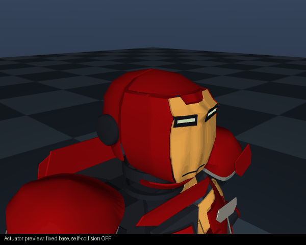
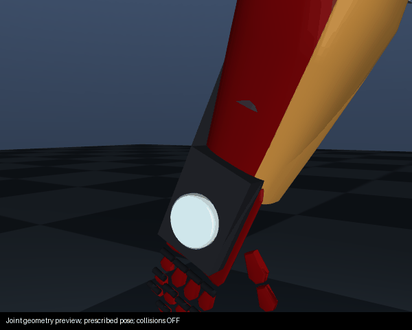
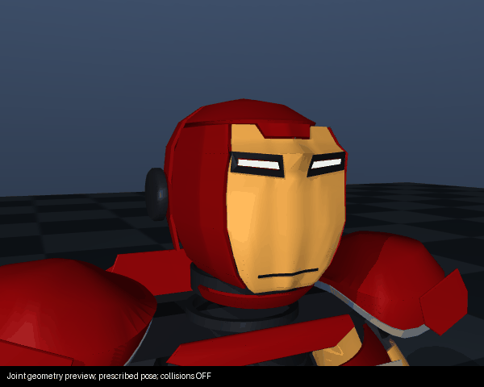
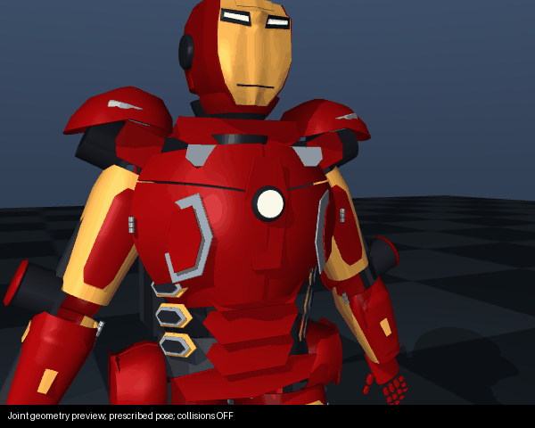
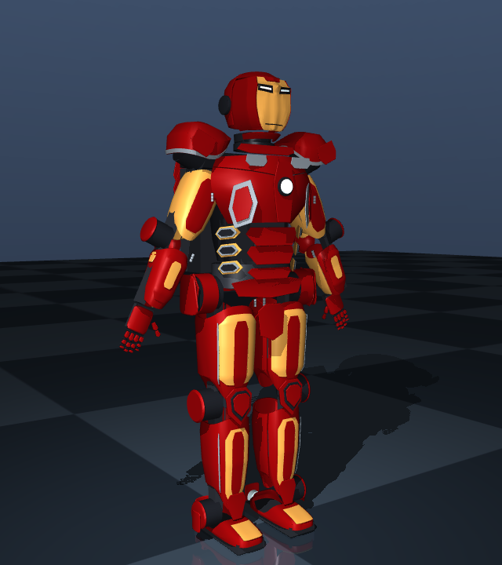
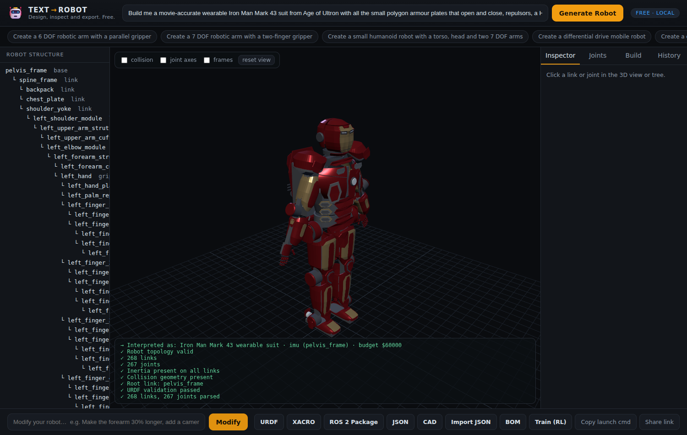
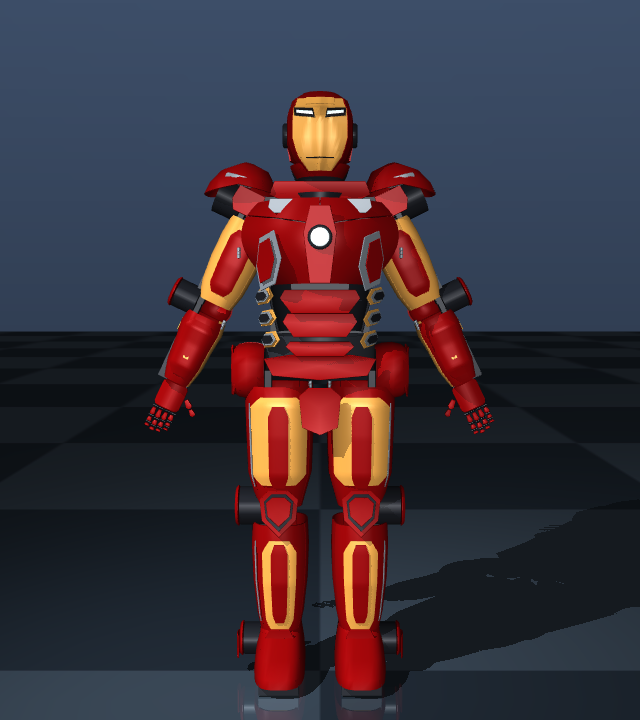
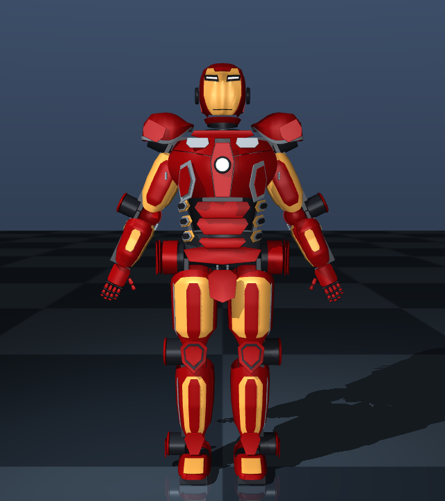
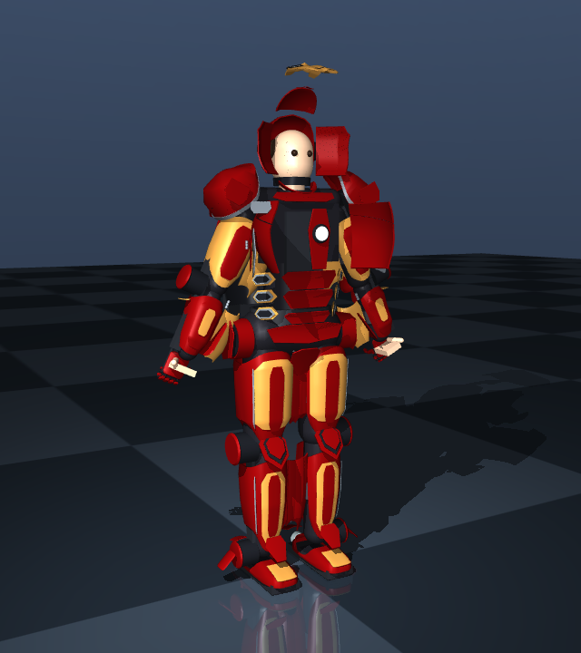

# iron_man_mark_43

Prompt: Build me a movie-accurate wearable Iron Man Mark 43 suit from Age of Ultron with all the small polygon armour plates that open and close, repulsors, a HUD and an IMU. Budget $60000


Collision model: **compound convex meshes and URDF primitives**.

This GIF runs gravity, pose holding and self-collision on the shipped model. It is
not a learned policy or proof of hardware accuracy. The model's failures remain visible.

## Download and inspect

- [CAD / STL / OpenSCAD](robot.cad.zip), [ROS 2 package](robot.ros2.zip), [training package](robot.training.zip), [URDF](robot.urdf), [robot JSON](robot.json), [BOM](BOM.md).
- [Simulation report](simulation_report.json): **4/6** checks;
  **0** initial penetration contacts.
- Failed checks: actuator_sweep, disturbance_recovery.
- [Physical build evidence and missing interfaces](BUILDABILITY.md), [machine-readable record](buildability_report.json). **No tested physical build is documented.**

## Design research

[Public engineering sources and model-specific changes](../../references/engineering/README.md).

## MoveIt / ROS 2

[Browse the generated MoveIt configuration](moveit/) (SRDF, KDL, OMPL, controllers).
Unzip the ROS package into a workspace's `src/` directory, then:

```bash
source /opt/ros/jazzy/setup.bash
rosdep install --from-paths src --ignore-src -r -y
colcon build
source install/setup.bash
ros2 launch iron_man_mark_43 move_group.launch.py
```

The launch uses mock hardware. Planning requires a collision-free start state.
The fixed-root planner is not a walking controller or a simulation bridge.

[Recorded MoveIt runtime result](moveit_report.json).

## Reproduce

From the repository root:

```bash
node scripts/export_examples.ts
python scripts/audit_examples.py
python scripts/render_example_gifs.py
python scripts/document_examples.py
python scripts/verify_example_artifacts.py
```

These are procedural concept models. Masses, motors and contacts are approximate;
manufacturing interfaces and measured dynamics remain unverified.

## Current armour and helmet animations




### Individual joint checks





These three close-ups prescribe joint positions on the exported meshes, with
collision resolution disabled. They verify the joint tree, not actuator forces
or safe motion. [Source-hashed articulation report](articulation_report.json).
Each finger has three flexion joints; each thumb has two. The neck has yaw and
pitch, and the chest inlays now move with their chest doors. Fixed trim is meant
to move with its supporting plate, not have an independent motor.


These two previews use a **fixed base and self-collision disabled** to show the
actuated geometry. They do not validate donning or motion clearance. The first
GIF and simulation report above use self-collision enabled.

[MoveIt runtime result](moveit_report.json): controllers and planning scene start,
with a collision-free neutral state. Small neck and left/right arm goals plan and
execute through mock control; this does not validate the whole motion range or
real motors. [Left arm](moveit_left_arm_report.json), [right arm](moveit_right_arm_report.json).
An initial five-second right-arm request [timed out](moveit_right_arm_timeout.json)
while other audits were running; a subsequent request succeeded. This is not a
planning reliability benchmark. [Wearer fit](wearability_report.json)
also fails. [Production references and downloaded design research](../../references/mark43/RESEARCH.md)
record the sources and limitations. [Visual comparison](../../docs/MARK43_VISUAL_REVIEW.md).

The current revision separates helmet seams and adds the red forehead insert,
reshapes shoulders and boot uppers, and cuts limb-shell ends around joint motors.
Surface-following boot/forearm trim replaces intersecting badges. Rear details
follow their flight flaps. Internal struts have clearance at their connector ends.

[Surface-contact comparison](surface_contact_comparison.json): **81 → 0**
non-adjacent intersecting pairs at neutral. No new neutral pairs were introduced.
This tests visual triangle surfaces with tessellated primitives; it is not a
penetration-depth, full-containment or wearer-fit measurement.
The chest doors have a clearance seam around the fixed sternum. The lower helmet
shroud follows yaw while pitch moves inside it; the fixed ring keeps its mounting
plane with 12 mm relieved from the top. The red collar plate is 8 mm lower.
The helmet position, neck limits and 140 mm ring bore are unchanged. Its closed
head-entry failure remains in the wearer report.

Eight limb clamshells now open away from their own cuffs and outer shells over
the original 1.4 rad travel. Each has 61 regression samples. In the standing pose,
large openings still strike neighbouring body parts; this is not a donning sequence.
The compound sweep has more failing poses than before the direction correction;
clearing each panel's own cuff does not establish a safe full-body opening path.

| Audit | Poses including neutral | Failing moving samples |
|---|---:|---:|
| [Seven selected joints](surface_contact_report.json) | 428 | 0 |
| [Combined neck yaw/pitch grid](neck_motion_report.json) | 962 | 0 |
| [Every limited joint, independently](all_joint_surface_report.json) | 1119 | 295 |
| [Compound collision audit](motion_clearance_report.json) | 775 | 159 |

These are different sampling grids and collision representations, not comparable
accuracy scores. Passing the neck grid does not validate the other joints,
continuous motion, a wearer insertion path or a physical mechanism.

Reproduce the full surface sweep and combined neck check:

```bash
python scripts/audit_surface_contacts.py examples/14_iron_man_mark_43/robot.sim.urdf --all-joints --samples 13 --json /tmp/all-joints.json
python scripts/audit_surface_contacts.py examples/14_iron_man_mark_43/robot.sim.urdf --joints neck_yaw neck_pitch --grid --samples 31 --json /tmp/neck.json
```

The main physics GIF and smoke report use the source-checked compound collision
archive, with self-collision enabled. The old box approximation fills hollow armour
and creates false collisions; its diagnostic remains in [clearance_report.json](clearance_report.json)
for comparison. Compound hulls are still approximations; their errors are reported.

## Model detail and audit status





The model contains **268 links, 232 mesh instances using 216 unique STL files and
86 actuated joints**. Each finger has three articulated segments, each thumb has
two, and the helmet has neck yaw and pitch. Chest inlays follow their opening
doors. Thigh, shin and arm trim follows the underlying shell surface.

### Visual reference

Shapes are compared against [Legacy Effects' Avengers: Age of Ultron production
references](https://www.legacyefx.com/avengersaou) and a licensed collectible
reference. The [visual review](../../docs/MARK43_VISUAL_REVIEW.md) compares specific
shapes with front and rear views. **This is not movie-accurate yet.** Chest
continuity, helmet topology, rib placement, hand anatomy and exposed drive modules
remain visible differences, and no visual accuracy percentage is claimed.
Reference photographs are cached locally and checked against saved iterations; see
the [reference workflow](../../references/mark43/README.md) and
[research notes](../../references/mark43/RESEARCH.md).

### Check summary

| Check | Current evidence |
|---|---|
| Closed mesh topology and mass integrals | 232/232 mesh instances pass |
| Empty-suit smoke battery, self-collision off | 3/5; tracking and disturbance recovery fail |
| Suit with passive mannequin, human/self-contact disabled | See [loaded physics report](mujoco_report_wearer.json); actuator tracking fails |
| Compound-convex initial collision | Zero initial contacts; not full-range or human clearance |
| Collision-enabled smoke battery, compound model | 4/6; actuator tracking and disturbance recovery fail |
| Joint-range clearance | Interference remains; see the audit table above |
| ROS 2 Jazzy / MoveIt | Zero neutral contacts; small neck and both arm goals plan and execute with mock control |
| Wearer fit | Example measurements fail opening/clearance checks |
| Breathing, structural strength, real hardware | Unverified |

Neutral surface intersections went from **81 to 0** and native MoveIt contacts from
**85 to 0** ([before/after evidence](surface_contact_comparison.json)). The combined
chest/neck [coordinated path](../../docs/motion_paths/README.md) clears 121 samples;
the knee path intersects at 45 of 51.

| Previous exported geometry | Current exported geometry |
|---|---|
|  |  |

Further reports: [physics](mujoco_report.json), [collision](clearance_report.json),
[motion clearance](motion_clearance_report.json), [suit MoveIt](moveit_report.json),
[arm MoveIt fixture](moveit_fixture_report.json),
[compound-convex model](robot.convex.zip), [preliminary BOM](BOM.md).

### Entry and breathing



Opening the panels does not establish that a person can enter. The closed pelvis
and neck openings fail straight-insertion checks against the illustrative wearer
dimensions, and static human-contact checks find interference in both open and
closed poses. These are proxy checks, not a continuous donning path or tissue
model. Measurements, separable frame interfaces, joint alignment and a manual
release system still need design and validation.

Decorative grilles and eye apertures do not establish breathable space. There is no
measured airflow, CO2, temperature, fan-duct design or emergency breathing
assessment; the wearer report leaves these unresolved.

### Regenerate the suit

```bash
node scripts/regen_mark43_example.ts
python3 scripts/audit_mark43.py --convex
python3 scripts/check_mesh_assets.py --json examples/14_iron_man_mark_43/mesh_quality_report.json
python3 scripts/render_mark43_review.py
ttr-mujoco test examples/14_iron_man_mark_43/robot.sim.urdf --self-collision
```

Regeneration invalidates reports and download bundles tied to old geometry. The
example audit rejects a stale compound collision archive, so run
`audit_mark43.py --convex` before `audit_examples.py`. Character references and
associated intellectual property belong to their respective owners.
