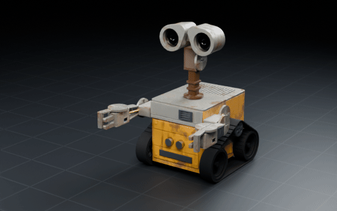
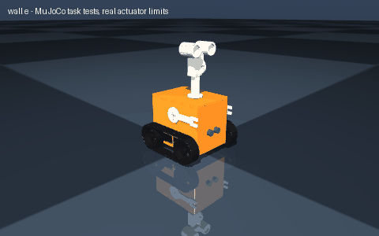

# wall e

> Build WALL-E: a tracked trash-compactor robot with a telescoping neck, binocular eyes and two gripper arms

Interpreted as: WALL-E character · range (body)

**Arduino WALL-E: TPU tracks on 4 TT motors, pan/tilt binocular head, two-joint arms with gripping hands, 1.17 kg, $100 of parts**

Parts cost **$119.83** · printed structure 21 parts, 582 g · checks passed 73/73

## What it can do

| | |
|---|--:|
| mass kg | 1.172 |
| top speed m s | 0.59 |
| runtime min | 87 |
| cost usd | 100.07 |
| height mm | 0 |
| tier | cheapest |
| tier label | Arduino WALL-E |
| turn rate rad s | 1.16 |
| turn slip factor | 3.26 |

## Actuators (sized from this robot's own loads)

| Joint | Actuator | Needs (peak) N·m | Rated / peak N·m | Margin | Speed loaded rad/s |
|---|---|--:|--:|--:|--:|
| neck_pan | hobby_sg90 | 0 | 0.0529 / 0.1765 | 176500x | 10.472 |
| neck_tilt | hobby_sg90 | 0.0537 | 0.0529 / 0.1765 | 3.28x | 10.472 |
| left_arm_lift | hobby_mg90s | 0.0689 | 0.0647 / 0.2157 | 3.13x | 13.09 |
| right_arm_lift | hobby_mg90s | 0.0689 | 0.0647 / 0.2157 | 3.13x | 13.09 |
| left_elbow | hobby_sg90 | 0.0308 | 0.0529 / 0.1765 | 5.72x | 10.472 |
| right_elbow | hobby_sg90 | 0.0308 | 0.0529 / 0.1765 | 5.72x | 10.472 |
| left_hand | hobby_sg90 | 0 | 0.0529 / 0.1765 | 176500x | 10.472 |
| right_hand | hobby_sg90 | 0 | 0.0529 / 0.1765 | 176500x | 10.472 |

## Engineering checks

All 73 checks pass (torque, speed, power, stability, print-bed fit). Details in `robot.json` → `metadata.design.checks`.

## Assumptions and limits

- Joint limits trimmed to the collision-free range found by exact solid sweeps: left_arm_lift [-1.00, 1.00] -> [-1.00, 0.49]; right_arm_lift [-1.00, 1.00] -> [-0.49, 1.00]; left_elbow [-1.50, 1.50] -> [-1.50, 1.25]; right_elbow [-1.50, 1.50] -> [-1.25, 1.50]; left_hand [-0.60, 0.60] -> [-0.01, 0.60]; right_hand [-0.60, 0.60] -> [-0.60, 0.01].
- tracks print in TPU 95A (flexible), everything else in PETG/PLA+; the body prints open side up without supports
- TT motor continuous torque taken as 30 % of the 0.8 kg.cm stall; a turn on the spot is a short transient above that (the tracks slide sideways), so spin in bursts on carpet or rubber floors
- prices are typical single-unit marketplace prices and vary by seller

## Prompt notes

- not applied: camera: the WALL-E character design has no mount for it yet

<!-- SIM -->
## Simulation (MuJoCo, real actuator limits)

**3/3 task tests pass.** Every motor is limited to its datasheet peak torque and its torque-speed line, with the rotor inertia reflected through its gearbox; continuous loads are compared with the rated torque. The animation below is recorded from these tests.

| | Test | Result |
|---|---|---|
| ✅ | drive straight | 2.33 m in 4.73 s, cruise speed 0.582 m/s vs claimed 0.590 m/s, heading drift 0.0 deg, lateral 0.0 cm |
| ✅ | ramp 10deg | from standstill on a 10 deg slope (speed ramped over 2.2 s at 0.5 m/s^2): 1.56 m uphill in 4.2 s, speed 0.548 m/s of 0.590 commanded |
| ✅ | turn in place | mean yaw rate 1.05 rad/s with 3.73 commanded (no-slip), claimed 1.16 rad/s (needs >= 0.99), centre moved 6.6 cm over 1.0 turn(s) (6.6 cm per turn) |

_PASS means the modelled actuators (datasheet peak torque as a hard limit, a linear torque-speed line to no-load speed, reflected rotor inertia, URDF damping/friction) can produce the torques and speeds the task needs in this geometry and mass distribution, and that mean torque over the hold stays within the continuous (rated) torque. Joint control uses an ideal model-based feedforward (computed torque) through the force-limited servo for fixed-base robots and plain position servos for floating robots; a pass therefore proves torque/speed capacity, not that a given controller achieves it. Untested: thermal limits over long duty cycles (only the mean-vs-rated proxy), gearbox backlash and compliance, link and joint flexibility, encoder resolution, supply voltage sag and current limits, bus latency, controller tuning, and contact/friction values (nominal friction only)._
<!-- /SIM -->

## Files

| File | What |
|---|---|
| `robot.urdf`, `meshes/` | URDF with real component and printed-part meshes, datasheet effort/velocity limits |
| `BOM.md`, `bom.json` | every part to buy, with supplier links and prices |
| `WIRING.md`, `wiring.svg` | power budget per rail, battery runtime, regulator heat, logic levels, pin-to-pin table, cut list, slack at each joint, cable diagram |
| `schematic.svg`, `schematic.pdf`, `breadboard.svg` | schematic with reference designators, power symbols and net labels; picture view with every wire in its colour |
| `robot.cad.zip` | build package: printable STLs, print list, bought-part models, assembly order |
| `robot.ros2.zip` | ROS 2 description package (ros2_control, MoveIt config, Gazebo launch) |
| `robot.training.zip` | MuJoCo / RL training scaffold |
| `simulation_report.json`, `simulation.gif` | MuJoCo task tests under the real actuator limits |
| `studio.gif` | Cycles render of a physics motion loop: every link where MuJoCo put it, the harness on its real routes |
