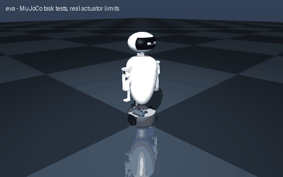

# eva

> Build EVA, a sleek hovering egg-shaped droid with a visor and two floating arms

Interpreted as: EVA character · imu (base_link) · camera (head)

**EVA-style companion robot: 3.352 kg, hidden diff-drive base, pan head with camera, two servo fins**

Parts cost **$622.22** · printed structure 35 parts, 1796 g · checks passed 50/51

## What it can do

| | |
|---|--:|
| mass kg | 3.352 |
| loaded mass kg | 3.352 |
| top speed m s | 1.24 |
| wheel torque nm | 0.188 |
| drive motor | pololu_37d_30to1_64cpr |
| battery | 1 x lipo_3s_2200 |
| average power w | 14.4 |
| runtime h | 1.35 |
| tip angle deg | 12.9 |
| compute | rpi5 |
| slope deg | 10 |
| turn rate rad s | 5.45 |
| turn slip factor | 1 |
| cost usd | 689 |
| cost breakdown | catalog parts $563, filament 2.07 kg $52, fasteners $14, fabricated/other $61 (Ø 236 x 3 mm aluminium disc deck, laser cut (~$30); 20 x 2 mm aluminium tube, 0.45 m (~$8); two 8-LED WS2812 sticks behind translucent eye diffusers (~$8); power switch, 15 A fuse, wiring) |

## Actuators (sized from this robot's own loads)

| Joint | Actuator | Needs (peak) N·m | Rated / peak N·m | Margin | Speed loaded rad/s |
|---|---|--:|--:|--:|--:|
| left_arm_shoulder_pitch | feetech_sts3215_c047 | 0.28 | 0.9807 / 2.942 | 10.52x | 4.48 |
| left_arm_elbow_pitch | feetech_sts3215_c047 | 0.082 | 0.9807 / 2.942 | 35.7x | 4.48 |
| right_arm_shoulder_pitch | feetech_sts3215_c047 | 0.28 | 0.9807 / 2.942 | 10.52x | 4.48 |
| right_arm_elbow_pitch | feetech_sts3215_c047 | 0.082 | 0.9807 / 2.942 | 35.7x | 4.48 |
| left_wheel_joint | pololu_37d_30to1_64cpr | 0.188 | 0.686 / 1.373 | 3.65x | 34.558 |
| right_wheel_joint | pololu_37d_30to1_64cpr | 0.188 | 0.686 / 1.373 | 3.65x | 34.558 |

## Engineering checks

- ❌ **stability:tip** — CoM -7, -3, 293 mm is 67 mm inside the support polygon; tips at 12.9 deg vs 12.9 deg (10 deg slope + braking), worst pose left_arm_shoulder_pitch=-1.57 with payload

## Assumptions and limits

- EVA cannot hover: this EVA rolls on a hidden differential-drive base (two 37D gearmotors, two ball casters) under a dark skirt; the egg rides on a 20 mm aluminium spine above it, so the gap reads as the film's hover.
- The egg body is four printed PETG shell segments (two bands, two halves) screwed to two printed ribs on the spine; the head is one print (230 x 200 x 150 mm) with a dark visor band and two LED eye diffusers.
- The head turns on a single pan servo; the film's free-floating head tilt is not reproduced. The arms are two-servo fins hanging beside the egg (they cannot fold flush into the body like the film's).
- The camera looks out through a 12 mm hole in the visor centre.

## Prompt notes

- warning: design check failed: stability:tip: CoM -7, -3, 293 mm is 67 mm inside the support polygon; tips at 12.9 deg vs 12.9 deg (10 deg slope + braking), worst pose left_arm_shoulder_pitch=-1.57 with payload

<!-- SIM -->
## Simulation (MuJoCo, real actuator limits)

**3/3 task tests pass.** Every motor is limited to its datasheet peak torque and its torque-speed line, with the rotor inertia reflected through its gearbox; continuous loads are compared with the rated torque. The animation above is recorded from these tests.

| | Test | Result |
|---|---|---|
| ✅ | drive straight | 3.44 m in 4.02 s, cruise speed 1.212 m/s vs claimed 1.240 m/s, heading drift -0.1 deg, lateral -0.4 cm |
| ✅ | ramp 10deg | from standstill on a 10 deg slope (speed ramped over 4.7 s at 0.5 m/s^2): 5.13 m uphill in 6.7 s, speed 1.198 m/s of 1.240 commanded |
| ✅ | turn in place | yaw rate 4.77 rad/s with 5.31 commanded (no-slip), claimed 5.45 rad/s (needs >= 4.63), centre moved 0.8 cm over 1.9 turn(s) (0.4 cm per turn) |

_PASS means the modelled actuators (datasheet peak torque as a hard limit, a linear torque-speed line to no-load speed, reflected rotor inertia, URDF damping/friction) can produce the torques and speeds the task needs in this geometry and mass distribution, and that mean torque over the hold stays within the continuous (rated) torque. Joint control uses an ideal model-based feedforward (computed torque) through the force-limited servo for fixed-base robots and plain position servos for floating robots; a pass therefore proves torque/speed capacity, not that a given controller achieves it. Untested: thermal limits over long duty cycles (only the mean-vs-rated proxy), gearbox backlash and compliance, link and joint flexibility, encoder resolution, supply voltage sag and current limits, bus latency, controller tuning, and contact/friction values (nominal friction only)._
<!-- /SIM -->

## Files

| File | What |
|---|---|
| `robot.urdf`, `meshes/` | URDF with real component and printed-part meshes, datasheet effort/velocity limits |
| `BOM.md`, `bom.json` | every part to buy, with supplier links and prices |
| `robot.cad.zip` | build package: printable STLs, print list, bought-part models, assembly order |
| `robot.ros2.zip` | ROS 2 description package (ros2_control, MoveIt config, Gazebo launch) |
| `robot.training.zip` | MuJoCo / RL training scaffold |
| `simulation_report.json` | MuJoCo task tests under the real actuator limits |
