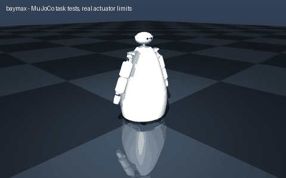

# baymax

> Build Baymax, an inflatable healthcare companion robot

Interpreted as: Baymax character · imu (base_link) · camera (head)

**Baymax-style service robot: 5.407 kg, 1.01 m tall, 4WD hidden base, two 4-servo arms, pan head with camera**

Parts cost **$880.93** · printed structure 29 parts, 1224 g · checks passed 53/53

## What it can do

| | |
|---|--:|
| mass kg | 5.407 |
| loaded mass kg | 5.407 |
| top speed m s | 1.24 |
| wheel torque nm | 0.152 |
| drive motor | pololu_37d_30to1_64cpr |
| battery | 1 x lipo_3s_2200 |
| average power w | 18.8 |
| runtime h | 1.04 |
| tip angle deg | 16.4 |
| compute | rpi5 |
| slope deg | 10 |
| turn rate rad s | 1.42 |
| turn slip factor | 2.67 |
| height m | 1.01 |
| cost usd | 1045 |
| cost breakdown | catalog parts $831, filament 1.41 kg $35, fasteners $19, fabricated/other $160 (380 x 290 x 3 mm 5052 aluminium deck, laser cut (~$64); 2020 aluminium extrusion, 0.75 m (~$9); 420 x 40 x 6 mm aluminium flat bar shoulder yoke (~$12); upper_arm fabric sleeve (in the cover kit); forearm fabric sleeve (in the cover kit); foam-filled fabric mitten on a printed wrist plate (in the cover kit); upper_arm fabric sleeve (in the cover kit); forearm fabric sleeve (in the cover kit); foam-filled fabric mitten on a printed wrist plate (in the cover kit); sewn white ripstop body cover with zip and foam lining, about 2 m^2 (~$60); power switch, 15 A fuse, wiring) |

## Actuators (sized from this robot's own loads)

| Joint | Actuator | Needs (peak) N·m | Rated / peak N·m | Margin | Speed loaded rad/s |
|---|---|--:|--:|--:|--:|
| left_arm_base_yaw | feetech_sts3215_c047 | 0.92 | 0.9807 / 2.942 | 3.2x | 3.5 |
| left_arm_shoulder_pitch | feetech_sts3250 | 1.973 | 1.5691 / 4.9033 | 2.49x | 4.86 |
| left_arm_elbow_pitch | feetech_sts3215_c047 | 0.839 | 0.9807 / 2.942 | 3.51x | 4.02 |
| left_arm_wrist_pitch | feetech_sts3215_c047 | 0.169 | 0.9807 / 2.942 | 17.39x | 4.48 |
| right_arm_base_yaw | feetech_sts3215_c047 | 0.92 | 0.9807 / 2.942 | 3.2x | 3.5 |
| right_arm_shoulder_pitch | feetech_sts3250 | 1.973 | 1.5691 / 4.9033 | 2.49x | 4.86 |
| right_arm_elbow_pitch | feetech_sts3215_c047 | 0.839 | 0.9807 / 2.942 | 3.51x | 4.02 |
| right_arm_wrist_pitch | feetech_sts3215_c047 | 0.169 | 0.9807 / 2.942 | 17.39x | 4.48 |
| left_front_wheel_joint | pololu_37d_30to1_64cpr | 0.152 | 0.686 / 1.373 | 4.52x | 34.558 |
| left_rear_wheel_joint | pololu_37d_30to1_64cpr | 0.152 | 0.686 / 1.373 | 4.52x | 34.558 |
| right_front_wheel_joint | pololu_37d_30to1_64cpr | 0.152 | 0.686 / 1.373 | 4.52x | 34.558 |
| right_rear_wheel_joint | pololu_37d_30to1_64cpr | 0.152 | 0.686 / 1.373 | 4.52x | 34.558 |

## Engineering checks

All 53 checks pass (torque, speed, power, stability, print-bed fit). Details in `robot.json` → `metadata.design.checks`.

## Assumptions and limits

- Baymax's inflatable vinyl body is a sewn ripstop cover with a foam-lined zip, bought or sewn, with negligible structural role; it hangs on the shoulder yoke and hides a 4WD skid-steer base. It is not inflated, so it does not cushion like the film's.
- Structure: 2020 aluminium extrusion spine and a 6 mm aluminium shoulder yoke; arms are four servos each (shoulder yaw, shoulder pitch, elbow, wrist) splayed 25 deg so they clear the belly; the hands are printed mittens covered with the same fabric.
- Each arm is sized as mounted to lift 0.1 kg in the mitten at full reach; the tipping check includes both arms stretched forward with that payload.
- The head turns on one pan servo; a camera looks out between the eyes through a 12 mm hole.

<!-- SIM -->
## Simulation (MuJoCo, real actuator limits)

**3/3 task tests pass.** Every motor is limited to its datasheet peak torque and its torque-speed line, with the rotor inertia reflected through its gearbox; continuous loads are compared with the rated torque. The animation above is recorded from these tests.

| | Test | Result |
|---|---|---|
| ✅ | drive straight | 3.44 m in 4.01 s, cruise speed 1.213 m/s vs claimed 1.240 m/s, heading drift -0.0 deg, lateral -0.0 cm |
| ✅ | ramp 10deg | from standstill on a 10 deg slope (speed ramped over 4.7 s at 0.5 m/s^2): 5.15 m uphill in 6.7 s, speed 1.201 m/s of 1.240 commanded |
| ✅ | turn in place | yaw rate 1.62 rad/s with 3.63 commanded (no-slip), claimed 1.42 rad/s (needs >= 1.21), centre moved 2.0 cm over 1.0 turn(s) (2.0 cm per turn) |

_PASS means the modelled actuators (datasheet peak torque as a hard limit, a linear torque-speed line to no-load speed, reflected rotor inertia, URDF damping/friction) can produce the torques and speeds the task needs in this geometry and mass distribution, and that mean torque over the hold stays within the continuous (rated) torque. Joint control uses an ideal model-based feedforward (computed torque) through the force-limited servo for fixed-base robots and plain position servos for floating robots; a pass therefore proves torque/speed capacity, not that a given controller achieves it. Untested: thermal limits over long duty cycles (only the mean-vs-rated proxy), gearbox backlash and compliance, link and joint flexibility, encoder resolution, supply voltage sag and current limits, bus latency, controller tuning, and contact/friction values (nominal friction only)._
<!-- /SIM -->

## Files

| File | What |
|---|---|
| `robot.urdf`, `meshes/` | URDF with real component and printed-part meshes, datasheet effort/velocity limits |
| `BOM.md`, `bom.json` | every part to buy, with supplier links and prices |
| `robot.cad.zip` | build package: printable STLs, print list, bought-part models, assembly order |
| `robot.ros2.zip` | ROS 2 description package (ros2_control, MoveIt config, Gazebo launch) |
| `robot.training.zip` | MuJoCo / RL training scaffold |
| `simulation_report.json` | MuJoCo task tests under the real actuator limits |
