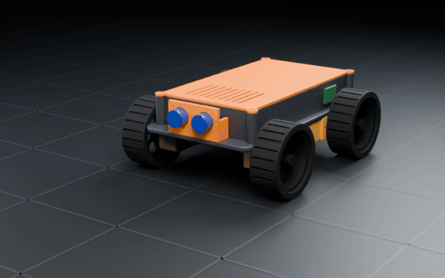
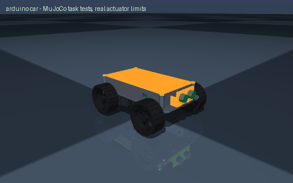

# arduino car

> An Arduino 4WD obstacle avoiding car with an ultrasonic sensor

Interpreted as: Arduino car (4WD) · range (sensor_bracket)

**Arduino car (stronger (4WD, ramps up to 10 deg)): 4WD on TT gear motors, 0.68 kg, 0.54 m/s, 99 min, $54 of parts**

Parts cost **$61.87** · printed structure 4 parts, 203 g · checks passed 38/38

## What it can do

| | |
|---|--:|
| tier | stronger |
| tier label | stronger (4WD, ramps up to 10 deg) |
| wheels | 4 |
| max slope deg | 10 |
| mass kg | 0.675 |
| top speed m s | 0.54 |
| runtime min | 99 |
| cost usd | 53.61 |
| controller | Arduino Nano compatible board (ATmega328P, CH340, USB-C) |
| length mm | 222 |
| width mm | 176 |
| turn rate rad s | 1.32 |
| turn slip factor | 2.74 |

## Engineering checks

All 38 checks pass (torque, speed, power, stability, print-bed fit). Details in `robot.json` → `metadata.design.checks`.

## Assumptions and limits

- TT motor continuous torque taken as 30 % of the 0.8 kg.cm stall (Adafruit #3777 data)
- prices are typical single-unit marketplace prices for generic modules and vary by seller

<!-- SIM -->
## Simulation (MuJoCo, real actuator limits)

**3/3 task tests pass.** Every motor is limited to its datasheet peak torque and its torque-speed line, with the rotor inertia reflected through its gearbox; continuous loads are compared with the rated torque. The animation below is recorded from these tests.

| | Test | Result |
|---|---|---|
| ✅ | drive straight | 2.27 m in 4.96 s, cruise speed 0.531 m/s vs claimed 0.540 m/s, heading drift 0.3 deg, lateral 0.3 cm |
| ✅ | ramp 10deg | from standstill on a 10 deg slope (speed ramped over 2.0 s at 0.5 m/s^2): 1.49 m uphill in 4.0 s, speed 0.525 m/s of 0.540 commanded |
| ✅ | turn in place | mean yaw rate 1.47 rad/s with 3.46 commanded (no-slip), claimed 1.32 rad/s (needs >= 1.12), centre moved 4.9 cm over 1.0 turn(s) (4.9 cm per turn) |

_PASS means the modelled actuators (datasheet peak torque as a hard limit, a linear torque-speed line to no-load speed, reflected rotor inertia, URDF damping/friction) can produce the torques and speeds the task needs in this geometry and mass distribution, and that mean torque over the hold stays within the continuous (rated) torque. Joint control uses an ideal model-based feedforward (computed torque) through the force-limited servo for fixed-base robots and plain position servos for floating robots; a pass therefore proves torque/speed capacity, not that a given controller achieves it. Untested: thermal limits over long duty cycles (only the mean-vs-rated proxy), gearbox backlash and compliance, link and joint flexibility, encoder resolution, supply voltage sag and current limits, bus latency, controller tuning, and contact/friction values (nominal friction only)._
<!-- /SIM -->

## Files

| File | What |
|---|---|
| `robot.urdf`, `meshes/` | URDF with real component and printed-part meshes, datasheet effort/velocity limits |
| `BOM.md`, `bom.json` | every part to buy, with supplier links and prices |
| `WIRING.md`, `wiring.svg` | power budget per rail, battery runtime, regulator heat, logic levels, pin-to-pin table, cut list, slack at each joint, cable diagram |
| `schematic.svg`, `schematic.pdf`, `breadboard.svg` | schematic with reference designators, power symbols and net labels; picture view with every wire in its colour |
| `robot.cad.zip` | build package: printable STLs, print list, bought-part models, assembly order |
| `robot.ros2.zip` | ROS 2 description package (ros2_control, MoveIt config, Gazebo launch) |
| `robot.training.zip` | MuJoCo / RL training scaffold |
| `simulation_report.json`, `simulation.gif` | MuJoCo task tests under the real actuator limits |
| `studio.gif` | Cycles render of a physics motion loop: every link where MuJoCo put it, the harness on its real routes |
