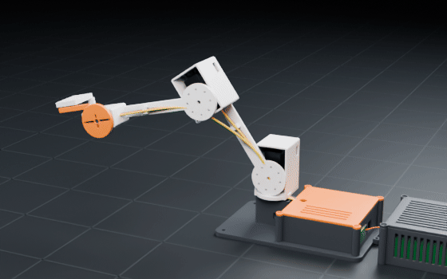
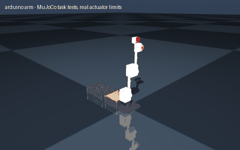

# arduino arm

> A cheap Arduino robot arm with a claw

Interpreted as: Arduino desk arm (3 DOF + claw)

**Arduino desk arm: 3 DOF + claw, 280 mm reach, 20 g payload, 0.82 kg, $50 of parts**

Parts cost **$63.54** · printed structure 9 parts, 377 g · checks passed 40/40

## What it can do

| | |
|---|--:|
| reach m | 0.28 |
| payload kg | 0.02 |
| mass kg | 0.818 |
| cost usd | 49.91 |
| dof | 3 |
| gripper | one-servo claw |
| servos | TowerPro SG90 micro servo / TowerPro MG996R standard servo |

## Actuators (sized from this robot's own loads)

| Joint | Actuator | Needs (peak) N·m | Rated / peak N·m | Margin | Speed loaded rad/s |
|---|---|--:|--:|--:|--:|
| shoulder | hobby_mg996r | 0.3183 | 0.3236 / 1.0787 | 3.39x | 7.48 |
| elbow | hobby_mg996r | 0.094 | 0.3236 / 1.0787 | 11.48x | 7.48 |

## Engineering checks

All 40 checks pass (torque, speed, power, stability, print-bed fit). Details in `robot.json` → `metadata.design.checks`.

## Assumptions and limits

- Joint limits trimmed to the collision-free range found by exact solid sweeps: claw [-0.60, 0.35] -> [0.00, 0.29].
- each joint runs on its servo's own output bearing (no extra bearings), as in MeArm-class kits: links are kept short so the servo holds them continuously
- prices are typical single-unit marketplace prices and vary by seller

<!-- SIM -->
## Simulation (MuJoCo, real actuator limits)

**3/3 task tests pass.** Every motor is limited to its datasheet peak torque and its torque-speed line, with the rotor inertia reflected through its gearbox; continuous loads are compared with the rated torque. The animation below is recorded from these tests.

| | Test | Result |
|---|---|---|
| ✅ | payload hold | stretched_plus: holds 0.02 kg with the arm stretched out for 3 s; worst continuous utilisation 0.76x rated at shoulder | stretched_minus: holds 0.02 kg with the arm stretched out for 3 s; worst continuous utilisation 0.76x rated at shoulder |
| ✅ | reach | TCP 0.293 m from the shoulder axis with the payload, claimed 0.280 m (tolerance 6 mm) |
| ✅ | speed | 1.47 s move at 80 % rated speed tracks within 0.1 rad; most saturated yaw (0 % of the move) |

Not tested: grip: the arm has no gripper joint

_PASS means the modelled actuators (datasheet peak torque as a hard limit, a linear torque-speed line to no-load speed, reflected rotor inertia, URDF damping/friction) can produce the torques and speeds the task needs in this geometry and mass distribution, and that mean torque over the hold stays within the continuous (rated) torque. Joint control uses an ideal model-based feedforward (computed torque) through the force-limited servo for fixed-base robots and plain position servos for floating robots; a pass therefore proves torque/speed capacity, not that a given controller achieves it. Untested: thermal limits over long duty cycles (only the mean-vs-rated proxy), gearbox backlash and compliance, link and joint flexibility, encoder resolution, supply voltage sag and current limits, bus latency, controller tuning, and contact/friction values (nominal friction only)._
<!-- /SIM -->

## Files

| File | What |
|---|---|
| `robot.urdf`, `meshes/` | URDF with real component and printed-part meshes, datasheet effort/velocity limits |
| `BOM.md`, `bom.json` | every part to buy, with supplier links and prices |
| `WIRING.md`, `wiring.svg` | power budget per rail, pin-to-pin table, cut list, slack at each joint, wiring diagram |
| `robot.cad.zip` | build package: printable STLs, print list, bought-part models, assembly order |
| `robot.ros2.zip` | ROS 2 description package (ros2_control, MoveIt config, Gazebo launch) |
| `robot.training.zip` | MuJoCo / RL training scaffold |
| `simulation_report.json`, `simulation.gif` | MuJoCo task tests under the real actuator limits |
| `studio.gif` | Cycles render of a physics motion loop: every link where MuJoCo put it, the harness on its real routes |
