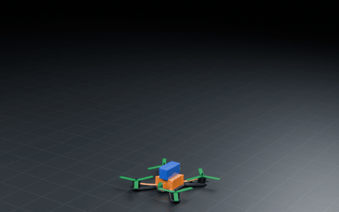
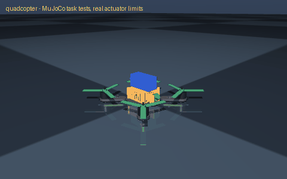

# quadcopter

> A quadcopter drone with a camera for aerial photos of my garden

Interpreted as: quadcopter (5 in props) · camera (camera_cradle) · imu (canopy)

**Quadcopter, 5 in props on 2207 motors: 0.47 kg take-off, thrust-to-weight 6.6, hover at 15 % throttle, about 10 min**

Parts cost **$269.6** · printed structure 4 parts, 97 g · checks passed 34/34

## What it can do

| | |
|---|--:|
| mass kg | 0.467 |
| payload kg | 0 |
| takeoff mass kg | 0.467 |
| max thrust kg | 3.1 |
| thrust to weight | 6.63 |
| hover throttle | 0.154 |
| hover thrust per motor n | 1.15 |
| max thrust per motor n | 7.6 |
| hover current a | 7.3 |
| burst current a | 60 |
| unlimited full throttle a | 132 |
| flight time min | 9.9 |
| wheelbase mm | 225 |
| prop | 5 x 4.3 x 3 tri-blade propeller, M5 hub (HQProp 5043 V1S), one |
| motor | 2207 brushless motor 1750 KV for 5 in props, 4S (e.g. iFlight XING2 2207) |
| cost usd | 270.53 |
| cost breakdown | parts 248.30 USD, filament 2.41 USD (0.10 kg), fasteners ~4.80 USD, wiring 15.02 USD |

## Engineering checks

All 34 checks pass (torque, speed, power, stability, print-bed fit). Details in `robot.json` → `metadata.design.checks`.

## Assumptions and limits

- Thrust and current come from a typical 2207 1750 KV static thrust table with 5 x 4.3 x 3 props on a full 4S pack (estimated; real motors vary by about 10 %). Thrust falls as the pack sags and in forward flight.
- The frame is printed flat in PETG (or better, CF-nylon). It is stiff enough for gentle flying; it does not survive crashes like a carbon frame. Balance the props.
- The flight controller runs Betaflight, INAV or ArduPilot: it does the stabilisation. Configure motor order, direction (props in), failsafe and the 60 A current limit before the first flight, without props.
- Fly where it is legal: in most countries a drone over 250 g must be registered and flown within sight, away from people.

<!-- SIM -->
## Simulation (MuJoCo, real actuator limits)

**3/3 task tests pass.** Every motor is limited to its datasheet peak torque and its torque-speed line, with the rotor inertia reflected through its gearbox; continuous loads are compared with the rated torque. The animation below is recorded from these tests.

| | Test | Result |
|---|---|---|
| ✅ | hover | lifts off and holds 0.8 m for 3 s: height within 17 mm, tilt under 0.0 deg, rotors at 15 % of full thrust on average (1.15 N each for 0.467 kg; design record says 1.15 N), peak 15 % |
| ✅ | thrust to weight | full throttle from hover climbs at 45.1 m/s^2: thrust-to-weight 5.60 (design record 6.63); 2.0 is the least that flies with control margin |
| ✅ | attitude recovery | released 15 deg tilted, it is level to 0.1 deg after 1 s (attitude control within the rotors' thrust range) |

Not tested: aerodynamics: each rotor is its static thrust curve applied at the hub (no drag, ground effect, prop wash or battery sag); stabilisation is an ideal cascaded PD on the true state, standing in for the flight controller

_PASS means the modelled actuators (datasheet peak torque as a hard limit, a linear torque-speed line to no-load speed, reflected rotor inertia, URDF damping/friction) can produce the torques and speeds the task needs in this geometry and mass distribution, and that mean torque over the hold stays within the continuous (rated) torque. Joint control uses an ideal model-based feedforward (computed torque) through the force-limited servo for fixed-base robots and plain position servos for floating robots; a pass therefore proves torque/speed capacity, not that a given controller achieves it. Untested: thermal limits over long duty cycles (only the mean-vs-rated proxy), gearbox backlash and compliance, link and joint flexibility, encoder resolution, supply voltage sag and current limits, bus latency, controller tuning, and contact/friction values (nominal friction only)._
<!-- /SIM -->

## Files

| File | What |
|---|---|
| `robot.urdf`, `meshes/` | URDF with real component and printed-part meshes, datasheet effort/velocity limits |
| `BOM.md`, `bom.json` | every part to buy, with supplier links and prices |
| `WIRING.md`, `wiring.svg` | power budget per rail, battery runtime, regulator heat, logic levels, pin-to-pin table, cut list, slack at each joint, cable diagram |
| `schematic.svg`, `schematic.pdf`, `breadboard.svg` | schematic with reference designators, power symbols and net labels; picture view with every wire in its colour |
| `robot.cad.zip` | build package: printable STLs, print list, bought-part models, assembly order |
| `robot.ros2.zip` | ROS 2 description package (ros2_control, MoveIt config, Gazebo launch) |
| `robot.training.zip` | MuJoCo / RL training scaffold |
| `simulation_report.json`, `simulation.gif` | MuJoCo task tests under the real actuator limits |
| `studio.gif` | Cycles render of a physics motion loop: every link where MuJoCo put it, the harness on its real routes |
