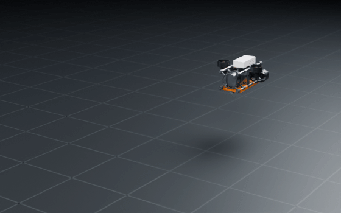
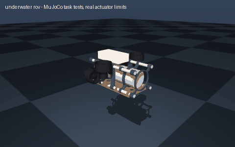

# underwater rov

> A small underwater ROV with a camera to explore a lake

Interpreted as: tethered underwater ROV · camera (hull_tray_fore) · imu (hull_tray_fore)

**Tethered ROV: 4 in sealed hull, 4 x T200 (surge, yaw, heave, roll), 6.1 kg, 239 g net lift, about 1.7 m/s, 18 min**

Parts cost **$1821.33** · printed structure 12 parts, 874 g · checks passed 55/55

## What it can do

| | |
|---|--:|
| mass kg | 6.07 |
| displaced l | 6.31 |
| net buoyancy g | 239 |
| righting arm mm | 23 |
| surge thrust n | 94 |
| heave thrust n | 94 |
| max thrust per thruster n | 47 |
| top speed m s | 1.73 |
| run time min | 18 |
| depth rating m | 100 |
| foam blocks | 1 |
| ballast weights | 5 |
| payload kg | 0 |
| cost usd | 1822.39 |
| cost breakdown | parts 1743.75 USD, filament 21.85 USD (0.87 kg), fasteners ~6.60 USD, wiring 50.19 USD |

## Engineering checks

All 55 checks pass (torque, speed, power, stability, print-bed fit). Details in `robot.json` → `metadata.design.checks`.

## Assumptions and limits

- Seal the hull with fresh, greased O-rings and pull a vacuum through the vent plug (it must hold 10 minutes) before every dive; a flooded hull destroys the electronics.
- Thrust is the maker's bollard figure interpolated to 14.8 V; drag uses Cd 1.0 on a 25 x 25 cm frontal area (a guess for an open frame) and leaves out the tether's drag.
- Trim (foam and ballast) is computed for fresh water; in sea water it floats about 2.5 % more, so add one ballast weight.
- The printed frame parts flood: they carry no pressure. PETG is fine in water; avoid PLA, which slowly swells.

<!-- SIM -->
## Simulation (MuJoCo, real actuator limits)

**4/4 task tests pass.** Every motor is limited to its datasheet peak torque and its torque-speed line, with the rotor inertia reflected through its gearbox; continuous loads are compared with the rated torque. The animation below is recorded from these tests.

| | Test | Result |
|---|---|---|
| ✅ | float | released unpowered it rises at 0.27 m/s and sits 0.0 deg from level (slightly buoyant: it surfaces if power is lost) |
| ✅ | righting | released rolled 30 deg it is 3.4 deg from level after 6 s, with no roll control: the buoyancy above the mass rights it |
| ✅ | depth hold | dives 0.3 m and holds depth within 1 mm on the two vertical thrusters |
| ✅ | surge | full thrust ahead settles at 1.74 m/s, 11 deg from level, holding its heading (design record: about 1.73 m/s; the heading loop takes some thrust) |

Not tested: water: a simple model (buoyancy at the design record's centre of buoyancy, quadratic drag from its Cd and frontal area, the maker's bollard thrust at each mount); no added mass, tether drag, waves or currents

_PASS means the modelled actuators (datasheet peak torque as a hard limit, a linear torque-speed line to no-load speed, reflected rotor inertia, URDF damping/friction) can produce the torques and speeds the task needs in this geometry and mass distribution, and that mean torque over the hold stays within the continuous (rated) torque. Joint control uses an ideal model-based feedforward (computed torque) through the force-limited servo for fixed-base robots and plain position servos for floating robots; a pass therefore proves torque/speed capacity, not that a given controller achieves it. Untested: thermal limits over long duty cycles (only the mean-vs-rated proxy), gearbox backlash and compliance, link and joint flexibility, encoder resolution, supply voltage sag and current limits, bus latency, controller tuning, and contact/friction values (nominal friction only)._
<!-- /SIM -->

## Files

| File | What |
|---|---|
| `robot.urdf`, `meshes/` | URDF with real component and printed-part meshes, datasheet effort/velocity limits |
| `BOM.md`, `bom.json` | every part to buy, with supplier links and prices |
| `WIRING.md`, `wiring.svg` | power budget per rail, battery runtime, regulator heat, logic levels, pin-to-pin table, cut list, slack at each joint, cable diagram |
| `schematic.svg`, `schematic.pdf`, `breadboard.svg` | schematic with reference designators, power symbols and net labels; picture view with every wire in its colour |
| `robot.cad.zip` | build package: printable STLs, print list, bought-part models, assembly order |
| `robot.ros2.zip` | ROS 2 description package (ros2_control, MoveIt config, Gazebo launch) |
| `robot.training.zip` | MuJoCo / RL training scaffold |
| `simulation_report.json`, `simulation.gif` | MuJoCo task tests under the real actuator limits |
| `studio.gif` | Cycles render of a physics motion loop: every link where MuJoCo put it, the harness on its real routes |
