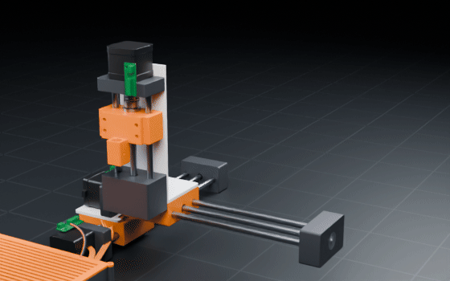
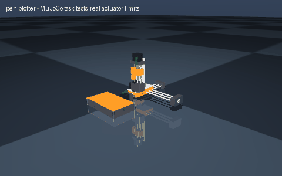

# pen plotter

> A pen plotter that draws portraits

Interpreted as: Cartesian XYZ gantry

**Cartesian XYZ robot on three lead-screw modules: 183 x 183 x 23 mm, 158 N per axis, 80 mm/s, pen holder**

Parts cost **$235.74** · printed structure 14 parts, 1025 g · checks passed 48/48

## What it can do

| | |
|---|--:|
| x stroke mm | 183 |
| y stroke mm | 183 |
| z stroke mm | 23 |
| payload kg | 0.2 |
| axis thrust n | 158 |
| max speed mm s | 80 |
| resolution um | 2.5 |
| mass kg | 3.5 |
| tool | pen holder |
| x sag mm | 1.28 |
| cost usd | 236.24 |
| cost breakdown | parts 192.02 USD, filament 25.63 USD (1.03 kg), fasteners ~4.05 USD, wiring 14.54 USD |

## Actuators (sized from this robot's own loads)

| Joint | Actuator | Needs (peak) N·m | Rated / peak N·m | Margin | Speed loaded rad/s |
|---|---|--:|--:|--:|--:|
| x_axis | nema17_42x40 | 4.2 | 158 / 158 | 37.19x | 0.08 |
| y_axis | nema17_42x40 | 5.2 | 158 / 158 | 30.12x | 0.08 |
| z_axis | nema17_42x40 | 6.5 | 158 / 158 | 24.19x | 0.08 |

## Engineering checks

All 48 checks pass (torque, speed, power, stability, print-bed fit). Details in `robot.json` → `metadata.design.checks`.

## Assumptions and limits

- The three modules are the same design at two lengths; the frame is screwed to a flat board (12 mm plywood or MDF, about 450 x 350 mm, not in the parts list).
- Lead screws are plain Tr8x8 with brass nuts: cheap and quiet, with some backlash; anti-backlash nuts are a drop-in upgrade.
- Clearance is checked with every rod, lead screw, bearing, bushing, coupler and lead nut as its round body with its bore, so each rod through its bushings and each screw through its nut is checked as built; no pair is left out.
- Speeds and thrust use the NEMA17's rated torque; at high step rates a stepper's torque falls, so the firmware limits speed to the checked value.
- The pen clamp takes pens and markers up to 12 mm; Z lifts the pen between strokes.

## Prompt notes

- not applied: pen holder: not designed yet: the Cartesian XYZ gantry is built without it (the pen holder module is planned; mount one on the deck or tool flange by hand)

<!-- SIM -->
## Simulation (MuJoCo, real actuator limits)

**3/3 task tests pass.** Every motor is limited to its datasheet peak torque and its torque-speed line, with the rotor inertia reflected through its gearbox; continuous loads are compared with the rated torque. The animation below is recorded from these tests.

| | Test | Result |
|---|---|---|
| ✅ | stroke:y axis | y_axis runs 174 mm in 1.0 s and stops within 0.00 mm of the target (peak 7 % of its force limit) |
| ✅ | stroke:x axis | x_axis runs 174 mm in 1.0 s and stops within 0.00 mm of the target (peak 6 % of its force limit) |
| ✅ | stroke:z axis | z_axis runs 22 mm in 1.0 s and stops within 0.01 mm of the target (peak 2 % of its force limit) |

_PASS means the modelled actuators (datasheet peak torque as a hard limit, a linear torque-speed line to no-load speed, reflected rotor inertia, URDF damping/friction) can produce the torques and speeds the task needs in this geometry and mass distribution, and that mean torque over the hold stays within the continuous (rated) torque. Joint control uses an ideal model-based feedforward (computed torque) through the force-limited servo for fixed-base robots and plain position servos for floating robots; a pass therefore proves torque/speed capacity, not that a given controller achieves it. Untested: thermal limits over long duty cycles (only the mean-vs-rated proxy), gearbox backlash and compliance, link and joint flexibility, encoder resolution, supply voltage sag and current limits, bus latency, controller tuning, and contact/friction values (nominal friction only)._
<!-- /SIM -->

## Files

| File | What |
|---|---|
| `robot.urdf`, `meshes/` | URDF with real component and printed-part meshes, datasheet effort/velocity limits |
| `BOM.md`, `bom.json` | every part to buy, with supplier links and prices |
| `WIRING.md`, `wiring.svg` | power budget per rail, battery runtime, regulator heat, logic levels, pin-to-pin table, cut list, slack at each joint, cable diagram |
| `schematic.svg`, `schematic.pdf`, `breadboard.svg` | schematic with reference designators, power symbols and net labels; picture view with every wire in its colour |
| `robot.cad.zip` | build package: printable STLs, print list, bought-part models, assembly order |
| `robot.ros2.zip` | ROS 2 description package (ros2_control, MoveIt config, Gazebo launch) |
| `robot.training.zip` | MuJoCo / RL training scaffold |
| `simulation_report.json`, `simulation.gif` | MuJoCo task tests under the real actuator limits |
| `studio.gif` | Cycles render of a physics motion loop: every link where MuJoCo put it, the harness on its real routes |
