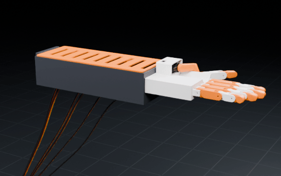
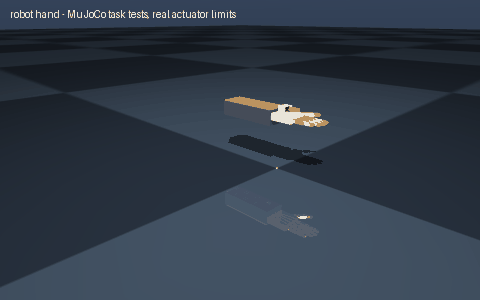

# robot hand

> A five-finger robot hand

Interpreted as: five-finger tendon hand

**Five-finger tendon hand: 5 MG996R flexion servos in the forearm, an MG90S thumb swing, 16 joints, squeezes about 10 N, holds about 1.17 kg**

Parts cost **$87.6** · printed structure 25 parts, 579 g · checks passed 49/49

## What it can do

| | |
|---|--:|
| fingers | 5 |
| actuators | 6 |
| dof | 16 |
| actuated dof | 6 |
| tendon force n | 53.9 |
| squeeze n | 9.6 |
| holds kg | 1.17 |
| payload kg | 1.17 |
| close time s | 0.26 |
| mass kg | 1.161 |
| actuator | TowerPro MG996R standard servo (metal gears) + round horn |
| mount | rear flange, 4 x M6 on PCD 50 (fits the arms' tool flange) |
| cost usd | 89.07 |
| cost breakdown | parts 56.00 USD, filament 14.48 USD (0.58 kg), fasteners ~8.25 USD, wiring 10.34 USD |

## Actuators (sized from this robot's own loads)

| Joint | Actuator | Needs (peak) N·m | Rated / peak N·m | Margin | Speed loaded rad/s |
|---|---|--:|--:|--:|--:|
| index_mcp | hobby_mg996r | 0.216 | 0.431 / 1.438 | 2x | 5.61 |
| middle_mcp | hobby_mg996r | 0.216 | 0.431 / 1.438 | 2x | 5.61 |
| ring_mcp | hobby_mg996r | 0.216 | 0.431 / 1.438 | 2x | 5.61 |
| little_mcp | hobby_mg996r | 0.216 | 0.431 / 1.438 | 2x | 5.61 |

## Engineering checks

All 49 checks pass (torque, speed, power, stability, print-bed fit). Details in `robot.json` → `metadata.design.checks`.

## Assumptions and limits

- Each finger is underactuated: one tendon over three joints, elastic cord on the back to open it. The middle and end joints are modelled as following the base joint (mimic); a real tendon finger also wraps round an object's shape.
- Fingertip forces use the MG996R's rated torque (not its stall torque) through a 6 mm spool: a household-object hand (cups, fruit, small tools), not a crushing grip.
- Glue silicone pads (or print TPU caps) on the fingertips and palm: the grip numbers assume friction 0.6.

## Prompt notes

- not applied: gripper: the five-finger tendon hand template has no arm (try "mobile manipulator")

<!-- SIM -->
## Simulation (MuJoCo, real actuator limits)

**7/7 task tests pass.** Every motor is limited to its datasheet peak torque and its torque-speed line, with the rotor inertia reflected through its gearbox; continuous loads are compared with the rated torque. The animation below is recorded from these tests.

| | Test | Result |
|---|---|---|
| ✅ | hold home | five-finger hand: holds the home pose for 3 s |
| ✅ | stroke:index mcp | index_mcp runs 79 deg in 1.0 s and stops within 0.01 deg of the target (peak 59 % of its force limit) |
| ✅ | stroke:middle mcp | middle_mcp runs 79 deg in 1.0 s and stops within 0.01 deg of the target (peak 59 % of its force limit) |
| ✅ | stroke:ring mcp | ring_mcp runs 79 deg in 1.0 s and stops within 0.01 deg of the target (peak 59 % of its force limit) |
| ✅ | stroke:little mcp | little_mcp runs 79 deg in 1.0 s and stops within 0.01 deg of the target (peak 59 % of its force limit) |
| ✅ | stroke:thumb swing | thumb_swing runs 54 deg in 1.0 s and stops within 0.01 deg of the target (peak 9 % of its force limit) |
| ✅ | stroke:thumb mcp | thumb_mcp runs 65 deg in 1.0 s and stops within 0.00 deg of the target (peak 23 % of its force limit) |

Not tested: grip force: the tendon drive is modelled as one motor per finger with its other joints following (mimic); contact with an object is not simulated, the grip is checked in the design record

_PASS means the modelled actuators (datasheet peak torque as a hard limit, a linear torque-speed line to no-load speed, reflected rotor inertia, URDF damping/friction) can produce the torques and speeds the task needs in this geometry and mass distribution, and that mean torque over the hold stays within the continuous (rated) torque. Joint control uses an ideal model-based feedforward (computed torque) through the force-limited servo for fixed-base robots and plain position servos for floating robots; a pass therefore proves torque/speed capacity, not that a given controller achieves it. Untested: thermal limits over long duty cycles (only the mean-vs-rated proxy), gearbox backlash and compliance, link and joint flexibility, encoder resolution, supply voltage sag and current limits, bus latency, controller tuning, and contact/friction values (nominal friction only)._
<!-- /SIM -->

## Files

| File | What |
|---|---|
| `robot.urdf`, `meshes/` | URDF with real component and printed-part meshes, datasheet effort/velocity limits |
| `BOM.md`, `bom.json` | every part to buy, with supplier links and prices |
| `WIRING.md`, `wiring.svg` | power budget per rail, battery runtime, regulator heat, logic levels, pin-to-pin table, cut list, slack at each joint, cable diagram |
| `schematic.svg`, `schematic.pdf`, `breadboard.svg` | schematic with reference designators, power symbols and net labels; picture view with every wire in its colour |
| `robot.cad.zip` | build package: printable STLs, print list, bought-part models, assembly order |
| `robot.ros2.zip` | ROS 2 description package (ros2_control, MoveIt config, Gazebo launch) |
| `robot.training.zip` | MuJoCo / RL training scaffold |
| `simulation_report.json`, `simulation.gif` | MuJoCo task tests under the real actuator limits |
| `studio.gif` | Cycles render of a physics motion loop: every link where MuJoCo put it, the harness on its real routes |
