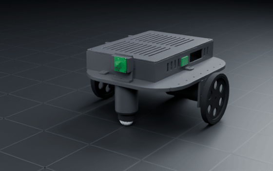
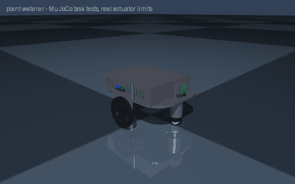

# plant waterer

> A robot that waters my plants

Interpreted as: differential-drive base · camera (base_link)

**Differential-drive base: pololu_37d_30to1_64cpr gearmotors, 1.336 kg, 1.24 m/s, 1.83 h on 1 x lipo_3s_2200, rpi5**

Parts cost **$423.76** · printed structure 12 parts, 523 g · checks passed 44/44

## What it can do

| | |
|---|--:|
| mass kg | 1.336 |
| loaded mass kg | 2.336 |
| top speed m s | 1.24 |
| wheel torque nm | 0.131 |
| drive motor | pololu_37d_30to1_64cpr |
| battery | 1 x lipo_3s_2200 |
| average power w | 10.7 |
| runtime h | 1.83 |
| tip angle deg | 36.9 |
| compute | rpi5 |
| slope deg | 10 |
| turn rate rad s | 5.22 |
| turn slip factor | 1 |
| cargo kg | 1 |
| cost usd | 426 |
| cost breakdown | catalog parts $394, filament 0.60 kg $15, fasteners $6, fabricated/other $0 (power switch, 15 A fuse, wiring) |

## Actuators (sized from this robot's own loads)

| Joint | Actuator | Needs (peak) N·m | Rated / peak N·m | Margin | Speed loaded rad/s |
|---|---|--:|--:|--:|--:|
| left_wheel_joint | pololu_37d_30to1_64cpr | 0.131 | 0.686 / 1.373 | 5.23x | 34.558 |
| right_wheel_joint | pololu_37d_30to1_64cpr | 0.131 | 0.686 / 1.373 | 5.23x | 34.558 |

## Engineering checks

All 44 checks pass (torque, speed, power, stability, print-bed fit). Details in `robot.json` → `metadata.design.checks`.

## Assumptions and limits

- Drive sized for the robot plus 1 kg cargo on a 10 deg slope accelerating at 0.5 m/s^2, rolling resistance 0.03; motors compared at their continuous (not stall) rating.
- All motors and servos are 12 V parts run straight from a 3S LiPo (9.9-12.6 V) through the main fuse and switch; see WIRING.md.
- Printed parts: PETG; brackets bolt to the deck with M3 screws and nuts; the motor face screws are the gearmotor's own six M3 holes.
- Two ball casters (front and rear) keep the deck level; on rough floors fit only one or add the Pololu spacer set so the drive wheels never lift.

## Prompt notes

- approximated: "waters my plants" is a task, not a robot type: built a differential-drive base (a small wheeled base drives to each pot; a pump pushes water from the tank on its deck through a hose to a nozzle)
- not applied: water tank: not designed yet: the differential-drive base is built without it (the water tank module is planned; mount one on the deck or tool flange by hand)
- not applied: pump with hose and nozzle: not designed yet: the differential-drive base is built without it (the pump with hose and nozzle module is planned; mount one on the deck or tool flange by hand)

<!-- SIM -->
## Simulation (MuJoCo, real actuator limits)

**3/3 task tests pass.** Every motor is limited to its datasheet peak torque and its torque-speed line, with the rotor inertia reflected through its gearbox; continuous loads are compared with the rated torque. The animation below is recorded from these tests.

| | Test | Result |
|---|---|---|
| ✅ | drive straight | 3.44 m in 4.01 s, cruise speed 1.212 m/s vs claimed 1.240 m/s, heading drift -0.2 deg, lateral -0.9 cm |
| ✅ | ramp 10deg | from standstill on a 10 deg slope (speed ramped over 4.7 s at 0.5 m/s^2): 5.19 m uphill in 6.7 s, speed 1.205 m/s of 1.240 commanded |
| ✅ | turn in place | mean yaw rate 4.90 rad/s with 4.74 commanded (no-slip), claimed 5.22 rad/s (needs >= 4.44), centre moved 1.4 cm over 2.0 turn(s) (0.7 cm per turn) |

_PASS means the modelled actuators (datasheet peak torque as a hard limit, a linear torque-speed line to no-load speed, reflected rotor inertia, URDF damping/friction) can produce the torques and speeds the task needs in this geometry and mass distribution, and that mean torque over the hold stays within the continuous (rated) torque. Joint control uses an ideal model-based feedforward (computed torque) through the force-limited servo for fixed-base robots and plain position servos for floating robots; a pass therefore proves torque/speed capacity, not that a given controller achieves it. Untested: thermal limits over long duty cycles (only the mean-vs-rated proxy), gearbox backlash and compliance, link and joint flexibility, encoder resolution, supply voltage sag and current limits, bus latency, controller tuning, and contact/friction values (nominal friction only)._
<!-- /SIM -->

## Files

| File | What |
|---|---|
| `robot.urdf`, `meshes/` | URDF with real component and printed-part meshes, datasheet effort/velocity limits |
| `BOM.md`, `bom.json` | every part to buy, with supplier links and prices |
| `WIRING.md`, `wiring.svg` | power budget per rail, battery runtime, regulator heat, logic levels, pin-to-pin table, cut list, slack at each joint, cable diagram |
| `schematic.svg`, `schematic.pdf`, `breadboard.svg` | schematic with reference designators, power symbols and net labels; picture view with every wire in its colour |
| `robot.cad.zip` | build package: printable STLs, print list, bought-part models, assembly order |
| `robot.ros2.zip` | ROS 2 description package (ros2_control, MoveIt config, Gazebo launch) |
| `robot.training.zip` | MuJoCo / RL training scaffold |
| `simulation_report.json`, `simulation.gif` | MuJoCo task tests under the real actuator limits |
| `studio.gif` | Cycles render of a physics motion loop: every link where MuJoCo put it, the harness on its real routes |
