# Gallery

24 robots, each made from the one-line prompt in its README. Open one for its parts list, printable parts, wiring, ROS 2 package and test results. Nothing here has been built yet.

Every example is regenerated from its prompt by `node scripts/build_examples.ts` and simulated by `scripts/simulate_examples.py`, and every prompt is generated on the website by `scripts/check_site.py`. Each robot is built from real, purchasable parts sized from its own loads. The film is a Cycles render of a motion loop run in MuJoCo through the real actuators (`scripts/studio/film.py`); each example's README also has the raw recording of its task tests.

**Design checks** are the engineering checks that pass (torque, speed, power, runtime, tipping, clearance, wiring). **Simulation** is the MuJoCo task tests that pass. Parts cost is the estimated total of the bill of materials.

| Example | Robot | Parts cost | Mass | Design checks | Simulation |
|---|---|--:|--:|--:|--:|
| [01_arm_2dof](01_arm_2dof/README.md) 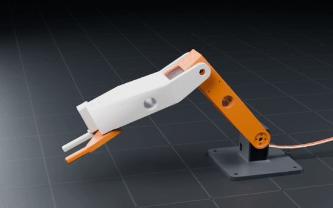 | 2-DOF arm, 350 mm reach, 0.1 kg payload, Feetech STS serial-bus servos (12 V) | $146.44 | 0.549 kg | 31/31 | 4/4 |
| [02_arm_6dof](02_arm_6dof/README.md) 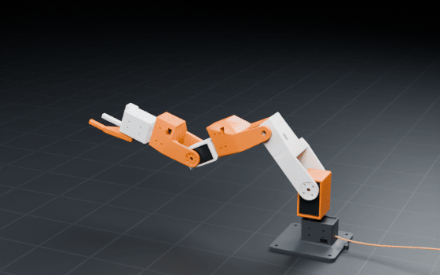 | 6-DOF arm, 455 mm reach, 0.1 kg payload, ROBOTIS DYNAMIXEL X-series (12 V) | $1170.08 | 0.939 kg | 43/43 | 4/4 |
| [03_arm_7dof](03_arm_7dof/README.md) 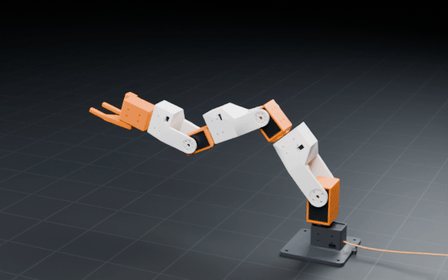 | 7-DOF arm, 500 mm reach, 0.1 kg payload, ROBOTIS DYNAMIXEL X-series (12 V) | $1218.55 | 1.042 kg | 46/46 | 4/4 |
| [04_scara](04_scara/README.md) 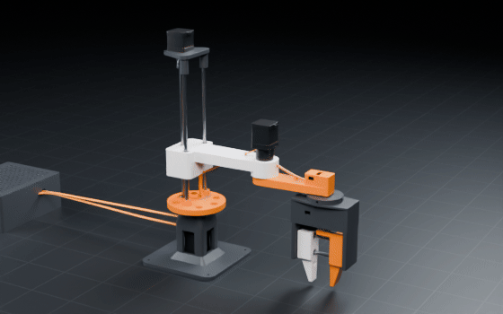 | SCARA arm: 0.30 m reach, 153 mm Z stroke, 0.5 kg payload; NEMA17 + 5.18:1 planetary on J1/J2, Tr8x8 lead-screw Z, Feetech STS3215 C047 12 V 30 kg.cm (1:345) wrist, parallel gripper | $366.86 | 5.164 kg | 60/60 | 2/2 |
| [05_diff_drive](05_diff_drive/README.md) 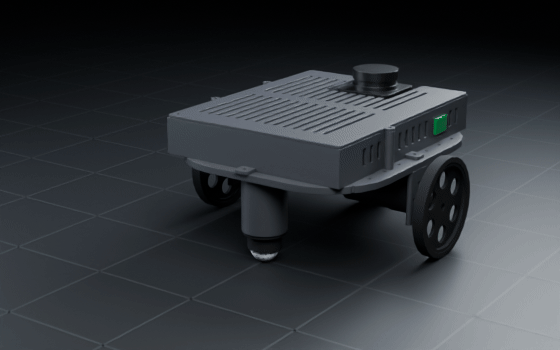 | Differential-drive base: pololu_37d_30to1_64cpr gearmotors, 1.521 kg, 1.24 m/s, 1.8 h on 1 x lipo_3s_2200, rpi5 | $513.72 | 1.521 kg | 49/49 | 3/3 |
| [06_four_wheel](06_four_wheel/README.md) 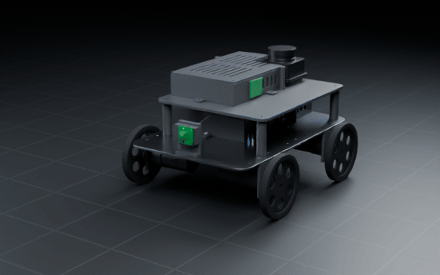 | Four-wheel skid-steer base: pololu_37d_30to1_64cpr gearmotors, 2.322 kg, 1.24 m/s, 1.47 h on 1 x lipo_3s_2200, rpi5 | $688.79 | 2.322 kg | 53/53 | 3/3 |
| [07_mecanum](07_mecanum/README.md) 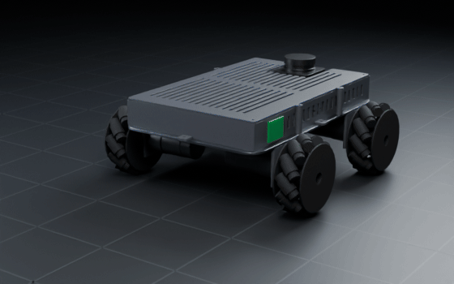 | Mecanum holonomic base: pololu_37d_30to1_64cpr gearmotors, 2.958 kg, 1.33 m/s, 1.58 h on 1 x lipo_3s_2200, rpi5 | $818.51 | 2.958 kg | 50/50 | 2/2 |
| [08_humanoid](08_humanoid/README.md) 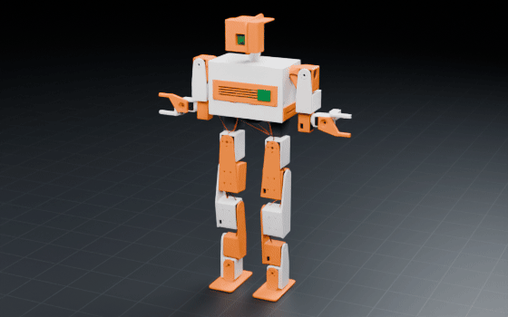 | Humanoid, 0.687 m, 3.61 kg, 24 DOF (4-DOF arms + grippers), 44 min, $4221 of parts | $4323.54 | 3.607 kg | 94/94 | 3/3 |
| [09_gripper](09_gripper/README.md) 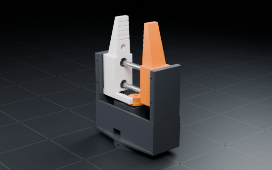 | Parallel gripper: 60 mm stroke, 47 N rated squeeze per finger, Feetech STS3215 C047 12 V 30 kg.cm (1:345) | $95.06 | 1.084 kg | 29/29 | 0/0 |
| [10_quadruped](10_quadruped/README.md) 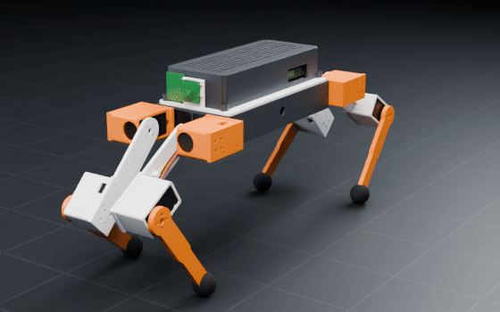 | Servo quadruped, 1.43 kg, hip height 0.18 m, 12 DOF, 32 min runtime, $530 of parts | $582.04 | 1.431 kg | 62/62 | 2/2 |
| [11_spider_scout](11_spider_scout/README.md) 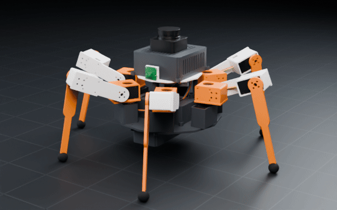 | Hexapod, 18 x Feetech STS3250 C002 12 V 50 kg.cm (1:345), 2.41 kg, 207 mm body, camera + lidar + imu, 41 min, $1030 of parts | $1104 | 2.414 kg | 86/86 | 2/2 |
| [12_mars_rover](12_mars_rover/README.md) 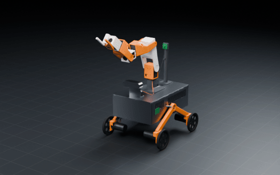 | 4-wheel rocker-bogie rover with a 6-DOF arm: 4.64 kg, 1.24 m/s, 1.53 h, jetson_orin_nano_super | $3861.31 | 4.64 kg | 74/74 | 3/3 |
| [13_battle_mech](13_battle_mech/README.md) 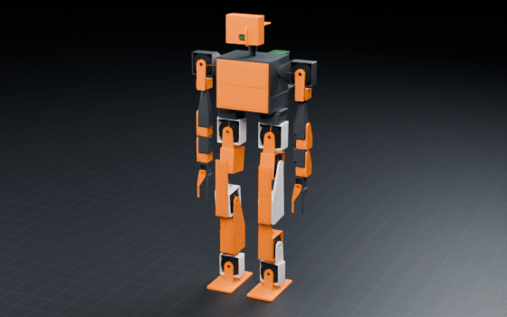 | Battle mech, 1.204 m, 23.05 kg, 30 DOF (7-DOF arms + grippers), 170 min, $16183 of parts | $16664.31 | 23.055 kg | 133/133 | 3/3 |
| [14_iron_man_mark_43](14_iron_man_mark_43/README.md) 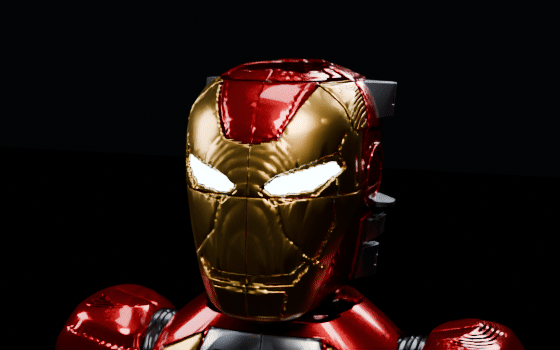 | Iron Man Mark 43 (full wearable suit): 358 printed pieces, 8.6 kg filament, motorised faceplate, $529 incl. filament | $565.86 | 9.99 kg | 475/475 | 2/2 |
| [15_wall_e](15_wall_e/README.md) 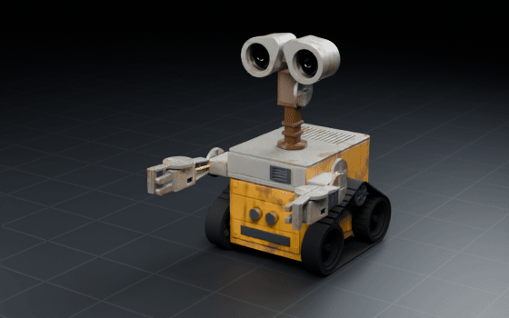 | Arduino WALL-E: TPU tracks on 4 TT motors, pan/tilt binocular head, two-joint arms with gripping hands, 1.17 kg, $100 of parts | $119.83 | 1.172 kg | 73/73 | 3/3 |
| [16_eva](16_eva/README.md) 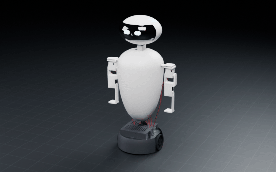 | EVA-style companion robot: 3.471 kg, hidden diff-drive base, pan head with camera, two servo fins | $651.2 | 3.471 kg | 85/85 | 3/3 |
| [17_baymax](17_baymax/README.md) 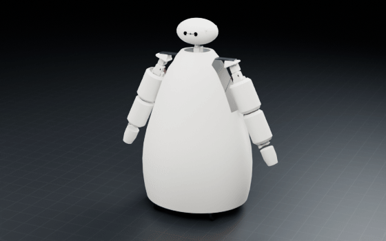 | Baymax-style service robot: 5.561 kg, 1.01 m tall, 4WD hidden base, two 4-servo arms, pan head with camera | $921.97 | 5.561 kg | 87/87 | 3/3 |
| [18_arduino_car](18_arduino_car/README.md) 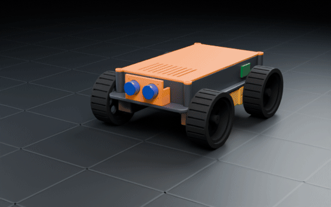 | Arduino car (stronger (4WD, ramps up to 10 deg)): 4WD on TT gear motors, 0.68 kg, 0.54 m/s, 99 min, $54 of parts | $61.87 | 0.675 kg | 38/38 | 3/3 |
| [19_arduino_arm](19_arduino_arm/README.md) 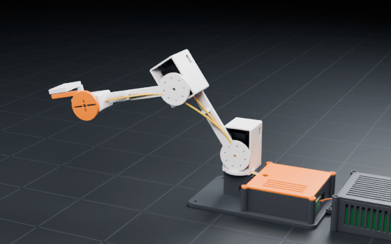 | Arduino desk arm: 3 DOF + claw, 280 mm reach, 20 g payload, 0.87 kg, $51 of parts | $65.55 | 0.866 kg | 40/40 | 3/3 |
| [20_quadcopter](20_quadcopter/README.md) 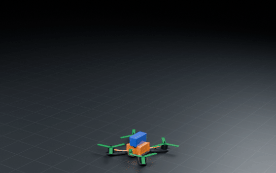 | Quadcopter, 5 in props on 2207 motors: 0.47 kg take-off, thrust-to-weight 6.6, hover at 15 % throttle, about 10 min | $273.1 | 0.467 kg | 34/34 | 3/3 |
| [21_underwater_rov](21_underwater_rov/README.md) 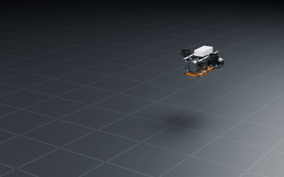 | Tethered ROV: 4 in sealed hull, 4 x T200 (surge, yaw, heave, roll), 6.1 kg, 239 g net lift, about 1.7 m/s, 18 min | $1821.33 | 6.07 kg | 55/55 | 4/4 |
| [22_pen_plotter](22_pen_plotter/README.md) 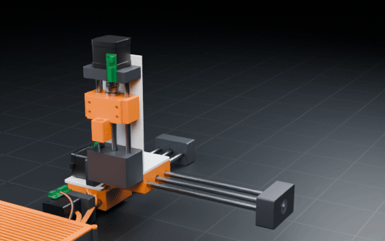 | Cartesian XYZ robot on three lead-screw modules: 183 x 183 x 23 mm, 158 N per axis, 80 mm/s, pen holder | $235.74 | 3.5 kg | 48/48 | 3/3 |
| [23_robot_hand](23_robot_hand/README.md) 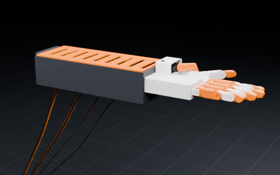 | Five-finger tendon hand: 5 MG996R flexion servos in the forearm, an MG90S thumb swing, 16 joints, squeezes about 10 N, holds about 1.17 kg | $88.57 | 1.195 kg | 49/49 | 7/7 |
| [24_plant_waterer](24_plant_waterer/README.md) 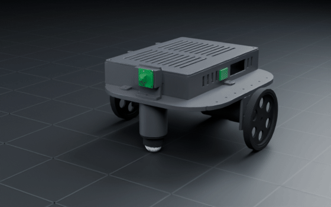 | Differential-drive base: pololu_37d_30to1_64cpr gearmotors, 1.366 kg, 1.24 m/s, 1.83 h on 1 x lipo_3s_2200, rpi5 | $425.05 | 1.366 kg | 44/44 | 3/3 |
