# Examples

Every example is regenerated from its prompt by `node scripts/build_examples.ts` and simulated by `scripts/simulate_examples.py`. Each robot is built from real, purchasable parts sized from its own loads; the GIF is recorded from its MuJoCo task tests under the real actuator limits.

| Example | Robot | Parts cost | Mass | Design checks | Simulation |
|---|---|--:|--:|--:|--:|
| [01_arm_2dof](01_arm_2dof/README.md) 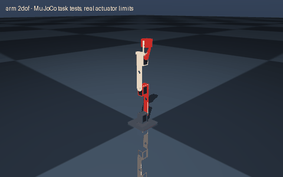 | 2-DOF arm, 350 mm reach, 0.1 kg payload, Feetech STS serial-bus servos (12 V) | $130.09 | 0.551 kg | 10/10 | 4/4 |
| [02_arm_6dof](02_arm_6dof/README.md) 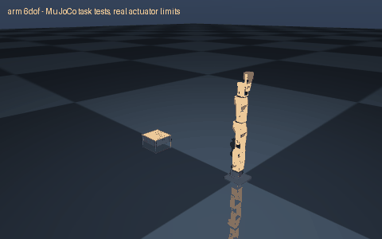 | 6-DOF arm, 455 mm reach, 0.1 kg payload, ROBOTIS DYNAMIXEL X-series (12 V) | $1151.04 | 0.95 kg | 22/22 | 4/4 |
| [03_arm_7dof](03_arm_7dof/README.md) 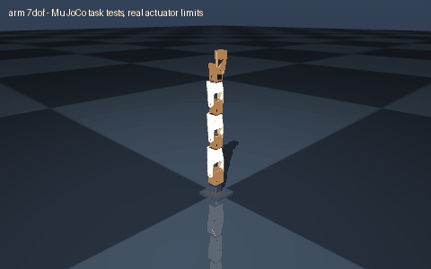 | 7-DOF arm, 500 mm reach, 0.1 kg payload, ROBOTIS DYNAMIXEL X-series (12 V) | $1198.6 | 1.055 kg | 25/25 | 4/4 |
| [04_scara](04_scara/README.md) 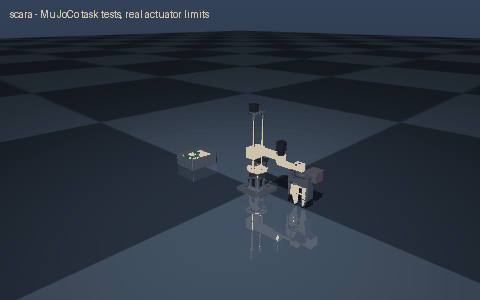 | scara | $571.91 | ? kg | 0/0 | 2/2 |
| [05_diff_drive](05_diff_drive/README.md) 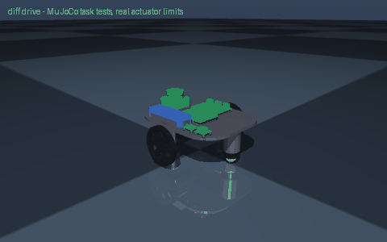 | Differential-drive base: pololu_37d_30to1_64cpr gearmotors, 1.489 kg, 1.24 m/s, 1.8 h on 1 x lipo_3s_2200, rpi5 | $494.38 | 1.489 kg | 23/23 | 3/3 |
| [06_four_wheel](06_four_wheel/README.md) 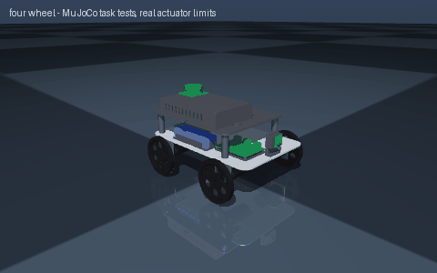 | Four-wheel skid-steer base: pololu_37d_30to1_64cpr gearmotors, 2.292 kg, 1.24 m/s, 1.47 h on 1 x lipo_3s_2200, rpi5 | $663.39 | 2.292 kg | 27/27 | 3/3 |
| [07_mecanum](07_mecanum/README.md) 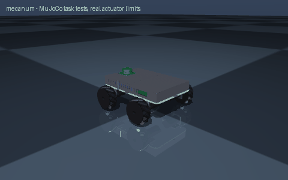 | Mecanum holonomic base: pololu_37d_30to1_64cpr gearmotors, 2.931 kg, 1.33 m/s, 1.58 h on 1 x lipo_3s_2200, rpi5 | $792.99 | 2.931 kg | 22/22 | 2/2 |
| [08_humanoid](08_humanoid/README.md) 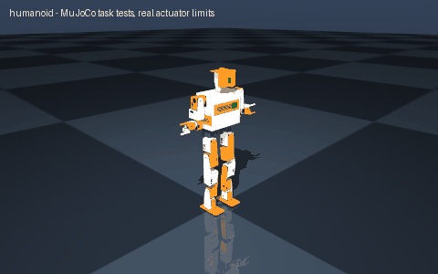 | humanoid_robot | $12629.25 | ? kg | 0/0 | 3/3 |
| [09_gripper](09_gripper/README.md) 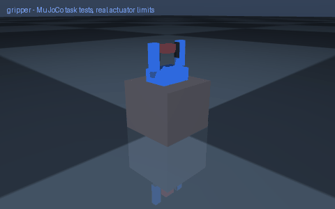 | parallel_gripper | $241.41 | ? kg | 0/0 | 1/1 |
| [10_quadruped](10_quadruped/README.md) 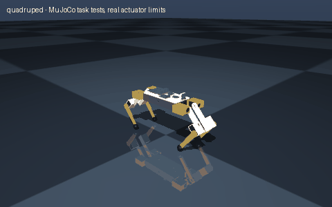 | quadruped | $5724.44 | ? kg | 0/0 | 2/2 |
| [11_spider_scout](11_spider_scout/README.md) 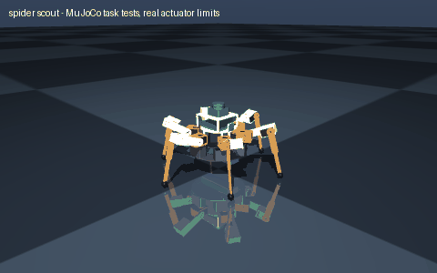 | hexapod | $582.05 | ? kg | 0/0 | 2/2 |
| [12_mars_rover](12_mars_rover/README.md) 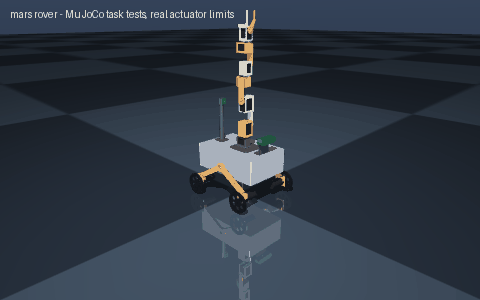 | 4-wheel rocker-bogie rover with a 6-DOF arm: 4.677 kg, 1.24 m/s, 1.53 h, jetson_orin_nano_super | $3819.02 | 4.677 kg | 42/42 | 2/3 |
| [13_battle_mech](13_battle_mech/README.md) 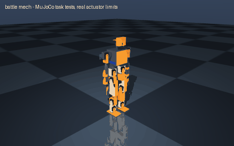 | battle_mech | $12699.56 | ? kg | 0/0 | 3/3 |
| [15_wall_e](15_wall_e/README.md) 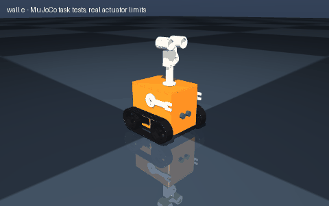 | WALL-E style tracked robot: 3.888 kg, 0.57 m/s, pan/tilt/lift head with stereo cameras, two servo arms | $784.53 | 3.888 kg | 53/53 | 3/3 |
| [16_eva](16_eva/README.md) 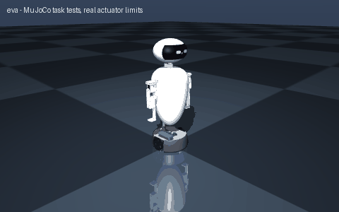 | EVA-style companion robot: 3.374 kg, hidden diff-drive base, pan head with camera, two servo fins | $622.71 | 3.374 kg | 52/52 | 3/3 |
| [17_baymax](17_baymax/README.md) 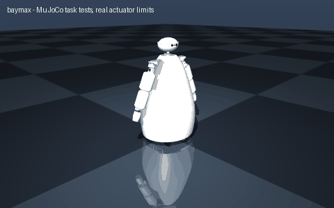 | Baymax-style service robot: 5.407 kg, 1.01 m tall, 4WD hidden base, two 4-servo arms, pan head with camera | $880.93 | 5.407 kg | 53/53 | 3/3 |
