# Examples

Every example is regenerated from its prompt by `node scripts/build_examples.ts` and simulated by `scripts/simulate_examples.py`. Each robot is built from real, purchasable parts sized from its own loads; the GIF is recorded from its MuJoCo task tests under the real actuator limits.

| Example | Robot | Parts cost | Mass | Design checks | Simulation |
|---|---|--:|--:|--:|--:|
| [01_arm_2dof](01_arm_2dof/README.md) 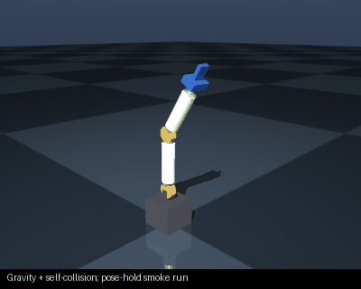 | arm_2dof | $1159.51 | ? kg | 0/0 | 4/5 |
| [02_arm_6dof](02_arm_6dof/README.md) 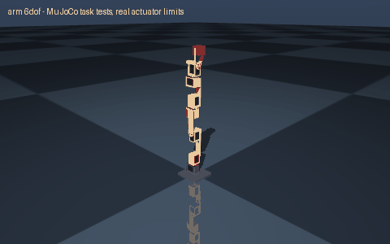 | 6-DOF arm, 450 mm reach, 0.1 kg payload, Feetech STS serial-bus servos (12 V) | $217.18 | 0.636 kg | 22/22 | 4/4 |
| [03_arm_7dof](03_arm_7dof/README.md) 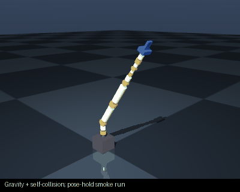 | arm_7dof | $3038.61 | ? kg | 0/0 | 4/5 |
| [04_scara](04_scara/README.md) 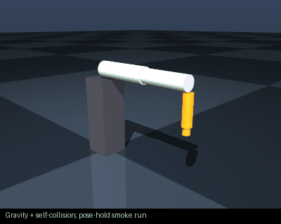 | scara | $571.91 | ? kg | 0/0 | 4/5 |
| [05_diff_drive](05_diff_drive/README.md) 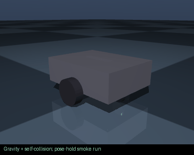 | diff_drive_robot | $1144.07 | ? kg | 0/0 | 5/6 |
| [06_four_wheel](06_four_wheel/README.md) 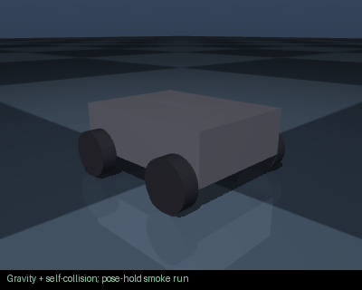 | four_wheel_robot | $2045.84 | ? kg | 0/0 | 5/6 |
| [07_mecanum](07_mecanum/README.md) 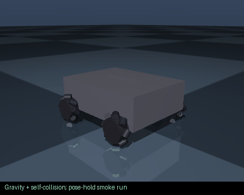 | mecanum_robot | $2047.37 | ? kg | 0/0 | 5/6 |
| [08_humanoid](08_humanoid/README.md) 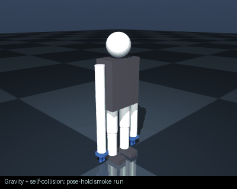 | humanoid_robot | $12822.89 | ? kg | 0/0 | 6/7 |
| [09_gripper](09_gripper/README.md) 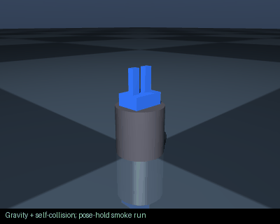 | parallel_gripper | $241.41 | ? kg | 0/0 | 5/5 |
| [10_quadruped](10_quadruped/README.md) 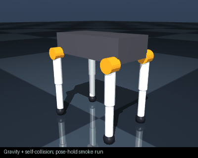 | quadruped | $5724.44 | ? kg | 0/0 | 5/6 |
| [11_spider_scout](11_spider_scout/README.md) 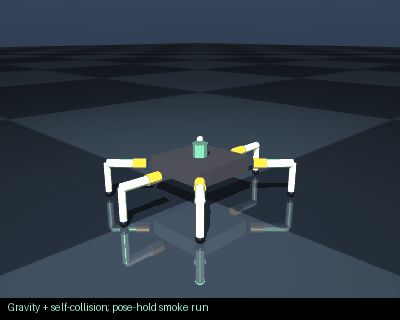 | hexapod | $582.05 | ? kg | 0/0 | 6/6 |
| [12_mars_rover](12_mars_rover/README.md) 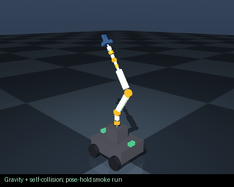 | rover_arm | $844.71 | ? kg | 0/0 | 5/6 |
| [13_battle_mech](13_battle_mech/README.md) 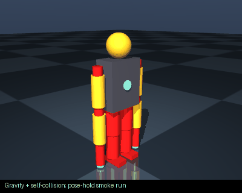 | battle_mech | $12715.56 | ? kg | 0/0 | 4/6 |
| [14_iron_man_mark_43](14_iron_man_mark_43/README.md) 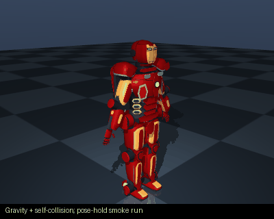 | iron_man_mark_43 | $38702.65 | ? kg | 0/0 | 4/6 |
| [15_wall_e](15_wall_e/README.md) 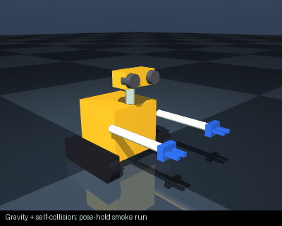 | wall_e | $3970.49 | ? kg | 0/0 | 5/6 |
| [16_eva](16_eva/README.md) 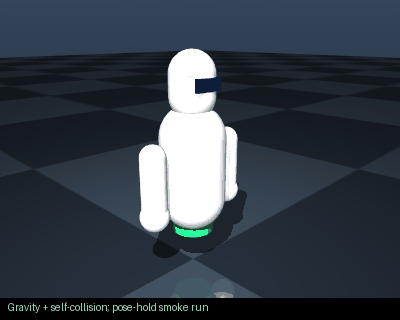 | eva | $3415.47 | ? kg | 0/0 | 5/6 |
| [17_baymax](17_baymax/README.md) 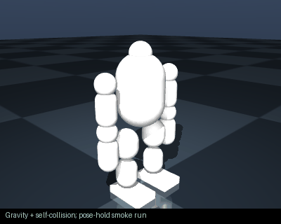 | baymax | $10082.68 | ? kg | 0/0 | 4/6 |
